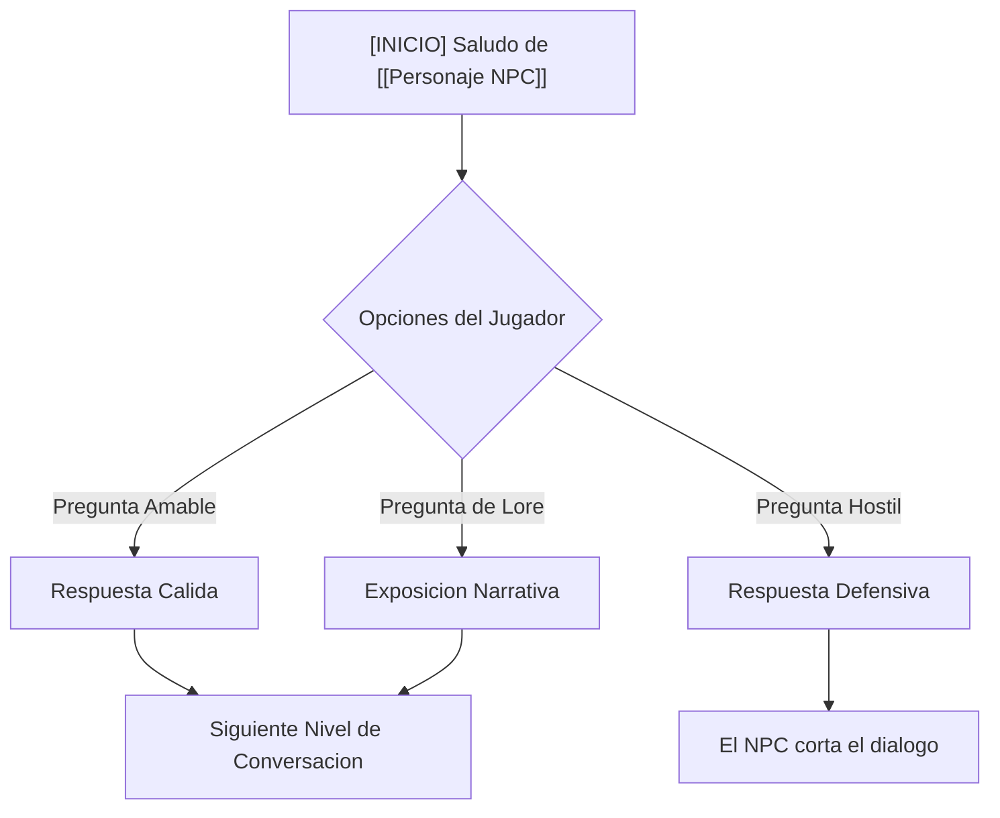

# {{title}}

> **Contexto de la conversación**: Estado anímico del NPC, objetivo de la conversación y tensión dramática.

---

## Nodo: `[inicio]`
**[[Personaje NPC]]**:
> *"Línea de diálogo inicial o reacción al ver al jugador."*

**Opciones del Jugador**:
- **1. [Diplomático]** *"Línea de opción cordial."* $\rightarrow$ Ir a `[nodo_diplomatico]`
- **2. [Directo / Hostil]** *"Línea de opción exigente."* $\rightarrow$ Ir a `[nodo_hostil]`
- **3. [Requisito: [[Item Reliquia]]]** *"He encontrado esto en las ruinas..."* $\rightarrow$ Ir a `[nodo_recompensa]`

---

## Nodo: `[nodo_diplomatico]`
**[[Personaje NPC]]**:
> *"Respuesta abierta y colaborativa..."*

- **Desencadena**: Actualización en [[Mision Relacionada]], suma reputación con [[Faccion NPC]].

---

## Nodo: `[nodo_hostil]`
**[[Personaje NPC]]**:
> *"Respuesta cortante o amenaza..."*

- **Desencadena**: El NPC se niega a comerciar temporalmente.

---

## Nodo: `[nodo_recompensa]`
**[[Personaje NPC]]**:
> *"¡No puedo creer que lo tengas! Esto lo cambia todo..."*

- **Desencadena**: Completa objetivo en [[Mision Relacionada]], otorga recompensa.
