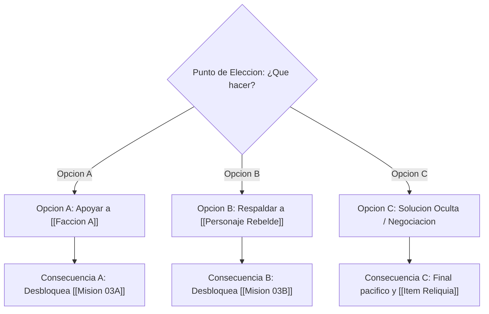

# {{title}}

> **Resumen del Quest**: Breve descripción del detonante y qué está en juego (apuestas / stakes).

## 1. Contexto Narrativo
- **Detonante (Inciting Incident)**: Qué ocurre para que el jugador se involucre.
- **Intereses en conflicto**: Quién gana y quién pierde según lo que decida el jugador.

## 2. Flujo de Objetivos
1. [ ] **Fase 1**: Hablar con [[NPC Dador]] en [[Lugar Inicio]].
2. [ ] **Fase 2**: Investigar [[Lugar de Pista]] y obtener información sobre [[Lore Relevante]].
3. [ ] **Fase 3**: Enfrentar a [[Enemigo o Desafio]] en [[Lugar del Enfrentamiento]].
4. [ ] **Fase 4 (Punto de Decisión)**: Ver sección de ramificaciones abajo.

## 3. Ramificaciones y Elecciones Morales / Mecánicas

### Detalle de Opciones:
- **Opción A (Lealtad)**:
  - **Acción**: El jugador entrega el artefacto a [[NPC A]].
  - **Consecuencias**: Reputación positiva con [[Faccion A]], hostilidad con [[Faccion B]].
  - **Desbloquea**: [[Mision Rama A]].
- **Opción B (Traición / Pragmatismo)**:
  - **Acción**: El jugador vende o destruye el artefacto.
  - **Consecuencias**: Reputación positiva con [[Faccion B]], recompensa monetaria inmediata.
  - **Desbloquea**: [[Mision Rama B]].

## 4. Recompensas
- **Narrativas**: Revelación sobre el pasado de [[Personaje Clave]], entrada en el códice [[Lore Secreto]].
- **Mecánicas**: Objeto [[Item Obtenido]], experiencia, acceso al área [[Nueva Zona]].
