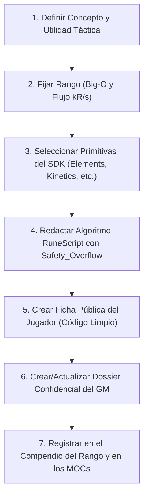

# 🔮 S.C.M.E.H. Spell Authoring System (Neoterra R&D)

Esta skill establece las especificaciones técnicas, metodológicas y operativas para crear **Secuencias de Hechizos Artificiales (S.C.M.E.H.)** consistentes, balanceadas y narrativamente inmersivas para el juego de rol **FATE Básico** en el entorno de **Neoterra**.

---

## 1. Filosofía de Diseño: La Regla de Oro de la Magia Artificial

En Neoterra, la magia no es un milagro ni una palabra mágica: **es software compilado en hardware fósil bio-rúnico**.

1. **Prohibición de Hechizos Monolíticos:**  
   Queda terminantemente prohibido crear primitivas de alto nivel como `LanzarRayo()` o `HacerEscudo()`. Cada llamada a una librería debe manipular **una y solo una variable física elemental** (temperatura, presión barométrica, fase molecular, reluctancia magnética, tensión superficial o retardo de fase).
2. **Arquitectura por Capas Desacopladas:**  
   Todo conjuro debe ensamblarse conectando módulos independientes:
   * **Capa 1 (Materia y Estado):** `Elements.Air`, `Fire`, `Water`, `Earth`, `Lightning`, `Aether`.
   * **Capa 2 (Confinamiento y Geometría):** `Geometry.Confinement`, `Geometry.Transform`.
   * **Capa 3 (Cinética y Movimiento):** `Kinetics.Vector`, `Kinetics.Speed`, `Kinetics.Gravity`.
   * **Capa 4 (Disparadores y Eventos):** `Triggers.Collision`, `Triggers.Proximity`, `Triggers.Chronos`.
   * **Capa 5 (Percepción y Sentidos):** `Sensory.Optics`, `Sensory.Acoustics`, `Sensory.Haptics`.
   * **Capa 6 (Bioeléctrica y Neurología):** `Neural.MindLink`, `Neural.Cognition`, `Elements.Lightning.Bioelectric`.
   * **Capa 7 (Mantenimiento e Ingeniería):** `Engineering.Diagnostics`, `Engineering.MemoryChip`.
   * **Capa 8 (Seguridad y Mitigación):** `Safety.Vent`, `Safety.Abort`.

---

## 2. Los Dos Ejes de Rango: Complejidad Big-O ($\mathcal{O}$) y Flujo Bio-Mágico

El rango de una secuencia está estrictamente dictado por dos variables técnicas:

| Rango | Complejidad Big-O ($\mathcal{O}$) | Flujo Bio-Mágico (`kR/s`) | Requisito `[✨] Control` | Nivel FATE | Enfoque Táctico |
| :---: | :--- | :---: | :---: | :---: | :--- |
| **C** | $\mathcal{O}(1)$ (Constante; un blanco o masa) | Bajo ($< 10\text{ kR/s}$) | `[✨] Control (1)` | Mediocre (+1) | Herramientas civiles, instrucción, cerrajería, soporte básico. |
| **B** | $\mathcal{O}(n) / \mathcal{O}(\log n)$ (Lineal; trayectoria o $n$ s) | Medio ($10 - 100\text{ kR/s}$) | `[✨] Control (2)` | Aceptable (+2) | Balística táctica, escudos rotatorios, trampas de terreno. |
| **A** | $\mathcal{O}(n^2)$ (Cuadrática; interacciones cruzadas) | Alto ($100 - 1.000\text{ kR/s}$) | `[✨] Control (3)` | Bueno (+3) | Fusiones bi-elementales, cadenas Tesla, implosiones masivas. |
| **S** | $\mathcal{O}(2^n)$ (Exponencial; reacción en cadena) | Crítico ($> 500\text{ kR/s}$) | `[✨] Control (4)` | Grande (+4) | Armas estratégicas clasificadas, térmicas masivas, sismos. |
| **SSS** | $\mathcal{O}(n!) / \mathcal{O}(\infty)$ (Singularidad física) | Extremo ($> 1.000\text{ kR/s}$) | `[✨] Control (5+)` | Excelente (+5+) | Reliquias de deicidio construidas sobre órganos de dragones. |

---

## 3. Estructura Canónica del Código RuneScript

Toda secuencia debe estructurarse con la sintaxis formal del lenguaje:

```python
IMPORT RuneScript.Elements.<Modulo> AS <Alias>;
IMPORT RuneScript.Geometry.<Modulo> AS <Alias>;
IMPORT RuneScript.Kinetics.<Modulo> AS <Alias>;
IMPORT RuneScript.Safety.<Modulo> AS <Alias>;

SEQUENCE NombreSecuencia(TargetParameter: Type) {
    HEADER {
        Rank: "C" | "B" | "A" | "S" | "SSS";
        Affinity: "Air" | "Fire" | "Water" | "Earth" | "Lightning" | "Neutral";
        Control_Threshold: 1 | 2 | 3 | 4 | 5;
        Recycle: "Infinite" | "Per_Scene" | "Single_Use_Burn";
        Complexity: "O(1)" | "O(n)" | "O(n^2)" | "O(2^n)";
        Throughput: "<X.X> kR/s";
    }

    PARAMETERS {
        # Variables numéricas y tolerancias del mundo real
        Param_1: Value;
        Param_2: Value;
    }

    EXECUTE {
        # Secuencia algorítmica procedimental
    }

    SAFETY_OVERFLOW {
        ON Control_Failure:
            # Protocolo de mitigación y derivación de sobretensión/calor
    }
}
```

---

## 4. Política Estricta de Separación: Ficha de Jugador vs. Dossier de DM

Para preservar la inmersión de los jugadores y la autoridad táctica del Director de Juego, **se deben generar dos versiones diferenciadas de cada secuencia**:

### A. Ficha Pública para el Jugador (`Magia_Artificial_FATE/05_Objetos_y_Lore_Items/`)
* **Ubicación:** `Magia_Artificial_FATE/05_Objetos_y_Lore_Items/Secuencia - <Nombre>.md`
* **Tono:** Asertivo, riguroso y formal (manual oficial de campo de la Federación o catálogo corporativo).
* **Cero Cuestionamientos de Diseño:** **Nunca** incluir preguntas retóricas como *"¿Por qué falla...?"*, *"¿Cómo descifra el operario...?"*, o notas de debate de diseño. Toda la física se presenta como hechos consolidados.
* **Código RuneScript Limpio:** El bloque de código para el jugador **no debe tener comentarios internos (`# PASO 1: ...`, `# PASO 2: ...`)**. Se presenta como código de producción limpio y depurado.
* **Estructura Obligatoria:**
  1. Frontmatter YAML con metadatos.
  2. `## 1. Ficha Técnica Oficial (S.C.M.E.H.)` (cuadro ASCII).
  3. `## 2. Descripción Operativa y Principios Físicos` (explicación directa de la física).
  4. `## 3. Código Algorítmico Oficial (RuneScript)` (código limpio sin `#`).
  5. `## 4. Implementación en FATE Básico (Proeza de Magia)` (Acciones, bono de afinidad +2, márgenes de fallo).
  6. `## 5. Entidades Relacionadas` (wikilinks).

### B. Dossier Confidencial del Director de Juego (`99_Secretos_GM/`)
* **Ubicación:** `99_Secretos_GM/Auditoría y Secretos de Secuencias - Rango <X>.md` *(bajo `git-crypt`)*
* **Tono:** Quirúrgico, analítico y preventivo.
* **Contenido Exclusivo de DM:**
  1. **Dilemas Físicos y de Ingeniería:** La explicación de por qué fallaba la física ingenua (resbalamiento de sustentación, dispersión gaseosa, resistencia dieléctrica de la piel, riesgo de paro cardíaco y bloqueo biocida, mecanismos de cizalla de cerraduras, etc.).
  2. **Código Fuente Completo con Comentarios:** El código íntegro con todas las etiquetas `# PASO 1: ...`, `# PASO 2: ...` para que el GM entienda cada microsegundo de ejecución.
  3. **Pautas de Adjudicación en Mesa:** Límites numéricos rígidos, consecuencias por fallo catastrófico (-3 o más), resolución de exploits que intenten los jugadores y reacciones de contramedidas enemigas.

---

## 5. Integración con FATE Básico

Cada secuencia equivale a una **Proeza activa vinculada a una ranura de un catalizador**:

1. **Requisito de Activación:** Tener la habilidad `[✨] Control` igual o superior al `Control_Threshold` del algoritmo, y tenerla cargada en un artefacto de rango compatible.
2. **Acciones Disponibles:** Toda secuencia debe detallar sus aplicaciones en al menos 2 de las 4 acciones de FATE:
   * *Superar Obstáculos (con `[✨] Control`)*
   * *Crear una Ventaja (con `[✨] Control`)*
   * *Atacar (con `[✨] Control`)*
   * *Defender (con `[✨] Control`)*
3. **Bono de Afinidad Elemental:**
   * Si el aspecto del Especialista coincide con la `Affinity` nativa de la secuencia, recibe un **+2 automático a su tirada de `[✨] Control`** o una invocación gratuita extra.
4. **Márgenes de Fallo:**
   * Fallo simple (-1 o -2): éxito con coste menor o complicación de escena.
   * Fallo catastrófico (-3 o más): sobrecarga bioeléctrica, casillas de estrés o consecuencias situacionales.

---

## 6. Flujo de Trabajo para Crear una Nueva Secuencia

Al recibir la instrucción de diseñar una nueva secuencia, sigue este protocolo:



---

## 7. Recursos y Plantillas Disponibles
* [[Compendio de Librerias Elementales SCMEH]]
* [[Macro de Librerias SCMEH]]
* [[Manual de Programacion SCMEH]]
* [[Calculo de Rangos SCMEH - Big-O y Flujo]]
* [[Compendio de Artefactos de Neoterra]]
* `resources/templates/template-secuencia-jugador.md`
* `resources/templates/template-secuencia-gm.md`
