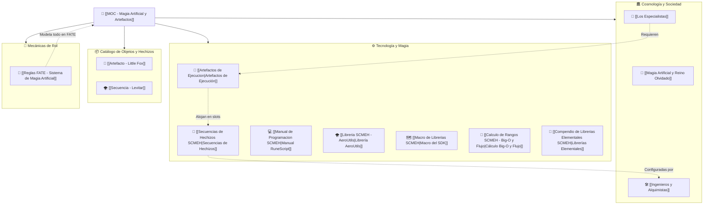

# 🔮 MOC - Sistema de Magia Artificial y Artefactos de Ejecución (FATE Básico)

> *"La magia ya no es un don divino reservado a unos pocos elegidos: es código, ingeniería y hardware. Compilada por alquimistas, canalizada por artefactos y liberada por la sangre de los Especialistas."*

Bienvenido al mapa de contenido para el **Sistema de Magia Artificial y Artefactos de Ejecución**, diseñado tanto como universo narrativo coherente como un compendio modular de reglas para el juego de rol **FATE Básico**.

---

## 🧭 Mapa de Navegación del Sistema

---

## 📚 Índice de Documentación

### 1. Cosmología, Origen y Sociedad
* **[[Magia Artificial y Reino Olvidado]]:** El origen de la tecnología a partir de la observación de las runas de los dioses, la extracción de materiales del Reino Olvidado y la transición de mecanismos fijos arcaicos a la miniaturización.
* **[[Los Especialistas]]:** La raza modificada genéticamente con materiales divinos. Su magia latente, la anatomía del parámetro `[✨] Control` y la influencia de la afinidad elemental.
* **[[Ingenieros y Alquimistas]]:** La casta técnica indispensable. Hardware vs. software, calibración de catalizadores y la célebre cláusula de exención de responsabilidades.

### 2. Tecnología y Magia Pseudo-Mágica
* **[[Artefactos de Ejecucion|Artefactos de Ejecución]]:** Catalizadores portátiles, jerarquía de Rangos (C, B, A, S, SSS), sistema de bahías o ranuras (slots), retrocompatibilidad descendente y protocolos de seguridad.
* **[[Secuencias de Hechizos SCMEH|Secuencias de Hechizos (SCMEH)]]:** Algoritmos digitales inspirados en runas divinas, imposibilidad de aprendizaje memorístico, chips de memoria de un solo uso y sincronía elemental.
* **[[Calculo de Rangos SCMEH - Big-O y Flujo|Cálculo de Rangos (Big-O y Flujo)]]:** Sistema matemático para auditar secuencias combinando complejidad algorítmica $\mathcal{O}$, flujo bioeléctrico (`kR/s`), hilos de concurrencia y fusiones elementales.
* **[[Manual de Programacion SCMEH|Manual de Programación RuneScript]]:** Estándar formal para que los jugadores escriban sus secuencias en pseudocódigo cyber-arcano: bloques de cabecera, parámetros, ejecución, protocolos de seguridad y exploits para FATE.
* **[[Macro de Librerias SCMEH|Macro General de Librerías (SDK)]]:** Arquitectura modular de 7 capas que divide el moldeo elemental de las acciones especializadas (cinética, disparadores/voz/sensores, ilusiones/óptica, psiónica, ingeniería y seguridad).
* **[[Compendio de Librerias Elementales SCMEH|Compendio de Librerías Elementales]]:** Especificación técnica de las 6 librerías de moldeo físico puro (`Air`, `Fire`, `Water`, `Earth`, `Lightning`, `Aether`) con sus clases, métodos y parámetros.
* **[[Libreria SCMEH - AeroUtils|Librería AeroUtils (Utilidades de Aire)]]:** Primer SDK modular oficial con clases (`AirPressure`, `WindFlow`, `AeroAcoustics`, `AeroSafety`) y métodos estandarizados para programar secuencias de viento y barometría.

---

### 3. Catálogo de Equipo y Hechizos (In-Game / Extras FATE)
* **[[Artefacto - Little Fox]]:** El catalizador canónico de iniciación (Rango C) dotado de 3 ranuras para novatos y cadetes.
* **[[Secuencia - Levitar]]:** S.C.M.E.H. de alteración gravitacional y barométrica de Rango C (Afinidad Aire, requisito Control 1, usos infinitos hasta 250 kg).

---

### 4. Compendio de Reglas para FATE Básico
* **[[Reglas FATE - Sistema de Magia Artificial]]:**
  * La nueva habilidad **`[✨] Control`** y su correspondencia con la escala de FATE.
  * Los **Artefactos como Extras** y las ranuras como contenedores de **Proezas (Stunts)**.
  * Mecánicas de **Afinidad Elemental** (+2 a la tirada).
  * Chips de memoria como proezas consumibles.
  * Reglas de sobrecarga, daño de estrés y consecuencias por incompatibilidad de rango o déficit de control.
  * Ejemplo de hoja de personaje lista para jugar.

---

## 📊 Cuadro Maestro de Rangos y Equivalencias

| Rango | Complejidad Big-O | Flujo Bio-Mágico | Puntuación (PC) | Habilidad `[✨] Control` | Nivel FATE | Ejemplo Operativo |
| :---: | :---: | :---: | :---: | :---: | :---: | :--- |
| **C** | $\mathcal{O}(1)$ | Bajo ($< 10\text{ kR/s}$) | 1 - 2 pts | `[✨] Control (1)` | Mediocre (+1) | [[Artefacto - Little Fox]] / [[Secuencia - Levitar]] |
| **B** | $\mathcal{O}(n) / \mathcal{O}(\log n)$ | Medio ($10 - 100\text{ kR/s}$) | 3 - 4 pts | `[✨] Control (2)` | Aceptable (+2) | Lanzas balísticas, proyectiles continuos |
| **A** | $\mathcal{O}(n^2)$ | Alto ($100 - 1.000\text{ kR/s}$) | 5 - 6 pts | `[✨] Control (3)` | Bueno (+3) | Rayos en cadena, áreas de atracción masiva |
| **S** | $\mathcal{O}(2^n)$ | Alto / Crítico ($> 500\text{ kR/s}$) | 7 - 8 pts | `[✨] Control (4)` | Grande (+4) | Tormentas de plasma bi-elemental, asedio |
| **SSS** | $\mathcal{O}(n!) / \mathcal{O}(\infty)$ | Crítico ($> 1.000\text{ kR/s}$) | 9+ pts | `[✨] Control (5+)` | Excelente (+5+) | Alteración espacial, runas del Reino Olvidado |
