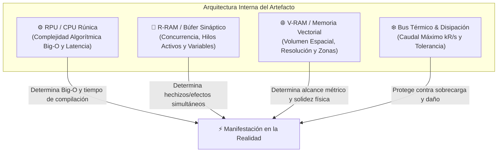

# 📱 Artefactos de Ejecución

> *"Un Especialista sin Artefacto es una batería sin circuito: solo almacena energía estática. El Artefacto es el compilador, la lente y el gatillo que traduce la vida en milagros programados."*

---

## 1. Naturaleza y Propósito
Los **Artefactos de Ejecución** (también conocidos como *Artefactos Catalizadores* o *Artefactos Pseudo-Mágicos*) son dispositivos electro-rúnicos desarrollados por la raza humana hace mucho tiempo como complemento indispensable para que su creación, [[Los Especialistas]], pudiera manifestar la [[Magia Artificial y Reino Olvidado|Magia Artificial]].

Funcionan físicamente como un almacén de hardware y firmware donde se guardan las **[[Secuencias de Hechizos (SCMEH)]]**, dotadas de instrucciones analíticas precisas que se activan mediante la resonancia bioenergética del usuario.

---

## 2. Jerarquía de Rangos

Tanto los Artefactos de Ejecución como las Secuencias de Hechizos se clasifican en una escala estricta de cinco rangos, ordenada de menor a mayor potencia destructiva y complejidad técnica:


1. **Rango C:** Dispositivos introductorios, civiles o de entrenamiento militar inicial. Estructura simple y segura.
2. **Rango B:** Artefactos estándar para fuerzas de asalto y especialistas veteranos.
3. **Rango A:** Equipamiento de alta gama, fabricado por maestros [[Ingenieros y Alquimistas]]. Capaces de manejar flujos de energía severos.
4. **Rango S:** Tecnologías raras y prototipos de grado militar clasificado o gubernamental.
5. **Rango SSS:** Artefactos legendarios o singulares, creados con aleaciones puras del Reino Olvidado. Capaces de alterar el mapa geográfico.

---

## 3. Arquitectura Interna de Hardware

Los Artefactos de Ejecución operan como computadoras bio-rúnicas de alta densidad. Su capacidad para materializar la [[Magia Artificial y Reino Olvidado|Magia Artificial]] no depende únicamente del número de ranuras, sino del equilibrio entre cuatro componentes de hardware esenciales:



### A. RPU (Runic Processing Unit) / CPU Rúnica
* **Función:** El microprocesador forjado con aleaciones del Reino Olvidado que interpreta y compila las líneas de [[Manual de Programacion SCMEH|RuneScript]] en tiempo real.
* **Capacidades que rige:**
  * **Complejidad Algorítmica Máxima ($\mathcal{O}$):** Dicta la clase de algoritmo que el hardware puede computar sin bloquearse (desde $\mathcal{O}(1)$ puntual hasta $\mathcal{O}(n^2)$ cuadrático o superior; ver [[Calculo de Rangos SCMEH - Big-O y Flujo]]).
  * **Latencia de Disparo (Cast Time):** Velocidad de procesamiento. Determina si el hechizo se compila en milisegundos (disparo instantáneo) o si requiere ciclos de precarga.
* **Impacto en FATE:** Define si la secuencia se puede ejecutar como una **Acción Libre / Interrupción** o si exige una **Acción Completa**.

### B. R-RAM (Runic Volatile Memory) / Búfer Sináptico
* **Función:** Memoria volátil de ultra-alta velocidad que retiene las variables ambientales dinámicas (vectores de viento, masas de los blancos, temperatura) y sostiene el estado activo de las secuencias en curso.
* **Capacidades que rige:**
  * **Concurrencia e Hilos Simultáneos (Threads):** Cuántos efectos continuos puede mantener el artefacto en memoria activa (ej. sostener una barrera de viento mientras se apunta una descarga cinética).
  * **Tolerancia a Saturación:** Si el Especialista intenta mantener más efectos de los que su R-RAM soporta, ocurre un *Stack Overflow Arcano*, colapsando el hechizo más antiguo de forma descontrolada.
* **Impacto en FATE:** Determina cuántos **Aspectos de Situación o Ventajas sostenidas** puede mantener el personaje activas de manera simultánea sin gastar acciones de mantenimiento.

### C. V-RAM (Spatial Vectorial RAM) / Memoria de Proyección Espacial
* **Función:** El subsistema de renderizado físico. Modela la geometría tridimensional, la coherencia molecular y la densidad de partículas que el artefacto puede proyectar en el plano real.
* **Capacidades que rige:**
  * **Escala Espacial y Densidad:** 
    * *Baja V-RAM:* Proyecciones puntuales (una chispa, un filo térmico sobre la propia arma).
    * *Alta V-RAM:* Geometrías complejas de gran volumen (murallas de tierra hiperdensas, tormentas barométricas de amplio radio o ilusiones óptico-táctiles fotorrealistas).
* **Impacto en FATE:** Determina el **Alcance y las Zonas**. Un artefacto con baja V-RAM solo opera en la misma zona del portador; una alta V-RAM permite proyectar efectos en **múltiples zonas simultáneas** o crear obstáculos de escala de escena.

### D. Bus de Flujo & Disipación Térmica (TDP / Coolant)
* **Función:** El calibre de las pistas superconductoras y el sistema de refrigeración bio-mágica (disipadores pasivos de cobre arcano, criofluidos o venteos de éter).
* **Capacidades que rige:**
  * **Caudal de Energía Brutal (`kR/s`):** Límite seguro de Kilo-Runas por segundo que puede atravesar el chasis sin fundir las pistas.
* **Impacto en FATE:** Confiere **Casillas de Estrés de Hardware** al artefacto. Si el flujo excede el límite del bus, el estrés del artefacto absorbe el impacto antes de transferir consecuencias al cuerpo del Especialista.

---

## 4. Matriz de Especificaciones por Rango

| Rango de Hardware | CPU Rúnica ($\mathcal{O}$ Máximo) | R-RAM (Hilos Máx.) | V-RAM (Escala Espacial) | Bus Térmico (`kR/s`) | Tipo de Hechizos Aptos |
| :---: | :---: | :---: | :---: | :---: | :--- |
| **Rango C** *(Civil / Cadete)* | $\mathcal{O}(1)$ Constante | **1 Hilo** *(Mono-tarea)* | **Puntual / Objeto** *(Tacto a 5 m)* | Hasta $15\text{ kR/s}$ | *Levitaciones simples, dardos cinéticos, ignición puntual, cerraduras rúnicas.* |
| **Rango B** *(Militar / Táctico)* | $\mathcal{O}(n)$ / $\mathcal{O}(\log n)$ | **2 Hilos** *(Doble búfer)* | **Zona Local** *(Radio 15-20 m)* | Hasta $100\text{ kR/s}$ | *Proyectiles tele-guiados, barreras de viento sostenidas, descargas en arco lineal.* |
| **Rango A** *(Élite / Maestro)* | $\mathcal{O}(n^2)$ Cuadrática | **3 - 4 Hilos** *(Paralelo)* | **Multi-Zona** *(Radio 50-100 m)* | Hasta $1.000\text{ kR/s}$ | *Arcos eléctricos en cadena, terremotos zonales, ilusiones táctiles con masa simulada.* |
| **Rango S** *(Estratégico)* | $\mathcal{O}(2^n)$ Exponencial | **8+ Hilos** *(Multinúcleo)* | **Sector Completo** *(1 km+)* | Hasta $5.000\text{ kR/s}$ | *Enjambres elementales autónomos, domos de anulación física, tormentas de vacío.* |
| **Rango SSS** *(Singularidad)* | $\mathcal{O}(n!)$ / $\mathcal{O}(\infty)$ | **Sin límite práctico** | **Regional / Geológico** | Infinito *(Metal Divino)* | *Desgarros de causalidad, transmutación biológica de biomas, micro-agujeros negros.* |

---

## 5. Periféricos de Entrada y Métodos de Activación

Para que un Especialista dispare una secuencia compilada, el artefacto debe incorporar uno o más métodos de activación (triggers):

1. **Enlace Neuro-Sináptico:** Agujas subdérmicas o nodos de contacto craneal/cervical.
   * *Ventaja:* Activación instantánea por pensamiento puro a velocidad de reflejo ($\sim 10\text{ ms}$).
   * *Riesgo:* En caso de retroceso, el daño se descarga directamente como estrés mental o migrañas sinápticas.
2. **Interfaz Cinética / Gestual:** Giroscopios en muñequeras, anillos de torsión y sensores de aceleración muscular.
   * *Ventaja:* Imposible de detonar por accidente; permite graduar el poder con la aceleración física del movimiento.
   * *Riesgo:* Requiere libertad motriz (inutilizable bajo ataduras o parálisis física).
3. **Módulo Acústico / Fónico:** Transductor rúnico que responde a frecuencias vocales específicas o palabras de mando.
   * *Ventaja:* Deja las manos libres para el combate cuerpo a cuerpo o uso de armamento auxiliar.
   * *Riesgo:* El ruido extremo de artillería, asfixia o silencios mágicos anulan la entrada.
4. **Percutor Mecánico:** Cerrojos, martillos de resorte, gatillos dobles o palancas magitech.
   * *Ventaja:* 100% inmune a interferencias electromagnéticas o pulsos PEM arcanos; robusto y fiable.
   * *Riesgo:* Lento de amartillar para respuestas reactivas inmediatas.
5. **Autenticación Hematológica:** Muestreador capilar que analiza los biomateriales divinos en la sangre del Especialista.
   * *Ventaja:* Seguridad de grado cero (inutilizable si es robado); habilita el protocolo de *Overclocking*.
   * *Riesgo:* Uso continuo drena vitalidad biológica; inutilizable si el portador padece toxinas sanguíneas.
6. **Disparadores Sensoriales Ambientales (Triggers Automáticos):** Células barométricas, térmicas o de densidad de éter.
   * *Ventaja:* Activación autónoma (minas programadas, escudos que saltan solos ante proyectiles entrantes).
   * *Riesgo:* Susceptibles a señuelos, falsos positivos y gasto innecesario de energía.

---

## 6. Chasis y Factores de Forma

El factor de forma físico condiciona la ventilación, el peso y la distribución de componentes:

* **Brazaletes y Guanteletes de Antebrazo:** El chasis militar predilecto. Conexión directa a las venas radiales y nervios motores, equilibrando CPU, V-RAM y 2 a 4 ranuras.
* **Armazones de Armas Híbridas (Rifles Rúnicos, Lanzas de Asalto):** El cañón o el filo de la hoja funciona como disipador térmico alargado y antena de colimación. Permiten un caudal (`kR/s`) devastador en una sola dirección, a costa de baja V-RAM multi-objetivo.
* **Visores y Monóculos Tácticos:** Construidos casi exclusivamente con memoria **V-RAM** y sensores ópticos. Ideales para exploradores, cartógrafos de combate y francotiradores que proyectan matrices de guiado e ilusiones.
* **Racks de Espalda (Módulos de Asalto Pesado / Servidores Móviles):** Pesadas mochilas con turbinas de disipación y bancos de memoria líquida. Usados por unidades de asedio Rango A/S para alimentar hechizos de área continua.
* **Micro-Joyería Rúnica (Anillos, Pines, Gemelos):** Dispositivos de sigilo sin disipador térmico. Limitados a secuencias $\mathcal{O}(1)$ de bajísimo flujo ($<5\text{ kR/s}$) para espionaje, infiltración y ganzúas electromagnéticas.
* **Terminales Handheld (Formato PDA / Pokedex Arcano):** Chasis compacto con pantalla de diagnóstico rúnico y teclado físico/táctil, como el canónico [[Artefacto - Little Fox]].

---

## 7. Protocolos Especiales de Hardware: Overclocking

Un Especialista puede obligar a su artefacto a operar temporalmente **un rango por encima de sus especificaciones de fábrica** (por ejemplo, procesar una secuencia de Rango B en un chasis Rango C):
* **Costo Operativo:** Los disipadores alcanzan temperaturas críticas y el búfer de RAM acumula ruido armónico.
* **Consecuencia en FATE:** Se añade de inmediato el Aspecto de Situación con una invocación gratuita para el rival: `[Chasis al Rojo Vivo]` o `[Fuga de Memoria Rúnica]`, o se marca 1 casilla de estrés de equipo obligatoria.

---

## 8. Sistema de Ranuras (Slots) y Retrocompatibilidad

### A. Ranuras de Memoria (Slots)
Cada artefacto dispone de un número limitado de **ranuras o slots** según su rango constructivo y su calidad de forja:
* En cada ranura se puede alojar exactamente una [[Secuencias de Hechizos (SCMEH)|Secuencia de Hechizo]].
* Por ejemplo, el catalizador de iniciación **[[Artefacto - Little Fox|Little Fox (Rango C)]]** posee 3 slots de Rango C:
  * *Slot #1:* (Nombre de la Secuencia)
  * *Slot #2:* (Nombre de la Secuencia)
  * *Slot #3:* (Nombre de la Secuencia)

### B. Ley de Compatibilidad Descendente
Un Artefacto de Ejecución puede almacenar y compilar secuencias de su **mismo rango y de rangos inferiores**:
* Un artefacto de **Rango A** puede albergar secuencias de **Rango A, B y C**, siempre que el [[Los Especialistas|Especialista]] posea el nivel de `[✨] Control` requerido para activarlas.
* **Prohibición Ascendente:** Un artefacto nunca puede ejecutar de forma segura una secuencia de rango superior al suyo.

---

## 9. Requisitos de Activación y Protocolos de Seguridad

Para activar una secuencia sin comprometer la vida del usuario ni destruir el entorno circundante, deben cumplirse dos condiciones estrictas:

```text
Condición 1: Rango(Artefacto) >= Rango(Secuencia)
Condición 2: [✨] Control(Usuario) >= [✨] Control_Requerido(Secuencia)
```

| Factor Crítico | Regla de Activación | Consecuencia en caso de Incumplimiento |
| :--- | :--- | :--- |
| **Rango del Artefacto** | Debe ser igual o superior al de la secuencia cargada. | **Fallo Crítico del Hardware:** El artefacto sufre errores de compilación, sobrecalentamiento, bloqueo de memoria o destrucción total de sus micro-circuitos. |
| **Capacidad del Usuario** | Debe poseer un valor de `[✨] Control` igual o mayor al exigido. | **Fallo Crítico Bio-mágico:** El Especialista sufre retroceso energético, quemaduras sinápticas o detonaciones incontroladas en su entorno inmediato. *(Los Alquimistas e Ingenieros declinan toda responsabilidad).* |

---

## 10. Implementación en FATE Básico

En las mesas de juego de rol con **FATE Básico**, los Artefactos de Ejecución se tratan como **Extras de Equipo** con slots de Proezas (Stunts) y subsistemas de hardware:

### Anatomía de un Artefacto en FATE
* **Nombre del Extra:** Nombre del modelo y su rango (ej. *Catalizador Portátil [[Artefacto - Little Fox|Little Fox]] [Rango C]*).
* **Aspecto del Artefacto:** Aspecto propio que describe su fabricación o estado (ej. *Resistente pero Básico*, *Circuitería de Cobre Refinado*). Puede ser invocado para beneficiar tiradas de canalización o forzado por el DJ si el artefacto sufre daños mecánicos.
* **Capacidad de Ranuras:** Dicta cuántas secuencias activas puede llevar el personaje listas para su uso.
* **Perfil de Hardware:**
  * **RPU (CPU):** Límite Big-O y velocidad de acción (Acción Libre vs Acción Completa).
  * **R-RAM:** Límite de ventajas sostenidas / aspectos mágicos activos en simultáneo.
  * **V-RAM:** Escala de efecto (Puntual, Zona, Multizona).
  * **TDP / Disipación:** Casillas de estrés de equipo para absorber sobrecargas.
* **Estrés / Consecuencias de Equipo:**
  * Si un jugador fuerza una secuencia de rango mayor o realiza *Overclock*, el artefacto absorbe daño en sus casillas de estrés de hardware o recibe Consecuencias: `[Sobrecarga de Circuitos]`, `[Disipadores al Rojo Vivo]` o `[Catalizador Inutilizado]`.

---

## 11. Entidades Relacionadas
* [[Magia Artificial y Reino Olvidado]]
* [[Los Especialistas]]
* [[Secuencias de Hechizos (SCMEH)]]
* [[Ingenieros y Alquimistas]]
* [[Artefacto - Little Fox]]
* [[Reglas FATE - Sistema de Magia Artificial]]
