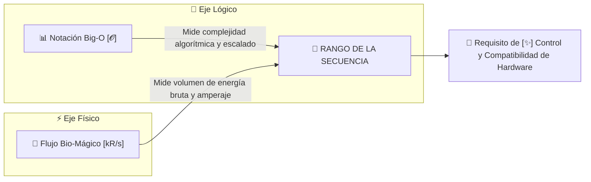

# 📐 Cálculo de Rangos S.C.M.E.H.: Notación Big-O y Flujo Bio-Mágico

> *"En la magia artificial no existen rangos caprichosos. El rango de una secuencia está grabado en su código: lo dictan la complejidad de su algoritmo y el caudal de energía bruta que exige a los circuitos."*
> — Tratado de Auditoría Rúnica, Academia de [[Ingenieros y Alquimistas]]

---

## 1. Los Dos Ejes Fundamentales del Rango

Para determinar si una secuencia pertenece a los rangos **C, B, A, S o SSS**, el Gremio evalúa dos magnitudes físicas y computacionales independientes:



1. **Complejidad Algorítmica (Notación Big-O $\mathcal{O}$):** Representa la *inteligencia del código*. Mide cómo crecen los cálculos lógicos del artefacto en función de las variables del entorno ($n$).
2. **Flujo Bio-Mágico (Throughput en `kR/s`):** Representa la *fuerza bruta*. Mide el caudal instantáneo de energía mágica que drena el Especialista y atraviesa las pistas conductoras del catalizador por segundo.

---

## 2. Primer Eje: Complejidad Algorítmica ($\mathcal{O}$)

En las S.C.M.E.H., la variable **$n$** representa el parámetro de escalado del hechizo:
* $n$ = Cantidad de objetivos a rastrear o impactar.
* $n$ = Radio de área de efecto en metros.
* $n$ = Distancia de vuelo o duración sostenida en segundos.

| Complejidad | Clasificación | Comportamiento Lógico en el Artefacto | Impacto Base en Rango |
| :---: | :--- | :--- | :---: |
| **$\mathcal{O}(1)$** | **Constante** | El cálculo se ejecuta una sola vez para una masa u objetivo puntual. La carga de cálculo no crece sin importar lo que haya alrededor. | **Rango C** |
| **$\mathcal{O}(n)$ / $\mathcal{O}(\log n)$** | **Lineal / Logarítmica** | La carga de cálculo crece proporcionalmente a $n$ (recorrer $n$ metros de trayectoria con ajuste activo, o mantener flujo durante $n$ segundos). | **Rango B** |
| **$\mathcal{O}(n^2)$** | **Cuadrática** | Cálculo de interacción cruzada "todos contra todos". Cada entidad dentro del área interactúa con las demás (arcos de rayos en cadena, atracción gravitatoria mutua). | **Rango A** |
| **$\mathcal{O}(2^n)$** | **Exponencial** | Procesamiento de reacciones en cadena geométricas o proliferación de enjambres auto-replicantes. | **Rango S** |
| **$\mathcal{O}(n!)$ / $\mathcal{O}(\infty)$** | **Factorial / Singularidad** | El código calcula todas las permutaciones posibles de la física local. Desgarros de causalidad o runas primordiales del [[Magia Artificial y Reino Olvidado|Reino Olvidado]]. | **Rango SSS** |

---

## 3. Segundo Eje: Flujo Bio-Mágico (Throughput en `kR/s`)

El **Flujo** mide el volumen de energía bioeléctrica drenada de la sangre del [[Los Especialistas|Especialista]] y transmitida a los circuitos en microsegundos. Se mide formalmente en **Kilo-Runas por segundo (`kR/s`)**:

```text
┌────────────────────────────────────────────────────────────────────────┐
│                       ESCALA DE FLUJO BIO-MÁGICO                       │
├────────────────────────────────────────────────────────────────────────┤
│ • FLUJO BAJO   (< 10 kR/s):      Frío, inaudible, doméstico.           │
│ • FLUJO MEDIO  (10 - 100 kR/s):  Zumbido electromagnético, calor leve. │
│ • FLUJO ALTO   (100 - 1.000 kR/s): Disipadores ardiendo, temblor físico.│
│ • FLUJO CRÍTICO (> 1.000 kR/s):  Plasma visible, peligro de colapso.   │
└────────────────────────────────────────────────────────────────────────┘
```

> [!IMPORTANT] La Paradoja de la Taza vs. La Puerta Blindada
> * **Calentar una taza de té:** Objetivo puntual $\rightarrow \mathcal{O}(1)$. Flujo mínimo ($0.2\text{ kR/s}$) $\rightarrow$ **Rango C**.
> * **Vaporizar una puerta blindada de titanio:** Objetivo puntual $\rightarrow \mathcal{O}(1)$. Flujo brutal ($350\text{ kR/s}$) $\rightarrow$ ¡Sube automáticamente a **Rango A** por exigencia de caudal!

---

## 4. Factores Moduladores Secundarios

Además de Big-O y el Flujo, existen tres modificadores de arquitectura:

1. **Concurrencia Sináptica (Número de Hilos / Threads):**
   * *Mono-hilo (Single Thread):* Disparar y terminar (no requiere sostener concentración). $\rightarrow +0\text{ pts}$.
   * *Bi-hilo (Dual Thread):* Sostener una barrera activa mientras se apunta o corre. $\rightarrow +1\text{ pt}$.
   * *Multi-hilo Paralelo ($>3$ Threads):* Ilusión óptica + control de temperatura + radar activo. $\rightarrow +2\text{ pts}$.
2. **Dependencias Cruzadas (Acoplamiento Multi-Elemental):**
   * *Mono-elemental:* Usa un solo módulo (ej. solo `AeroUtils`). $\rightarrow +0\text{ pts}$.
   * *Bi-elemental:* Fusiona dos matrices opuestas (ej. Aire + Fuego = Plasma). $\rightarrow +1\text{ pt}$.
   * *Tri-elemental o Éter Divino:* Fusión de tres o más elementos. $\rightarrow +2\text{ pts}$.
3. **Índice de Entropía Física:**
   * *Física Asistida:* Respeta leyes newtonianas básicas (acelerar masas, cambiar presiones). $\rightarrow +0\text{ pts}$.
   * *Ruptura Parcial:* Desafía la conservación de materia o gravedad local. $\rightarrow +1\text{ pt}$.
   * *Anomalía Primordial:* Inversión de causalidad o desgarro dimensional. $\rightarrow +2\text{ pts}$.

---

## 5. La Matriz de Compilación de Rangos (Fórmula Oficial)

Para calcular el rango final de cualquier secuencia, se calcula su **Puntuación de Compilación (PC)** sumando los valores de la siguiente rúbrica:

$$\text{Puntuación de Compilación (PC)} = \text{Puntos Big-O} + \text{Puntos de Flujo} + \text{Modificadores}$$

### Tabla de Rúbrica de Puntuación

| Criterio | Medida Técnica | Puntos Asignados |
| :--- | :--- | :---: |
| **Complejidad Big-O** | $\mathcal{O}(1)$<br>$\mathcal{O}(n)$ o $\mathcal{O}(\log n)$<br>$\mathcal{O}(n^2)$<br>$\mathcal{O}(2^n)$<br>$\mathcal{O}(n!)$ o $\mathcal{O}(\infty)$ | **1 pt**<br>**2 pts**<br>**3 pts**<br>**4 pts**<br>**5 pts** |
| **Flujo Bio-Mágico** | Bajo ($< 10\text{ kR/s}$ / Escala humana o leve)<br>Medio ($10 - 100\text{ kR/s}$ / Escala táctica-militar)<br>Alto ($100 - 1.000\text{ kR/s}$ / Escala de demolición o asedio)<br>Crítico ($> 1.000\text{ kR/s}$ / Escala calamidad masiva) | **0 pts**<br>**1 pt**<br>**2 pts**<br>**3 pts** |
| **Concurrencia** | Mono-hilo (disparo único o instantáneo)<br>Bi-hilo (concentración sostenida en 2 procesos)<br>Multi-hilo (3 o más procesos paralelos) | **0 pts**<br>**1 pt**<br>**2 pts** |
| **Acoplamiento Elemental** | 1 Solo Elemento<br>Fusión Bi-Elemental (dos elementos combinados)<br>Tri-Elemental o Infusión con Aether del Reino Olvidado | **0 pts**<br>**1 pt**<br>**2 pts** |

---

### Escala de Conversión a Rangos Oficiales

| Puntuación (PC) | Rango Oficial | Requisito de `[✨] Control` | Nivel FATE Básico | Artefacto de Ejemplo Compatible |
| :---: | :---: | :---: | :---: | :--- |
| **1 a 2 pts** | **Rango C** | `[✨] Control (1)` | Mediocre (+1) | [[Artefacto - Little Fox\|Little Fox]] (Principiante) |
| **3 a 4 pts** | **Rango B** | `[✨] Control (2)` | Aceptable (+2) | Catalizador Táctico de Asalto |
| **5 a 6 pts** | **Rango A** | `[✨] Control (3)` | Bueno (+3) | Guantelete de Oficial / Élite |
| **7 a 8 pts** | **Rango S** | `[✨] Control (4)` | Grande (+4) | Matriz Estratégica Gubernamental |
| **9+ pts** | **Rango SSS** | `[✨] Control (5+)`| Excelente (+5+) | Reliquia Divina del Reino Olvidado |

---

## 6. Casos Prácticos de Auditoría

### Caso 1: [[Secuencia - Levitar|Secuencia: Levitar]]
* **Big-O:** $\mathcal{O}(1)$ (procesa una única masa menor a 250 kg) $\rightarrow$ **1 pt**.
* **Flujo:** Bajo ($4\text{ kR/s}$, solo genera sustentación barométrica suave) $\rightarrow$ **0 pts**.
* **Concurrencia:** Mono-hilo de concentración simple $\rightarrow$ **0 pts**.
* **Elementos:** Solo `AeroUtils` (Aire) $\rightarrow$ **0 pts**.
* **TOTAL:** **1 Punto $\rightarrow$ RANGO C** (Compatible con Little Fox, Control 1).

### Caso 2: Secuencia: Lanza Balística Perforante
* **Big-O:** $\mathcal{O}(1)$ (un solo proyectil con vector fijo) $\rightarrow$ **1 pt**.
* **Flujo:** Medio ($65\text{ kR/s}$, impulso suficiente para perforar blindajes de tanques) $\rightarrow$ **1 pt**.
* **Concurrencia:** Mono-hilo de disparo $\rightarrow$ **0 pts**.
* **Elementos:** Solo Cinética/Tierra $\rightarrow$ **0 pts**.
* **TOTAL:** **2 Puntos (Rango C-Plus) $\rightarrow$ RANGO C o B** según pureza del chasis.

### Caso 3: Secuencia: Relámpago en Cadena
* **Big-O:** $\mathcal{O}(n^2)$ (salta a $n$ objetivos y cada arco emite interferencia cruzada) $\rightarrow$ **3 pts**.
* **Flujo:** Medio-Alto ($80\text{ kR/s}$) $\rightarrow$ **1 pt**.
* **Concurrencia:** Bi-hilo (cálculo de trayectoria + modulación de voltaje) $\rightarrow$ **1 pt**.
* **Elementos:** Solo `ElectroUtils` $\rightarrow$ **0 pts**.
* **TOTAL:** **5 Puntos $\rightarrow$ RANGO A** (Exige Control 3 y catalizador de alta gama).

### Caso 4: Secuencia: Tormenta de Plasma Ígneo-Cinética
* **Big-O:** $\mathcal{O}(n^2)$ (área continua con interacción de proyectiles térmicos) $\rightarrow$ **3 pts**.
* **Flujo:** Alto ($300\text{ kR/s}$, temperatura superior a 2.000 °C) $\rightarrow$ **2 pts**.
* **Concurrencia:** Multi-hilo (vórtice + control térmico + detonador) $\rightarrow$ **1 pt**.
* **Elementos:** Fusión Fuego + Aire (`Pyro` + `Aero`) $\rightarrow$ **1 pt**.
* **TOTAL:** **7 Puntos $\rightarrow$ RANGO S** (Nivel Estratégico, Control 4).

---

## 7. Entidades Relacionadas
* [[Artefactos de Ejecucion]]
* [[Secuencias de Hechizos SCMEH]]
* [[Manual de Programacion SCMEH]]
* [[Macro de Librerias SCMEH]]
* [[Los Especialistas]]
* [[Reglas FATE - Sistema de Magia Artificial]]
