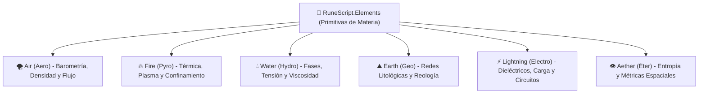

# 🌌 Compendio de Librerías Elementales (`RuneScript.Elements.*`)

> *"Si una librería te ofreciera una función llamada `LanzarBolaDeFuego()`, no serías un Especialista ni un programador rúnico: serías un usuario corriente apretando un interruptor roto. El verdadero arte reside en excitar las moléculas, confinar el plasma, condensar su núcleo, imprimirle un vector cinético y rezar para que tu rutina de seguridad no deje escapar una chispa a tus venas."*
> — Cátedra de Arquitectura Algorítmica, Academia de [[Ingenieros y Alquimistas]]

---

## 1. Principio Fundamental: Primitivas Atómicas vs Hechizos Monolíticos

Bajo el estándar [[Macro de Librerias SCMEH|RuneScript]], queda terminantemente prohibida la inclusión de métodos de alto nivel que representen conjuros completos empaquetados. 

Toda llamada dentro de `RuneScript.Elements.*` obedece las siguientes **reglas de arquitectura modular**:
1. **Regla de Atomicidad Física:** Cada función altera una y solo una propiedad de la materia (presión, fase, temperatura molecular, polaridad de dipolos, enlace de red cristalina o confinamiento de campo).
2. **Sin Cinética ni Trayectorias Nativas:** Los elementos no tienen velocidad ni dirección por sí mismos. Para mover masa u ondas elementales se debe importar explícitamente `RuneScript.Kinetics.*`.
3. **Composición Algorítmica Obligatoria:** Un hechizo (S.C.M.E.H.) es una **secuencia procedimental** compuesta por varios pasos:
   * **Paso A — Captación / Preparación:** Recolectar masa o aislar comburente ambiental.
   * **Paso B — Modificación de Estado:** Variar temperatura, densidad, ionización o fase.
   * **Paso C — Geometría y Confinamiento:** Crear una envoltura de campo que contenga la energía para evitar fugas descontroladas.
   * **Paso D — Validación Lógica:** Condicionales de estabilidad previa a la ignición o disparo (`IF (!campo.is_stable()) ABORT(...)`).
   * **Paso E — Vectorización Cinética:** Transferencia de impulso o aceleración vectorial.
   * **Paso F — Disparadores de Evento:** Instrucciones de impacto, colisión o temporizado (`Triggers.OnCollision`, `Triggers.OnTimer`).



---

## 2. Catálogo Oficial de Primitivas por Librería

---

### 🔥 1. `RuneScript.Elements.Fire` (`Pyro`)
Manipulación de agitación molecular, combustión química, ionización y envolturas de confinamiento de alta energía.

#### A. `Pyro.Thermal` (Termodinámica Molecular)
* `.excite_molecules(target_zone: Area/Object, temp_celsius: Float)`:
  * Incrementa la energía cinética microscópica en una coordenada, elevando la temperatura sin encender llama directa a menos que exista comburente.
* `.absorb_heat(source: Point/Object, sink: Point/Chassis, joules: Float)`:
  * Extrae energía calórica de un cuerpo o zona para enfriarlo, transfiriéndola a un disipador o condensador.
* `.set_thermal_gradient(from_point: Point, to_point: Point, delta_k: Float)`:
  * Establece una línea de transferencia térmica rápida.

#### B. `Pyro.Combustion` (Reacción Exotérmica)
* `.ignite_mix(flammable_target: Object, oxygen_ratio: Float)`:
  * Si la temperatura local supera el punto de inflamación del material, inicia la reacción en cadena de fuego.
* `.sustain_reaction(combustion_core: FireCore, fuel_feed_rate: Float)`:
  * Alimenta una llama activa consumiendo combustible ambiental o éter del operador.
* `.ignite_surface(radius_m: Float, burn_rate: Float)`:
  * Genera un plano residual de combustión en el suelo o superficie de impacto. FATE: Aspecto de zona `[Superficie en Llamas]`.

#### C. `Pyro.Plasma` (Estado Ionizado)
* `.ionize_gas(gas_pocket: GasPocket, energy_density: EnergyLevel) -> PlasmaCore`:
  * Transforma un volumen de gas precalentado en masa gaseosa superionizada conductora. *Advertencia: Altamente inestable si no se confina de inmediato.*
* `.set_plasma_conductivity(plasma_core: PlasmaCore, siemens_meter: Float)`:
  * Modula la conductividad eléctrica del plasma para que pueda absorber y canalizar arcos voltaicos procedentes de `RuneScript.Elements.Lightning` sin romper su estructura.

#### D. `Pyro.Radiation` (Flujo Térmico Radiante)
* `.radiant_heat_flux(origin: Point, vector: Vector3, flux_watts_m2: Float)`:
  * Emite un haz o cono de calor radiante infrarrojo invisible a distancia sin proyectil físico (calienta blindajes, funde componentes electrónicos o cocina munición enemiga en cargadores).

#### E. `Pyro.Byproducts` (Subproductos de Combustión)
* `.generate_smoke(combustion_core: FireCore, opacity_pct: Float, toxicity_level: Int, radius_m: Float) -> SmokeZone`:
  * Genera una nube densa de monóxido y hollín opaco a partir de la combustión. FATE: Aspectos como `[Atmósfera Asfixiante]` o `[Ceguera por Humo Negro]`.
* `.pyrolyze_material(target_solid: Object) -> FlammableVapor`:
  * Descompone térmicamente materia sólida orgánica (madera, plástico, resinas) en vapor inflamable antes de la ignición, preparando áreas para combustiones súbitas.

#### F. `Pyro.Flashpoint` (Sensibilidad Térmica de Materiales)
* `.lower_flashpoint(target_material: Object, delta_celsius: Float)`:
  * Altera la estabilidad química superficial de un objeto o blindaje reduciendo su temperatura mínima de autoignición (hace que materiales ignífugos o metales ardan ante una mínima chispa).

#### G. `Pyro.Confinement` (Campos de Contención y Forma)
* `.bind_sphere(energy_core: PlasmaCore/FireCore, radius_m: Float) -> Envelope`:
  * Crea una barrera magnética/rúnica esférica que retiene la energía dentro del radio deseado.
* `.bind_cylinder(energy_core: PlasmaCore/FireCore, length_m: Float, radius_m: Float) -> Envelope`:
  * Confinamiento tubular para proyectiles de perforación o rayos térmicos.
* `.compress(envelope: Envelope, factor: Float)`:
  * Reduce el volumen del campo aumentando radicalmente su densidad térmica y presión interna.
* `.is_stable(envelope: Envelope) -> Boolean`:
  * Valida si el campo resiste la presión del núcleo. Si devuelve `false`, la secuencia corre riesgo de fuga bioeléctrica.
* `.release(envelope: Envelope)`:
  * Desactiva el confinamiento liberando súbitamente la energía almacenada al medio circundante.

---

### 🌪️ 2. `RuneScript.Elements.Air` (`Aero`)
Control de presiones diferenciales, densidad de masa gaseosa, separación de componentes y vectores de momento angular.

#### A. `Aero.Pressure` (Barometría Diferencial)
* `.set_differential(surface_high: Surface, surface_low: Surface, delta_bar: Float)`:
  * Desbalancea la presión barométrica entre dos caras de un objetivo o cuerpo para generar sustentación o empuje neumático.
* `.depressurize_zone(volume_m3: Float, target_bar: Float) -> LowPressureZone`:
  * Desaloja masa gaseosa de un volumen creando una zona de baja presión o vacío técnico.

#### B. `Aero.Density` (Compresión y Expansión de Gases)
* `.compress_gas(volume_m3: Float, ratio: Float) -> GasPocket`:
  * Condensa moléculas de gas circundante en un bolsón esférico de alta densidad (precursor de combustiones o expansiones).
* `.expand_gas(gas_pocket: GasPocket, expansion_rate: Float)`:
  * Provoca una descompresión acelerada de un bolsón de gas generando una onda de choque expansiva pura.

#### C. `Aero.GasFlow` (Dinámica de Flujos)
* `.stream_vector(origin: Point, vector: Vector3, flux_liters_sec: Float) -> AirStream`:
  * Establece una corriente laminar estable de gas continuo en una dirección.
* `.create_vortex_ring(origin: Point, vector: Vector3, core_radius_m: Float, circulation_gamma: Float) -> VortexRing`:
  * Genera un anillo de vórtice toroidal autosostenido (solitón neumático) que preserva la masa y la energía cinética sin dispersión por rozamiento ambiental a lo largo de su trayectoria.
* `.vortex_angular(axis_vector: Vector3, radius_m: Float, rpm: Int) -> VortexField`:
  * Introduce momento angular y fuerza centrífuga sobre una masa de gas (desvío de proyectiles balísticos o vórtices de succión).

#### D. `Aero.Composition` (Separación y Filtrado de Gases)
* `.isolate_component(volume_m3: Float, gas_type: [OXYGEN | NITROGEN | CO2 | TOXIN]) -> GasPocket`:
  * Separa selectivamente un componente químico del aire circundante (e.g. concentrar $O_2$ puro para alimentar combustiones extremas, saturar de nitrógeno para sofocar incendios, o depurar toxinas ambientales).

#### E. `Aero.Drag` (Fricción y Coeficiente Aerodinámico)
* `.set_drag_coefficient(target: Object/Entity, drag_factor: Float)`:
  * Modifica cómo el aire interactúa con la superficie de un cuerpo en movimiento. Permite frenar proyectiles balísticos en el aire multiplicando su fricción o desacelerar caídas libres estilo paracaídas neumático.

#### F. `Aero.Acoustics` (Acústica y Ondas de Presión)
* `.decouple_vibration(zone: Area)`:
  * Desacopla la transmisión mecánica de ondas de sonido a través del aire en un perímetro definido (silenciador físico total de detonaciones, pasos o motores).
* `.pulse_compression(origin: Point, vector: Vector3, decibels: Float)`:
  * Emite un frente de onda acústico concentrado de alta energía hacia un vector (aturdimiento sináptico o fractura de vidrios/sensores por sobrepresión sonora).

#### G. `Aero.ThermalShift` (Física de Gases Adiabática)
* `.joule_thomson_expansion(gas_pocket: GasPocket, ratio: Float)`:
  * Descomprime un volumen gaseoso de forma no reactiva, induciendo una caída brusca de temperatura en el gas (generación instantánea de escarcha, enfriamiento de chasis sobrecalentados o niebla por condensación de humedad ambiental).

---

### 💧 3. `RuneScript.Elements.Water` (`Hydro`)
Captación de masa acuosa, transición molecular de fase, rigidez superficial y modulación de flujo viscoso.

#### A. `Hydro.Gathering` (Masa Acuosa)
* `.extract_ambient_moisture(origin: Point, volume_liters: Float) -> FluidVolume`:
  * Condensa el vapor de agua disperso en el aire o extrae humedad del subsuelo inmediato hacia una masa líquida manipulable.

#### B. `Hydro.Phase` (Transición Termodinámica)
* `.shift_phase(fluid: FluidVolume, target_state: [SOLID | LIQUID | GAS], rate: Float)`:
  * Modifica el enlace termodinámico de las moléculas de $H_2O$.
* `.crystallize_lamellar_matrix(fluid: FluidVolume, layer_thickness_um: Float, hardness_factor: Float) -> CompositeIce`:
  * Estructura los cristales de hielo en una matriz estratificada laminar cruzada (inspirada en la estructura del nácar), disipando grietas por cizallamiento y multiplicando su resistencia balística contra proyectiles.
* `.crystallize_lattice(fluid: FluidVolume, hardness_factor: Float) -> IceLattice`:
  * Fuerza una estructura cristalina hexagonal rígida (hielo de alta densidad para coberturas o barreras sólidas).
* `.sublimate_instant(fluid: FluidVolume) -> VaporCloud`:
  * Pasa líquido a vapor sobrecalentado de golpe creando una cortina de ocultamiento y escaldadura.

#### C. `Hydro.FluidDynamics` (Reología y Presión)
* `.set_surface_tension(fluid: FluidVolume, tension_coefficient: Float)`:
  * Altera la fuerza de los enlaces superficiales permitiendo que el agua actúe como una lámina elástica amortiguadora contra impactos.
* `.pressurize(fluid: FluidVolume, bar_pressure: Float)`:
  * Introduce energía hidrostática para convertir el líquido en un chorro cortante de alta velocidad.
* `.set_viscosity(fluid: FluidVolume, cP_viscosity: Float)`:
  * Transforma el líquido en un fluido no-newtoniano (espeso ante reposo, ultra-rígido ante impactos bruscos).

#### D. `Hydro.Solutes` (Disolución, Purificación y Salinidad)
* `.dissolve_solute(fluid: FluidVolume, solute_type: [ELECTROLYTE_SALTS | ACID | TOXIN], concentration_ppm: Float)`:
  * Modifica la composición del agua incorporando solutos. Disolver sales electrolíticas la convierte en un conductor eléctrico óptimo para arcos de `RuneScript.Elements.Lightning`, o permite transportar agentes corrosivos sin dispersión.
* `.precipitate_solutes(fluid: FluidVolume)`:
  * Fuerza la separación y decantación de minerales e impurezas químicas disueltas (desalinización táctica y purificación para consumo).

#### E. `Hydro.Capillarity` (Adherencia y Humectabilidad Superficial)
* `.set_contact_angle(fluid: FluidVolume, target_surface: Surface, angle_deg: Float)`:
  * Modula la interacción física entre el líquido y las superficies sólidas.
  * *Ángulo bajo (0° - Superhumectante):* El agua se adhiere fuertemente a muros, telas o armaduras sin escurrirse, manteniéndolas saturadas para conductividad o congelación posterior.
  * *Ángulo alto (>150° - Superhidrofóbico):* Repelencia hidrofóbica total (efecto loto); crea una película lubricante que hace resbaladizo el suelo o repele ataques con fluidos corrosivos.

#### F. `Hydro.FlowRegime` (Régimen de Coherencia de Flujo)
* `.set_flow_coherence(fluid: FluidVolume, regime: [LAMINAR_COHERENT | TURBULENT_SPRAY])`:
  * *Laminar:* Mantiene el chorro compacto en un vector uniforme sin dispersión de gotas, maximizando el alcance y la energía de corte hidrostático.
  * *Turbulento:* Dispersa la masa fluida en un cono de microaerosol o rocío atomizado de cobertura amplia.

#### G. `Hydro.Osmosis` (Presión Osmótica de Tejidos)
* `.induce_osmotic_flux(fluid: FluidVolume, target_tissue: OrganicTissue, direction: [DEHYDRATE | HYDRATE])`:
  * Provoca un gradiente osmótico violento para drenar o saturar agua en tejidos vegetales, fúngicos o biomasa sintética.
  * ⚠️ **Restricción de Firmware de la Asociación de Alquimistas del Código:** Por decreto regulatorio internacional, todos los inductores rúnicos poseen un DRM ético a nivel de circuito. Cualquier intento de apuntar esta función a tejidos humanos o humanoides dispara instantáneamente la excepción `UNAUTHORIZED_BIOCIDE_LOCKOUT`, apagando el artefacto y disipando el éter a tierra para evitar necrosis letal no autorizada.

---

### ⛰️ 4. `RuneScript.Elements.Earth` (`Geo`)
Interacción con la litología de suelos, redes cristalinas minerales, planos de corte y polarización ferrosa.

#### A. `Geo.Lattice` (Cohesión Litológica)
* `.densify_mineral(stone_target: MineralBody, density_ratio: Float)`:
  * Reordena la red atómica de rocas o muros de cemento haciéndolos exponencialmente más resistentes a la fragmentación.
* `.cleave_fault(plane_vector: Vector3, stress_joules: Float)`:
  * Aplica un esfuerzo cortante a lo largo de un plano litológico para inducir una grieta o falla controlada en terreno o estructuras.

#### B. `Geo.Granular` (Reología de Suelos)
* `.fluidize_soil(ground_area: Area, depth_m: Float)`:
  * Rompe la fricción de fricción intergranular entre partículas de tierra, asfalto o arena, transformando el piso firme en lodo o arena movediza. FATE: Aspecto `[Piso Licuado e Inestable]`.
* `.recompact_soil(ground_area: Area)`:
  * Reestablece instantáneamente el rozamiento granular, solidificando de golpe la materia y atrapando cualquier extremidad sumergida.

#### C. `Geo.Ferrous` (Alineación Magnética Mineral)
* `.polarize_mineral_domain(target_area: Area, field_tesla: Float)`:
  * Excita los dominios ferromagnéticos de las vetas subterráneas de hierro para inducir un polo atractor hacia el suelo.

#### D. `Geo.Crystalline` (Nucleación Mineral)
* `.nucleate_crystal(seed_point: Point, growth_vector: Vector3, rate: Float) -> CrystalSpire`:
  * Estimula la precipitación y crecimiento rápido de prismas minerales o cuarzos afilados en una trayectoria vectorial.

#### E. `Geo.Seismic` (Propagación Sísmica y Acústica de Suelos)
* `.listen_elastic_waves(contact_point: Point, sample_rate_hz: Float) -> SeismicWaveform`:
  * Escucha pasiva de deformaciones mecánicas superficiales (ondas P y S) a través de roca o concreto sin emitir energía activa.
* `.triangulate_phase_delay(sensor_array: List[Point], signal: SeismicWaveform) -> SeismicVector`:
  * Compara los micro-retrasos de llegada de la onda entre los nodos de contacto de la mano del operador para triangular el vector angular de origen y calcular distancia según la atenuación de amplitud.
* `.pulse_seismic_wave(origin: Point, vector: Vector3, frequency_hz: Float, amplitude_joules: Float)`:
  * Envía una vibración mecánica continua o en pulso a través del suelo o estructuras de roca/cemento (desestabiliza el equilibrio enemigo a distancia, quiebra cimientos o sacude coberturas).
* `.dampen_seismic_vibrations(zone: Area)`:
  * Amortigua y absorbe cualquier vibración mecánica superficial en el terreno dentro del radio (permite desplazamiento en silencio absoluto sobre baldosas, escombros o grava crujiente).

#### F. `Geo.SurfaceTexture` (Fricción y Acabado Litológico)
* `.set_directional_shear_friction(stone_surface: Surface, normal_release: Boolean, max_shear_mu: Float)`:
  * Modula una adherencia dependiente de la carga biomecánica: traba firmemente la suela ante esfuerzo cortante lateral o pendientes verticales, pero libera la adhesión instantáneamente cuando el pie se levanta perpendicularmente, permitiendo una marcha fluida.
* `.set_friction_profile(stone_surface: Surface, profile: [ULTRA_GRIP_ABRASIVE | MIRROR_POLISHED_ZERO_FRICTION])`:
  * Modifica la aspereza atómica de la roca o cemento.
  * *Ultra-Grip:* Genera microdientes moleculares de alto agarre, permitiendo escalar muros verticales a mano limpia sin equipo de escalada.
  * *Mirror-Polished:* Pule la superficie a nivel atómico anulando la fricción superficial (cualquier entidad que pise o frene patina incontrolablemente como en hielo puro).

#### G. `Geo.Porosity` (Permeabilidad y Microcanales)
* `.set_porosity(mineral_body: MineralBody, porosity_pct: Float)`:
  * Modula los poros microscópicos de la piedra.
  * *Baja porosidad (0%):* Vuelve la roca impermeable y estanca contra filtraciones de agua, ácidos o gases a presión.
  * *Alta porosidad (>40%):* Abre microcanales capilares para que la roca absorba rápidamente fluidos combustibles o humedad del entorno.

#### H. `Geo.Piezoelectric` (Conector Piezoeléctrico Tierra $\leftrightarrow$ Rayo)
* `.excite_piezo_discharge(crystal_core: CrystalSpire, mechanical_stress_pascals: Float) -> VoltageSpike`:
  * Induce una descarga de alto voltaje al aplicar una sobretensión o impacto mecánico brusco sobre una formación de cuarzo/cristal, permitiendo a operadores de Tierra generar chispas eléctricas tácticas.

---

### ⚡ 5. `RuneScript.Elements.Lightning` (`Electro`)
Ruptura dieléctrica del aire, acumulación de carga estática y cierre de arcos inductivos.

#### A. `Electro.Dielectric` (Canal de Resistencia Cero)
* `.ionize_channel(start_point: Point, end_point: Point, target_resistance: Float) -> IonChannel`:
  * Quema microscópicamente un filamento invisible de aire transformándolo en un conductor de resistencia nula. *Sin este paso previo, cualquier descarga eléctrica saltará sin rumbo al objeto metálico más cercano.*

#### B. `Electro.Charge` (Potencial Electrostático)
* `.accumulate(capacitance_source: Hardware/Capacitor, coulombs: Float) -> ChargeNode`:
  * Almacena carga bioeléctrica concentrada en el acumulador del artefacto.
* `.polarize_dipole(node_a: Point, node_b: Point, delta_volts: Float)`:
  * Establece una tensión o diferencia de potencial eléctrico entre el lanzador y la coordenada de destino.

#### C. `Electro.Circuit` (Descarga e Inducción Básica)
* `.close_discharge(channel: IonChannel, charge_node: ChargeNode)`:
  * Conecta la carga acumulada con el canal ionizado provocando el arco voltaico instantáneo a la velocidad del destello.
* `.generate_magnetic_pulse(current_amperes: Float, radius_m: Float)`:
  * Emite un pulso electromagnético inducido (EMP) capaz de alterar los circuitos lógicos de otros artefactos en el radio.

#### D. `Electro.Magnetics` (Campos Magnéticos y Aceleración de Lorentz)
* `.detect_ferrous_nodes(target: Object, flux_density_tesla: Float) -> List[MagneticNode]`:
  * Escanea variaciones de reluctancia magnética para mapear componentes ferrosos internos ocultos (clavijas de cerrojos, bobinas de relés o muelles).
* `.apply_rotational_torque(target_core: Object, torque_newton_meters: Float, axis: Vector3)`:
  * Induce un par de giro tangencial continuo sobre un núcleo ferroso giratorio (rotor de cerradura o bombín).
* `.pulse_focused_attraction(node: MagneticNode, lift_force_newtons: Float)`:
  * Aplica un pulso electromagnético enfocado en una coordenada micrométrica para elevar un componente individual (un perno) hasta su línea de corte sin mover los adyacentes.
* `.induce_magnetic_solenoid(axis_vector: Vector3, radius_m: Float, field_tesla: Float) -> SolenoidField`:
  * Genera un campo de atracción o repulsión magnética sobre blindajes, armas o metralla ferrosa circundante.
* `.lorentz_acceleration(rail_vector: Vector3, conductive_mass: Object, current_amps: Float)`:
  * Aplica fuerza de Lorentz perpendicular sobre una masa conductora (principio de *railgun*; propulsa proyectiles o esquirlas metálicas a velocidad hipersónica mediante corriente pura).

#### E. `Electro.Bioelectric` (Interferencia Neuromuscular por Microamperios)
* `.stimulate_motor_nerve(target_entity: Entity, limb: LimbType, pulse_pattern: [TETANIC_LOCK | INVOLUNTARY_REFLEX])`:
  * Aplica pulsos en milivoltios sobre terminales nerviosas motoras.
  * *Tetanic Lock:* Parálisis por contracción muscular tetánica sostenida (aturdimiento táctico no letal tipo táser).
  * *Involuntary Reflex:* Espasmo muscular instantáneo (fuerza al blanco a soltar un objeto retenido o a disparar accidentalmente su arma).

#### F. `Electro.Static` (Carga Electrostática Pasiva en Superficies)
* `.charge_surface_static(surface_target: Surface, charge_density_coulombs_m2: Float)`:
  * Deposita carga estática latente sobre picaportes, rejas metálicas, consolas o charcos de agua. Cualquier entidad que haga contacto sin toma de tierra cierra el circuito y absorbe la descarga acumulada.

#### G. `Electro.SignalJamming` (Inhibición y Ruido de Radiofrecuencia)
* `.emit_rf_interference(band: [RADIO_COMMS | SENSOR_TELEMETRY | DATA_BUS], dbm_power: Float, radius_m: Float)`:
  * Inunda el espectro electromagnético local con ruido blanco sostenido, bloqueando transmisiones de radio, balizas y enlace de datos de drones enemigos sin dañar físicamente el hardware.

---

### 👁️ 6. `RuneScript.Elements.Aether` (`Aether` / Éter Primordial)
Alteración de constantes físicas fundamentales y entropía cósmica. *Restringido a Rango S y SSS.*

#### A. `Aether.Entropy` (Degradación de Estructuras)
* `.accelerate_decay(matter_target: Any, half_life_factor: Float)`:
  * Incrementa la tasa de entropía molecular; el objetivo sufre desintegración o corrosión acelerada en cuestión de milisegundos.

#### B. `Aether.Spacetime` (Curvatura Local)
* `.distort_local_metric(point: Point, curvature_tensor: Float) -> SpatialDistortion`:
  * Genera una deformación en el espacio local que desvía trayectorias de luz, sonido y proyectiles cinéticos.

#### C. `Aether.Matrix` (Interferencia de Código Mágico)
* `.decompile_active_flux(target_sequence: SequenceID)`:
  * Ataca la matriz lógica de un hechizo enemigo en ejecución, disolviendo sus variables y forzando una excepción en el artefacto rival.

#### D. `Aether.Topology` (Plegado Métrico y Puentes Espaciales)
* `.anchor_metric_fold(anchor_a: Point, anchor_b: Point, throat_radius_m: Float) -> MetricBridge`:
  * Pliega la métrica euclidiana conectando dos coordenadas distantes mediante un puente topológico de distancia cero (puente de Einstein-Rosen sostenido). Permite transferir proyectiles, fluidos o personas instantáneamente entre ambos puntos mientras se mantenga el flujo bioeléctrico.

#### E. `Aether.ChronoDilation` (Dilatación del Marco Temporal Local)
* `.set_temporal_dilation_factor(volume_m3: Float, dilation_factor: Float)`:
  * Modifica la tasa de flujo del tiempo en un marco de referencia local.
  * *Factor < 1.0 (Ralentización):* Proyectiles, ondas y entidades dentro del volumen se mueven a velocidad microscópica, otorgando tiempo de reacción táctica.
  * *Factor > 1.0 (Aceleración):* Acelera procesos de forma salvaje (una corrosión, hemorragia o combustión se resuelve en una fracción de segundo).

#### F. `Aether.VacuumFlux` (Energía de Vacío Cuántico y Fuerza de Casimir)
* `.induce_casimir_gradient(surface_a: Surface, surface_b: Surface, attraction_joules: Float)`:
  * Modula las fluctuaciones cuánticas del estado fundamental entre dos superficies materiales sin medio físico intermedio, induciendo una compresión violenta que aplasta o desgarra blindajes ignorando su dureza convencional.

#### G. `Aether.Constants` (Sobreescritura de Constantes Universales Locales)
* `.override_local_constant(zone: Area, constant_id: UniversalConstant, multiplier: Float)`:
  * Reescribe transitoriamente una constante física fundamental del cosmos dentro de un volumen delimitado.

##### 📋 Catálogo Oficial de Constantes Modificables (`UniversalConstant.*`)

| ID de Constante          | Símbolo Físico  | Ley Gobernada                          | Efecto Táctico al Alterar Multiplicador (`multiplier`)                                                                                                                              |
| :----------------------- | :-------------: | :------------------------------------- | :---------------------------------------------------------------------------------------------------------------------------------------------------------------------------------- |
| `VACUUM_PERMITTIVITY`    | $\varepsilon_0$ | Permisividad eléctrica del vacío       | **$< 1.0$:** El aire no soporta voltaje; los arcos de rayo colapsan y no pueden dispararse.<br>**$> 1.0$:** Hiperconductividad de vacío; las chispas saltan a decenas de metros.    |
| `VACUUM_PERMEABILITY`    |     $\mu_0$     | Permeabilidad magnética                | **$< 1.0$:** Los campos magnéticos se disuelven; balas e imanes pierden interacción electromagnética.<br>**$> 1.0$:** Inducción magnética masiva; metales quedan clavados al suelo. |
| `GRAVITATIONAL_COUPLING` |       $G$       | Constante de gravitación universal     | **$= 0.0$:** Gravedad cero absoluta en la burbuja.<br>**$< 0.0$:** Inversión gravitacional; todo cae violentamente hacia el cielo.<br>**$> 2.0$:** Hipergravedad de aplastamiento.  |
| `LOCAL_LIGHT_SPEED`      |       $c$       | Límite de propagación electromagnética | **$< 1.0$:** Reduce la velocidad de la luz y el radio; genera retraso extremo en visores y sensores ópticos rivales.<br>**$> 1.0$:** Aceleración causal de pulsos de energía.       |
| `BOLTZMANN_TRANSFER`     |      $k_B$      | Constante de dispersión térmica        | **$= 0.0$:** Cero termodinámico adiabático perfecto; nada puede enfriarse ni calentarse dentro de la zona (inmunidad térmica total mientras dure).                                  |
| `PLANCK_ACTION_QUANTUM`  |     $\hbar$     | Umbral de indeterminación cuántica     | **$> 10^3$:** Incertidumbre a escala macroscópica; la materia y los proyectiles parpadean en múltiples posiciones probabilísticas a la vez, volviéndose casi imposibles de acertar. |

---

## 3. Ejemplo Canónico: Construcción Algorítmica de un Proyectil de Plasma

A continuación se muestra cómo un Especialista debe concatenar primitivas de **cuatro librerías distintas** (`Aero`, `Pyro`, `Kinetics`, `Triggers`) para construir una esfera de plasma propulsada:

```python
# ==============================================================================
# SECUENCIA: EsferaDePlasma // DEMOSTRACIÓN DE ARQUITECTURA MODULAR
# ==============================================================================

IMPORT RuneScript.Elements.Air AS Aero;
IMPORT RuneScript.Elements.Fire AS Pyro;
IMPORT RuneScript.Kinetics.Vector AS KineticVector;
IMPORT RuneScript.Triggers AS Triggers;

SEQUENCE EsferaDePlasma(Target: Entity) {
    HEADER {
        Rank: "B";
        Affinity: "Fire";
        Control_Threshold: 2;
    }

    EXECUTE {
        # PASO 1: Condensar bolsón de aire ambiental como comburente base
        GasPocket = Aero.Density.compress_gas(volume_m3=0.25, ratio=3.5);

        # PASO 2: Elevar temperatura e ionizar el gas a estado de plasma
        Pyro.Thermal.excite_molecules(target_zone=GasPocket, temp_celsius=2600.0);
        Core = Pyro.Plasma.ionize_gas(gas_pocket=GasPocket, energy_density=HIGH);

        # PASO 3: Confinar el núcleo en una envoltura esférica estable
        Envelope = Pyro.Confinement.bind_sphere(energy_core=Core, radius_m=0.20);
        Envelope.compress(factor=1.5); # Densificación del núcleo

        # PASO 4: Auditoría de seguridad del campo antes de acelerar
        IF (!Envelope.is_stable()) {
            ABORT("Inestabilidad de contención: colapso de campo evitado");
        }

        # PASO 5: Impulso vectorial balístico hacia el objetivo
        Direction = KineticVector.calculate_line(from=Operator.Hand, to=Target.CenterOfMass);
        KineticVector.apply_impulse(target=Envelope, vector=Direction, force_newtons=400.0);

        # PASO 6: Disparador de impacto (colisión con entidad o terreno)
        Triggers.OnCollision(target=Envelope) {
            Envelope.release(); # Se disuelve la barrera liberando la onda térmica
            Pyro.Combustion.ignite_surface(radius_m=3.0, burn_rate=STEADY);
        }
    }

    SAFETY_OVERFLOW {
        ON Control_Failure:
            # En caso de desconcentración, se disipa la energía al suelo verticalmente
            Envelope.release();
            Pyro.Thermal.absorb_heat(source=Core, sink=CHASSIS_HEAT_SINK, joules=5000.0);
            Operator.TakeStress(amount=1, type="Mental");
    }
}
```

---

## 4. Matriz de Primitivas Físicas por Elemento

| Elemento | Namespace | Propiedades Físicas Gobernadas | Submódulos Atómicos |
| :--- | :--- | :--- | :--- |
| **Aire** | `Elements.Air` | Presión diferencial, densidad gaseosa, corrientes, filtrado, fricción y acústica | `Pressure`, `Density`, `GasFlow`, `Composition`, `Drag`, `Acoustics`, `ThermalShift` |
| **Fuego** | `Elements.Fire` | Agitación molecular, ignición química, plasma, radiación térmica y subproductos | `Thermal`, `Combustion`, `Plasma`, `Radiation`, `Byproducts`, `Flashpoint`, `Confinement` |
| **Agua** | `Elements.Water` | Extracción de humedad, cambios de fase, tensión superficial, solutos, adherencia y flujo | `Gathering`, `Phase`, `FluidDynamics`, `Solutes`, `Capillarity`, `FlowRegime`, `Osmosis` |
| **Tierra** | `Elements.Earth` | Cohesión litológica, reología granular, magnetismo, nucleación, sismología, textura, porosidad y piezoelectricidad | `Lattice`, `Granular`, `Ferrous`, `Crystalline`, `Seismic`, `SurfaceTexture`, `Porosity`, `Piezoelectric` |
| **Rayo** | `Elements.Lightning` | Ruptura dieléctrica, carga capacitiva, arcos, magnetismo de Lorentz, bioelectricidad, estática y jamming | `Dielectric`, `Charge`, `Circuit`, `Magnetics`, `Bioelectric`, `Static`, `SignalJamming` |
| **Éter** | `Elements.Aether` | Entropía molecular, curvatura métrica, descompilación, topología, dilatación temporal, vacío y constantes cósmicas | `Entropy`, `Spacetime`, `Matrix`, `Topology`, `ChronoDilation`, `VacuumFlux`, `Constants` |

---

## 5. Entidades Relacionadas
* [[Macro de Librerias SCMEH]]
* [[Manual de Programacion SCMEH]]
* [[Calculo de Rangos SCMEH - Big-O y Flujo]]
* [[Secuencias de Hechizos SCMEH]]
* [[Artefactos de Ejecucion]]
* [[Reglas FATE - Sistema de Magia Artificial]]