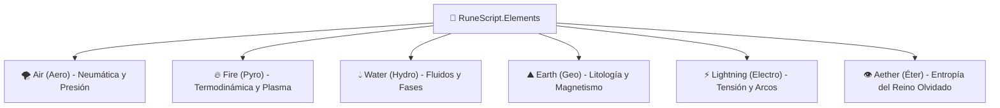

# 🌌 Compendio de Librerías Elementales (`RuneScript.Elements.*`)

> *"Las librerías elementales no contienen lógica de disparo, ni temporizadores, ni miras de puntería. Son únicamente la voz con la que el código le ordena a la materia prima del cosmos cómo debe vibrar, condensarse o arder."*
> — Cátedra de Física Alquímica, Academia de [[Ingenieros y Alquimistas]]

---

## 1. Filosofía de Moldeo Elemental Puro

Bajo la arquitectura de [[Macro de Librerias SCMEH|RuneScript]], las **Librerías Elementales** cumplen una regla de oro:
* **Principio de Aislamiento Físico:** Solo manejan el cambio de estado, densidad, temperatura, polaridad o cohesión de su elemento correspondiente.
* **Separación de Responsabilidades:** No controlan vectores de movimiento (eso lo hace `Kinetics.Vector`), ni aceleraciones balísticas (`Kinetics.Speed`), ni detonadores (`Triggers.*`). 

Existen **6 Librerías Elementales Oficiales**:



---

## 2. Especificación Detallada de cada Librería

---

### 🌪️ 1. `RuneScript.Elements.Air` (`Aero`)
* **Dominio Físico:** Dinámica de gases, presión diferencial, barometría y vacío atmosférico.
* **Afinidad Elemental:** Aire.

#### Clases y Métodos:
1. **`AirDensity` (Barometría y Vacío):**
   * `.polarize_pressure(target: Entity/Object, surface: SurfaceType, delta_bar: Float)`
     * *Efecto:* Aumenta o disminuye la presión atmosférica sobre una cara del objetivo (genera empuje o aplastamiento). FATE: *Crear Ventaja* o *Superar*.
   * `.compress_gas(volume_m3: Float, ratio: Float) -> GasPocket`
     * *Efecto:* Concentra masa de aire en un volumen esférico denso listo para expandirse.
   * `.vacuum_pocket(radius_m: Float, duration_turns: Int)`
     * *Efecto:* Desaloja instantáneamente las moléculas de oxígeno de un perímetro. (FATE: *Ataque de Zona* por asfixia).
2. **`AirCurrent` (Forma y Estructura Neumática):**
   * `.laminar_stream(vector: Vector3, width_m: Float) -> Stream`
     * *Efecto:* Genera una corriente continua de flujo ordenado.
   * `.vortex_shape(radius_m: Float, rpm: Int) -> Vortex`
     * *Efecto:* Construye un cilindro o embudo de rotación ciclónica para desviar proyectiles.
   * `.cushion(altitude_m: Float, weight_limit_kg: Float)`
     * *Efecto:* Colchón neumático ascendente de sustentación continua.
3. **`AeroThermal` (Expansión Térmica de Gases):**
   * `.expand_blast(center: Point, force_bar: Float)`
     * *Efecto:* Descompresión violenta que genera una onda de choque expansiva.

```python
# Ejemplo de Moldeo de Aire Puro:
IMPORT RuneScript.Elements.Air AS Aero;

Pocket = Aero.AirDensity.compress_gas(volume_m3=1.5, ratio=4.0);
Aero.AirCurrent.vortex_shape(radius_m=2.0, rpm=2400);
```

---

### 🔥 2. `RuneScript.Elements.Fire` (`Pyro`)
* **Dominio Físico:** Excitación atómica, termodinámica exotérmica, combustión y física de plasma.
* **Afinidad Elemental:** Fuego.

#### Clases y Métodos:
1. **`ThermalFlux` (Control de Temperatura Molecular):**
   * `.excite_molecules(target: Object/Entity, target_temp_celsius: Float)`
     * *Efecto:* Eleva la temperatura interna de un cuerpo mediante agitación molecular directa.
   * `.drain_heat(volume_m3: Float, delta_celsius: Float)`
     * *Efecto:* Enfría un área absorbiendo el calor ambiental para canalizarlo en un punto focal.
   * `.focal_point(target_point: Point, temp_celsius: Float) -> HeatNode`
     * *Efecto:* Genera un punto de calor microscópico de altísima temperatura (capaz de fundir cerraduras o cortar metales).
2. **`Combustion` (Ignición y Comburentes):**
   * `.spark(oxygen_mix_ratio: Float)`
     * *Efecto:* Genera una chispa rúnica instantánea de encendido.
   * `.ignite_material(target: FlammableObject, burn_rate: Float)`
     * *Efecto:* Incendia un material inflamable manteniendo una llama controlada. FATE: Aspecto `[Envuelto en Llamas]`.
   * `.consume_oxygen(radius_m: Float)`
     * *Efecto:* Alimenta el fuego consumiendo el oxígeno del entorno para avivar la llama.
3. **`PlasmaState` (Gas Superionizado - Alta Energía):**
   * `.ionize_gas(volume_m3: Float, kelvin_temp: Float) -> PlasmaCore`
     * *Efecto:* Transforma el gas circundante en plasma ionizado de color cegador.
   * `.shape_lance(length_m: Float, core_temp: Float) -> ThermalLance`
     * *Efecto:* Moldea el plasma en una hoja o lanza térmica pura (FATE: *Ataque* demoledor que ignora blindajes comunes).

```python
# Ejemplo de Moldeo de Fuego:
IMPORT RuneScript.Elements.Fire AS Pyro;

Heat = Pyro.ThermalFlux.focal_point(target_point=LockCore, temp_celsius=1400.0);
Pyro.Combustion.ignite_material(target=TargetArmor, burn_rate=2.5);
```

---

### 💧 3. `RuneScript.Elements.Water` (`Hydro`)
* **Dominio Físico:** Hidrostática, tensión superficial, viscosidad y transiciones de fase del $H_2O$.
* **Afinidad Elemental:** Agua.

#### Clases y Métodos:
1. **`FluidDynamics` (Masa Líquida y Presión Hidráulica):**
   * `.condense_ambient_humidity(origin: Point, liters: Float) -> LiquidBody`
     * *Efecto:* Agrupa la humedad del aire o del suelo en una masa líquida manipulable.
   * `.pressurize_stream(nozzle_mm: Float, bar_pressure: Float) -> HydroJet`
     * *Efecto:* Genera un chorro de agua a ultra-alta presión capaz de cortar blindajes o noquear objetivos.
   * `.surface_tension_lock(liquid: LiquidBody, hardness: Float)`
     * *Efecto:* Modifica los enlaces de hidrógeno para que el agua actúe como un sólido frente a impactos rápidos (barrera elástica).
2. **`PhaseShift` (Transición de Fase Molecular):**
   * `.freeze_solid(liquid: LiquidBody, hardness_moh: Float) -> IceMass`
     * *Efecto:* Congela agua líquida de golpe en hielo cristalino. FATE: Aspecto `[Pies Congelados]` o `[Muro de Hielo]`.
   * `.flash_evaporate(liquid: LiquidBody) -> SteamCloud`
     * *Efecto:* Hierve el agua al instante creando una nube de vapor hirviente que ciega y quema.
   * `.frost_coating(surface: SurfaceType)`
     * *Efecto:* Genera una película de escarcha resbaladiza. FATE: Aspecto de zona `[Suelo Extremadamente Resbaladizo]`.
3. **`Viscosity` (Densidad y Fluidos No-Newtonianos):**
   * `.modulate_density(liquid: LiquidBody, cP_viscosity: Float)`
     * *Efecto:* Convierte el agua en un fluido espeso similar al gel para atrapar o amortiguar impactos balísticos.

```python
# Ejemplo de Moldeo de Agua:
IMPORT RuneScript.Elements.Water AS Hydro;

WaterPool = Hydro.FluidDynamics.condense_ambient_humidity(origin=Self.Hands, liters=25.0);
IceShield = Hydro.PhaseShift.freeze_solid(liquid=WaterPool, hardness_moh=6.0);
```

---

### ⛰️ 4. `RuneScript.Elements.Earth` (`Geo`)
* **Dominio Físico:** Cohesión mineral, reología de suelos, litología y magnetismo de vetas ferrosas.
* **Afinidad Elemental:** Tierra.

#### Clases y Métodos:
1. **`MineralCohesion` (Densidad y Estructura Pétrea):**
   * `.densify_rock(target_rock: Stone, density_ratio: Float)`
     * *Efecto:* Aumenta la masa molecular de la piedra haciéndola ultradensa y resistente al fuego y proyectiles.
   * `.liquefy_soil(radius_m: Float, depth_m: Float)`
     * *Efecto:* Rompe la fricción entre partículas de tierra/cemento, transformándolo en arena movediza. FATE: Aspecto `[Atrapado en Codo de Lodo]`.
   * `.cleave_fault(line_vector: Vector2, depth_m: Float)`
     * *Efecto:* Abre una falla o zanja tectónica localizada en el pavimento o terreno rocoso.
2. **`FerroMagnetics` (Alineación Magnética Terrestre):**
   * `.polarize_iron_vein(ground_area: Area, tesla_force: Float)`
     * *Efecto:* Excita los minerales ferrosos bajo el suelo para crear un imán gigante que atrae armas o vehículos enemigos al piso.
   * `.extract_ferrous_dust(radius_m: Float) -> MetalDustCloud`
     * *Efecto:* Extrae micropartículas de hierro de la tierra creando una nube abrasiva y conductora.
3. **`Crystalline` (Crecimiento Mineral Rápido):**
   * `.grow_spikes(surface: Point, height_m: Float, count: Int)`
     * *Efecto:* Hace brotar agujas o picos de piedra afilada del suelo o muros. FATE: *Ataque* o trampa de empalamiento.
   * `.vitrify_sand(volume_m3: Float) -> ObsidianShard`
     * *Efecto:* Transmuta silicatos y arena en vidrio volcánico u obsidiana de filo molecular.

```python
# Ejemplo de Moldeo de Tierra:
IMPORT RuneScript.Elements.Earth AS Geo;

Geo.MineralCohesion.liquefy_soil(radius_m=3.0, depth_m=1.0);
Geo.Crystalline.grow_spikes(surface=EnemyArea, height_m=1.8, count=5);
```

---

### ⚡ 5. `RuneScript.Elements.Lightning` (`Electro`)
* **Dominio Físico:** Potencial de ionización, arcos voltaicos, inducción electromagnética y corriente de plasma.
* **Afinidad Elemental:** Rayo.

#### Clases y Métodos:
1. **`VoltagePotential` (Diferencial de Potencial e Ionización):**
   * `.charge_capacitor(volts: Float, amperes: Float) -> EnergyNode`
     * *Efecto:* Acumula una carga electrostática violenta en el catalizador o en un objeto metálico.
   * `.polarize_air_channel(source: Point, target: Entity) -> IonizedPath`
     * *Efecto:* Ioniza una línea invisible de aire creando un canal conductor de resistencia cero para que el rayo viaje sin desviarse.
   * `.static_field(radius_m: Float, c_charge: Float)`
     * *Efecto:* Carga el ambiente de electricidad estática; eriza el pelo y sobrecarga circuitos electrónicos.
2. **`ArcDischarge` (Disparo y Arcos Voltaicos):**
   * `.strike_channel(path: IonizedPath, joules: Float)`
     * *Efecto:* Descarga un rayo fulgurante por el canal ionizado. FATE: *Ataque* electrostático instantáneo.
   * `.fork_arc(parent_arc: Arc, max_branches: Int)`
     * *Efecto:* Divide el rayo en múltiples ramas secundarias (Complejidad $\mathcal{O}(n^2)$).
3. **`ElectroMagnet` (Inducción y Pulsos):**
   * `.magnetic_pinch(target: MetalObject, tesla_force: Float)`
     * *Efecto:* Aplasta o arruga un objeto metálico mediante compresión magnética pura.
   * `.emp_burst(radius_m: Float)`
     * *Efecto:* Emite un pulso electromagnético que fríe radios, terminales y luces en el radio.

```python
# Ejemplo de Moldeo de Rayo:
IMPORT RuneScript.Elements.Lightning AS Electro;

Path = Electro.VoltagePotential.polarize_air_channel(source=Chassis, target=EnemyMech);
Electro.ArcDischarge.strike_channel(path=Path, joules=50000.0);
```

---

### 👁️ 6. `RuneScript.Elements.Aether` (`Aether` / Éter Primordial)
* **Dominio Físico:** Entropía de vacío, alteración de constantes cósmicas y remanentes del [[Magia Artificial y Reino Olvidado|Reino Olvidado]].
* **Afinidad Elemental:** Ninguna / Sangre Primordial.
* **Restricción:** Exclusivo de **Rango S** y **Rango SSS**. Exige artefactos de aleaciones divinas.

#### Clases y Métodos:
1. **`EntropicFlux` (Desintegración de Leyes):**
   * `.decay_matter(target: Any, half_life_seconds: Float)`
     * *Efecto:* Acelera la entropía molecular; el objetivo envejece, se oxida o se convierte en polvo gris en segundos.
   * `.dissolve_magic_matrix(target_sequence: SequenceID)`
     * *Efecto:* Descompila y borra el código de un hechizo enemigo activo en el aire.
2. **`Singularity` (Masa Gravitacional Anómala):**
   * `.collapse_micro_point(point: Point, gravitational_pull: Float) -> SingularityCore`
     * *Efecto:* Crea un micro-agujero gravitatorio que devora luz y materia cercana.
   * `.spatial_tear(length_m: Float, duration_ticks: Int)`
     * *Efecto:* Desgarra el espacio creando una grieta donde las armas no pueden penetrar.
3. **`RunicFabric` (Runas Divinas no Compiladas):**
   * `.invoke_forgotten_glyph(glyph_id: DivineRune)`
     * *Efecto:* Fuerza la manifestación de un milagro divino original. Requiere tirada de `[✨] Control (5+)` so pena de desintegración del operador.

```python
# Ejemplo de Moldeo de Aether (Rango S / SSS):
IMPORT RuneScript.Elements.Aether AS Aether;

Aether.EntropicFlux.decay_matter(target=TitanShield, half_life_seconds=0.5);
```

---

## 3. Matriz Comparativa de Librerías

| Elemento | Namespace | Propiedad Física Primaria | Impacto Típico en FATE | Riesgo de Fallo Bioeléctrico |
| :--- | :--- | :--- | :--- | :--- |
| **Aire** | `Elements.Air` | Presión Barométrica / Vacío | Movilidad, Desarme, Desvío | Caídas, despresurización de tímpanos |
| **Fuego** | `Elements.Fire` | Excitación Térmica / Plasma | Daño Letal Directo, Fundición | Quemaduras cutáneas, sobrecalentamiento |
| **Agua** | `Elements.Water` | Hidrostática / Fases Hielo-Vapor | Control de Terreno, Corte, Barreras | Congelación de extremidades, ahogo |
| **Tierra** | `Elements.Earth` | Cohesión Litológica / Magnetismo | Cobertura, Fosas, Dureza | Sobrecarga ósea, fracturas por retroceso |
| **Rayo** | `Elements.Lightning` | Diferencial de Tensión / Arco | Ataque Instantáneo, EMP, Aturdimiento | Paro cardíaco, convulsiones sinápticas |
| **Éter** | `Elements.Aether` | Entropía Pura / Gravedad Anómala | Aniquilación, Alteración Espacial | Borrado de memoria, disolución celular |

---

## 4. Entidades Relacionadas
* [[Macro de Librerias SCMEH]]
* [[Calculo de Rangos SCMEH - Big-O y Flujo]]
* [[Manual de Programacion SCMEH]]
* [[Artefactos de Ejecucion]]
* [[Los Especialistas]]
* [[Reglas FATE - Sistema de Magia Artificial]]
