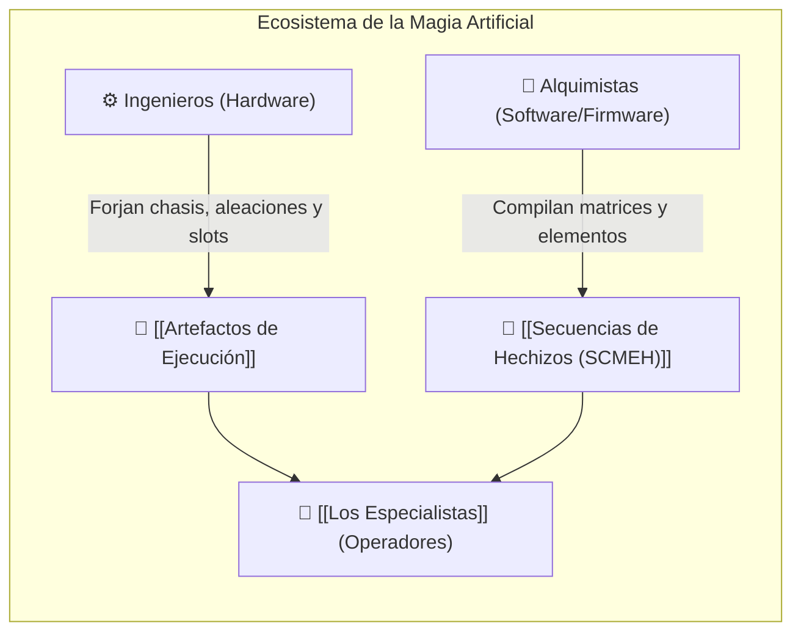

# 🛠️ Ingenieros y Alquimistas

> *"Si un Especialista sale al campo sin calibrar su catalizador, no está empuñando magia: está cargando una bomba de relojería. Y si no tiene el Control necesario... el gremio no devuelve depósitos funerarios."*

---

## 1. Rol y Trascendencia Social
En el universo de la [[Magia Artificial y Reino Olvidado|Magia Artificial]], los **Ingenieros** y **Alquimistas** constituyen la columna vertebral de la civilización tecnológica:
* Son los herederos intelectuales de los humanos que descifraron las runas del [[Magia Artificial y Reino Olvidado|Reino Olvidado]] y diseñaron a [[Los Especialistas]].
* Son **los únicos profesionales legal y técnicamente capacitados** para crear, calibrar, modificar y cargar **[[Secuencias de Hechizos (SCMEH)]]** dentro de los **[[Artefactos de Ejecución]]**.

---

## 2. División de Disciplinas

### A. Los Ingenieros (Especialistas de Hardware)
* Diseñan la carcasa física, las aleaciones conductoras y la arquitectura interna de microcircuitos de los artefactos.
* Determinan el **Rango del Artefacto (C, B, A, S, SSS)** y el número de slots disponibles.
* Instalan los sistemas de refrigeración y los supresores de retroceso bioeléctrico.

### B. Los Alquimistas (Especialistas de Software y Resonancia)
* Transcriben y depuran el código rúnico inspirado en las deidades.
* Codifican la **Afinidad Elemental** y fijan el umbral mínimo de `[✨] Control` requerido.
* Queman y sellan los **chips de memoria de un solo uso** para la distribución de secuencias en el mercado abierto o el frente militar.

---

## 3. La Famosa "Cláusula de Descargo"
Todo artefacto comercializado o militar lleva grabada la advertencia estándar del gremio:

> *"El Alquimista o Ingeniero no se hace responsable por las consecuencias, mutilaciones, explosiones o disoluciones moleculares causadas por la activación de secuencias con [✨] Control insuficiente o en artefactos de rango incompatible."*

Esta frase es a la vez un recordatorio de los peligros intrínsecos de la magia artificial y un reflejo de la mentalidad pragmática y desapegada de sus artífices.

---

## 4. Uso en FATE Básico

En una campaña de **FATE Básico**, los Ingenieros y Alquimistas aportan ganchos narrativos y mecánicos clave:
* **Contactos y Recursos:** Son indispensables como PNJs para cambiar la carga de secuencias entre misiones o reparar un artefacto dañado por una Consecuencia.
* **Aspectos de Personaje:** Un Especialista puede tener aspectos como `En deuda con el Maestro Alquimista Vane` o `Mi Artefacto fue modificado por un Ingeniero renegado`.
* **Habilidades Complementarias:** Aquellos personajes que ejerzan la ingeniería utilizan habilidades como *Artesanía*, *Conocimiento* o *Ciencia* para identificar secuencias enemigas o intentar reparaciones de emergencia en el campo de batalla.

---

## 5. Entidades Relacionadas
* [[Magia Artificial y Reino Olvidado]]
* [[Artefactos de Ejecución]]
* [[Secuencias de Hechizos (SCMEH)]]
* [[Los Especialistas]]
* [[Reglas FATE - Sistema de Magia Artificial]]
