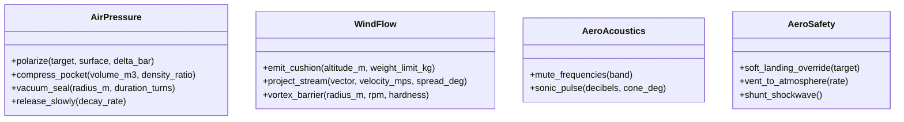

# 🌪️ Librería S.C.M.E.H.: Utilidades de Aire (`AeroUtils`)

> *"El aire no está vacío: es una masa densa esperando que alguien le dé la orden de empujar, cortar o sostener. Si dominas `AirPressure` y `WindFlow`, la gravedad se convierte en una simple sugerencia."*
> — Cátedra de Dinámica Neumática, Academia de [[Ingenieros y Alquimistas]]

---

## 1. Ficha del Módulo (SDK Metadata)

* **Espacio de Nombres (Namespace):** `RuneScript.Elements.Air` (alias común: `Aero`)
* **Compatibilidad de Hardware:** Soportado desde [[Artefactos de Ejecucion|Artefactos de Rango C]] en adelante.
* **Requisito Bioenergético:** Requiere al menos `[✨] Control (1)`. Si el [[Los Especialistas|Especialista]] posee **Afinidad Elemental con el Aire**, el coste de fatiga se anula y obtiene **+2** en las tiradas activas de FATE.

---

## 2. Índice de Clases del Módulo



---

## 3. Especificación Detallada de Clases y Métodos

### 🅰️ Clase: `AirPressure` (Manipulación Barométrica y Densidad)
Gestiona los diferenciales de presión atmosférica entre el aire ambiental y la superficie de los objetos.

| Método | Parámetros | Acción Física / Efecto en FATE | Rango Mín. |
| :--- | :--- | :--- | :---: |
| `polarize(...)` | `target: Entity/Object`<br>`surface: SurfaceType`<br>`delta_bar: Float` | Altera la presión sobre una cara del objetivo para levantarlo o aplastarlo contra el suelo. En FATE: Acción de **Superar** o **Crear Ventaja** (*Aplastado por Presión*). | **C** |
| `compress_pocket(...)`| `volume_m3: Float`<br>`density_ratio: Float` | Condensa un volumen esférico de aire para acumular energía potencial que puede detonarse. | **B** |
| `vacuum_seal(...)` | `radius_m: Float`<br>`duration_turns: Int` | Extrae el oxígeno de un perímetro cerrado. En FATE: Acción de **Ataque de Zona** o bloqueo de respiración. | **A** |
| `release_slowly(...)`| `decay_rate: BarPerSec` | Despresuriza suavemente un campo activo para evitar turbulencias bruscas. Utilizado comúnmente en protocolos de seguridad. | **C** |

---

### 🅱️ Clase: `WindFlow` (Vectores Cinéticos y Corrientes)
Controla la dirección, velocidad y geometría de las masas de aire en movimiento.

| Método | Parámetros | Acción Física / Efecto en FATE | Rango Mín. |
| :--- | :--- | :--- | :---: |
| `emit_cushion(...)` | `altitude_m: Float`<br>`weight_limit_kg: Float` | Crea un colchón laminar ascendente que mantiene un cuerpo suspendido. En FATE: Permite **Superar** caídas o abismos. | **C** |
| `project_stream(...)`| `vector: Vector3`<br>`velocity_mps: Float`<br>`spread_deg: Float` | Lanza una corriente dirigida o una ráfaga afilada. En FATE: Acción de **Ataque a Distancia** cinético. | **C** |
| `vortex_barrier(...)`| `radius_m: Float`<br>`rpm: Int`<br>`hardness: HardnessType` | Levanta un remolino perimetral que desvía proyectiles y metralla. En FATE: Acción de **Defender** contra ataques balísticos. | **B** |

---

### 🅲️ Clase: `AeroAcoustics` (Manipulación Sónica Ambiental)
Aprovecha el aire como medio conductor del sonido para modular ondas audibles.

| Método | Parámetros | Acción Física / Efecto en FATE | Rango Mín. |
| :--- | :--- | :--- | :---: |
| `mute_frequencies(...)`| `band: FrequencyBand` | Anula las vibraciones sonoras en un radio inmediato. En FATE: Otorga el aspecto situacional temporal `[Silencio Absoluto]` con +2 a acciones de Sigilo. | **C** |
| `sonic_pulse(...)` | `decibels: Int`<br>`cone_deg: Float` | Emite un estallido sonoro aturdidor en cono. En FATE: Ataque mental/físico que provoca el aspecto `[Ensordecido / Desorientado]`. | **B** |

---

### 🅳️ Clase: `AeroSafety` (Protocolos de Disipación de Fallos)
Subrutinas estándar diseñadas para absorber el retroceso bioeléctrico y salvar al portador si falla la tirada de dados.

| Método | Parámetros | Efecto de Protección en FATE |
| :--- | :--- | :--- |
| `soft_landing_override(target)` | `target: Entity/Object` | Si el hechizo de vuelo o levitación colapsa por error, amortigua la caída a velocidad terminal segura (anula consecuencias de impacto). |
| `vent_to_atmosphere(rate)` | `rate: VentRate` | Disipa el exceso de energía rúnica al aire en lugar de fundir el chasis del artefacto o el sistema nervioso del usuario. |
| `shunt_shockwave()` | *Ninguno* | Desvía una explosión de retroceso hacia arriba en dirección al cielo. |

---

## 4. Ejemplos de Implementación para Jugadores

A continuación se muestra cómo un jugador programa secuencias reales utilizando las clases de `AeroUtils`:

### Ejemplo 1: Secuencia "Levitar" reescrita con la librería oficial
```python
# =========================================================
# S.C.M.E.H. ID: KIN-01 // LEVITACIÓN ESTÁNDAR
# COMPILADO CON: RuneScript.Elements.Air (AeroUtils v1.2)
# =========================================================

IMPORT RuneScript.Elements.Air AS Aero;

SEQUENCE Levitar(Target: Object) {
    HEADER {
        Rank: "C";
        Affinity: "Air";
        Control_Threshold: 1;
        Recycle: "Infinite";
    }

    PARAMETERS {
        Max_Weight: 250.kg;
        Flight_Height: 3.5.meters;
    }

    EXECUTE {
        # Validación de peso mediante método de presión
        IF (Target.weight > Max_Weight) {
            ABORT("Carga fuera de los límites de compresión de AeroUtils");
        }

        # Aplicación combinada de presión y flujo laminar
        Aero.AirPressure.polarize(target=Target, surface=BOTTOM, delta_bar=+2.8);
        Aero.WindFlow.emit_cushion(altitude_m=Flight_Height, weight_limit_kg=Max_Weight);
    }

    SAFETY_OVERFLOW {
        ON Control_Failure:
            # En caso de fallo en tirada FATE, el sistema activa descenso suave
            Aero.AeroSafety.soft_landing_override(target=Target);
            Aero.AirPressure.release_slowly(decay_rate=0.4);
    }

    CUSTOM_EXPLOIT {
        # El jugador aprovecha AeroAcoustics para no hacer ruido de viento
        Aero.AeroAcoustics.mute_frequencies(band="AeroWindNoise");
    }
}
```

---

### Ejemplo 2: Secuencia Táctica "Muro de Vórtice" (Defensa)
```python
# =========================================================
# S.C.M.E.H. ID: DEF-02 // ESCUDO DE VÓRTICE CILÍNDRICO
# COMPILADO CON: RuneScript.Elements.Air
# =========================================================

IMPORT RuneScript.Elements.Air AS Aero;

SEQUENCE MuroVortice(User: Entity) {
    HEADER {
        Rank: "B";
        Affinity: "Air";
        Control_Threshold: 2;
        Recycle: "Per_Scene";
    }

    PARAMETERS {
        Barrier_Radius: 2.0.meters;
        Rotation_Speed: 3600.rpm;
    }

    EXECUTE {
        # Despliega remolino con resistencia balística
        Aero.WindFlow.vortex_barrier(
            radius_m=Barrier_Radius, 
            rpm=Rotation_Speed, 
            hardness=DEFLECT_KINETIC
        );
    }

    SAFETY_OVERFLOW {
        ON Control_Failure:
            # Disipa la fuerza centrífuga hacia el cielo abierto
            Aero.AeroSafety.shunt_shockwave();
            Aero.AeroSafety.vent_to_atmosphere(rate=IMMEDIATE);
    }
}
```

---

## 5. Integración y Buenas Prácticas para el DJ

1. **Catálogo de Métodos a la Vista:** Puedes imprimir o entregar esta nota a los jugadores con afinidad de Aire. Les sirve como una "caja de herramientas" estructurada para que no tengan que inventar nombres desde cero.
2. **Requisitos de Rango por Método:** Fíjate que métodos como `vortex_barrier` o `vacuum_seal` exigen **Rango B o A**. Si un novato intenta usar un método avanzado en un artefacto de Rango C como el [[Artefacto - Little Fox|Little Fox]], se aplica la regla de incompatibilidad de hardware.
3. **Próximas Librerías:** Del mismo modo que existe `AeroUtils`, se pueden estandarizar librerías para otros elementos: `PyroUtils` (Fuego/Termodinámica), `GeoUtils` (Tierra/Densidad mineral), `HydroUtils` (Agua/Fluidos) o `ElectroUtils` (Rayo/Circuitos).

---

## 6. Entidades Relacionadas
* [[Manual de Programacion SCMEH]]
* [[Secuencias de Hechizos SCMEH]]
* [[Artefactos de Ejecucion]]
* [[Los Especialistas]]
* [[Artefacto - Little Fox]]
* [[Secuencia - Levitar]]
* [[Reglas FATE - Sistema de Magia Artificial]]
