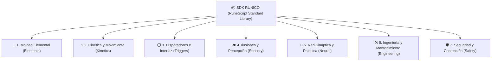

# 📦 Macro General de Librerías S.C.M.E.H. (Arquitectura SDK)

> *"Un conjuro militar no es una masa informe de energía; es una suite de software bien modulada. Quien mezcla el moldeo elemental con la cinemática y los sensores de proximidad sin orden, solo logra fundir su propio catalizador."*
> — Tratado de Arquitectura de Sistemas, Academia de [[Ingenieros y Alquimistas]]

---

## 1. Filosofía de Modularidad

Para evitar la redundancia y permitir que los jugadores diseñen hechizos verdaderamente creativos y tácticos, el estándar **RuneScript** divide su código en dos grandes familias de librerías:

1. **Librerías de Moldeo Elemental (`Elements`):** Encargadas *única y exclusivamente* de interactuar con la materia física del elemento (darle forma, variar su temperatura, densidad, fase o compresión).
2. **Librerías de Acciones y Sistemas Especializados:** Controlan la dinámica de ejecución independiente del elemento (velocidad, sensores de activación, óptica/ilusión, reparación de hardware, telepatía o seguridad).



---

## 2. Catálogo de Capas y Librerías

### 🌌 Capa 1: Moldeo Elemental (`RuneScript.Elements.*`)
*Manipula exclusivamente el estado físico de la materia. No maneja balística ni sensores.*

* **`Elements.Air` (`Aero`):** Ver [[Libreria SCMEH - AeroUtils|Librería AeroUtils]]. Regula presiones barométricas (alta/baja presión), vacío parcial, bolsas de sustentación, densidad ambiental y vórtices.
* **`Elements.Fire` (`Pyro`):** Generación de ignición exotérmica, modulación de temperatura puntual (°C), combustión de comburentes y generación de plasma ionizado.
* **`Elements.Water` (`Hydro`):** Hidrodinámica, condensación de humedad ambiental, tensión superficial y cambios de fase (agua líquida, escarcha/hielo sólido y vapor hirviente).
* **`Elements.Earth` (`Geo`):** Cohesión mineral, polarización magnética de vetas ferrosas, licuefacción de suelos, cristalización de sílice y dureza geológica.
* **`Elements.Lightning` (`Electro`):** Diferencial de potencial (tensión/voltios), ionización del medio, direccionamiento de arco voltaico y acumulación estática.
* **`Elements.Aether` (`Aether`):** Materia primordial del [[Magia Artificial y Reino Olvidado|Reino Olvidado]]. Manejo de entropía, desintegración molecular y singularidades (Exclusivo Rango S y SSS).

---

### ⚡ Capa 2: Cinética y Movimiento (`RuneScript.Kinetics.*`)
*Controla el comportamiento espacial y la velocidad de cualquier masa u objeto.*

* **`Kinetics.Speed`:** Aceleración progresiva, aceleración instantánea por ráfaga (`BURST`), desaceleración controlada y fijación de velocidad terminal.
* **`Kinetics.Vector`:** Bloqueo de trayectorias lineales, cálculos de parábolas balísticas, cambios de vector en ángulo recto y atracción/repulsión vectorial.
* **`Kinetics.Gravity`:** Anulación transitoria de masa inercial (gravedad cero localizada), anclajes cinéticos (fijar un objeto en el espacio como si estuviera soldado al aire) y micro-pozos atractores.

---

### ⏱️ Capa 3: Disparadores e Interfaces (`RuneScript.Triggers.*`)
*Define la condición exacta que dispara o pausa el algoritmo.*

* **`Triggers.Voice`:**
  * `on_vocal_command("clave")`: Dispara la secuencia al detectar una orden fonética hablada.
  * `vocal_authorization(user_id)`: Bloqueo biométrico por timbre de voz del Especialista.
* **`Triggers.Proximity`:**
  * `proximity_alarm(radius_m, target_filter)`: Modos de trampa o mina defensiva.
  * `thermal_sensor(temp_threshold)`: Se activa si una fuente de calor biológica entra al radio.
* **`Triggers.Chronos`:**
  * `timer_delay(seconds)`: Retardo de detonación controlada.
  * `sync_pulse(channel)`: Coordinación de disparos simultáneos entre escuadras de Especialistas.
* **`Triggers.Remote`:**
  * `manual_detonator(signal_code)`: Disparo a distancia mediante radiofrecuencia o pulso rúnico.

---

### 👁️ Capa 4: Ilusiones y Percepción (`RuneScript.Sensory.*`)
*Engaña los receptores sensoriales biológicos y electrónicos.*

* **`Sensory.Optics`:**
  * `refract_light(target)`: Camuflaje mimético o invisibilidad angular.
  * `project_hologram(geometry, loop_anim)`: Proyección de dobles, espectros visuales y señuelos tridimensionales.
* **`Sensory.Acoustics`:**
  * `ventriloquism(coords, audio_sample)`: Emite voces o ruidos en un punto alejado del operador.
  * `mute_frequencies(band)`: Silenciamiento total de pasos, disparos o motores.
* **`Sensory.Phantom`:**
  * `false_sensory_feedback(sense, pattern)`: Inducción de percepciones falsas (olor a gas quemado, sabor ferroso, sensación táctil de calor o dolor).

---

### 🧠 Capa 5: Red Sináptica y Psíquica (`RuneScript.Neural.*`)
*Interactúa con el sistema neurológico del usuario o de objetivos vivos.*

* **`Neural.MindLink`:** Enlace de comunicación sináptica bidireccional entre mentes de [[Los Especialistas]].
* **`Neural.Empathy`:**
  * `suppress_fear(target)`: Supresión de pánico y dolor (FATE: +2 a tiradas de Voluntad contra estrés mental).
  * `induce_dread(target)`: Proyección de un aura de terror o sumisión paralizante.
* **`Neural.Cognition`:**
  * `sensory_overload(target)`: Bombardeo bioeléctrico que aturde o causa ceguera/sordera temporal.
  * `memory_echo_scan(object)`: Lectura de las impresiones psíquicas residuales dejadas en un objeto.

---

### 🛠️ Capa 6: Ingeniería y Mantenimiento (`RuneScript.Engineering.*`)
*Para reparaciones tácticas, soporte de equipo y gestión de datos.*

* **`Engineering.Repair`:**
  * `reconstruct_molecular(target, integrity_pct)`: Restaura metales fracturados, armas dañadas o blindajes.
  * `seal_breach(hull_point)`: Sellado estanco de emergencia en tanques, esclusas o tuberías.
* **`Engineering.Diagnostics`:**
  * `scan_artefact_heat(target_artefact)`: Monitoriza la temperatura de un [[Artefactos de Ejecucion|Artefacto de Ejecución]] para evitar sobrecalentamientos.
  * `bypass_damaged_bus(circuit)`: Puenteo provisional de una ranura rota para disparar un último hechizo.
* **`Engineering.MemoryChip`:**
  * `burn_single_use_chip(sequence_data)`: Quema y compila secuencias en chips de memoria desechables de un solo uso.

---

### 🛡️ Capa 7: Seguridad y Contención (`RuneScript.Safety.*`)
*Librería transversal obligatoria para amortiguar el retroceso ante fallos en tiradas.*

* **`Safety.Vent`:**
  * `shunt_heat_to_atmosphere()`: Descarga la sobretensión calórica al aire.
  * `ground_electrical_surge()`: Descarga energía residual a tierra o chasis.
* **`Safety.Firewall`:**
  * `sever_neural_link()`: Desconexión de emergencia antes de sufrir daño cerebral ante ataques mentales.
* **`Safety.Abort`:**
  * `safe_cooldown_shutdown()`: Apagado progresivo del artefacto sin explosión.

---

## 3. Ejemplo Maestro: Mina Táctica con Sensor y Voz

A continuación se muestra cómo un jugador importa y combina módulos de distintas capas en un único algoritmo coherente:

```python
# =========================================================
# S.C.M.E.H. TÁCTICA // MINA DE VÓRTICE PROGRAMABLE
# ARTEFACTO: RANGO B // REQUISITO: [✨] CONTROL (2)
# =========================================================

IMPORT RuneScript.Elements.Air AS Aero;
IMPORT RuneScript.Kinetics.Speed AS Kin;
IMPORT RuneScript.Triggers.Proximity AS Sensor;
IMPORT RuneScript.Triggers.Voice AS Voice;
IMPORT RuneScript.Safety AS Safe;

SEQUENCE MinaVortice(AnchorPoint: Point) {
    HEADER {
        Rank: "B";
        Affinity: "Air";
        Control_Threshold: 2;
        Recycle: "Per_Scene";
    }

    PARAMETERS {
        Detection_Radius: 3.5.meters;
        Compression_Ratio: 4.5;
    }

    EXECUTE {
        # 1. Arma el sensor de proximidad en el suelo
        Sensor.proximity_arm(radius_m=Detection_Radius, target_type="HostileEntity");

        # 2. Cláusula de cancelación por voz del portador
        IF (Voice.detect_command("¡CODIGO CERO!")) {
            ABORT("Mina desactivada por clave vocal autorizada");
        }

        # 3. Moldeo elemental de alta densidad
        Pocket = Aero.AirPressure.compress_pocket(volume_m3=2.0, density_ratio=Compression_Ratio);

        # 4. Aceleración cinética de estallido
        Kin.Speed.accelerate(target=Pocket, rate=INSTANT_BURST);
    }

    SAFETY_OVERFLOW {
        ON Control_Failure:
            # En caso de fallo en tirada FATE, la detonación sale hacia arriba
            Safe.Vent.shunt_shockwave_upward();
            Safe.Vent.shunt_heat_to_atmosphere();
    }
}
```

---

## 4. Entidades Relacionadas
* [[Manual de Programacion SCMEH]]
* [[Libreria SCMEH - AeroUtils]]
* [[Artefactos de Ejecucion]]
* [[Secuencias de Hechizos SCMEH]]
* [[Los Especialistas]]
* [[Reglas FATE - Sistema de Magia Artificial]]
