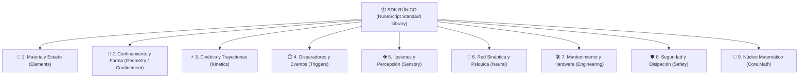

# 📦 Macro General de Librerías S.C.M.E.H. (Arquitectura SDK)

> *"Un conjuro militar no es una masa informe de energía ni un botón prefabricado; es un programa algorítmico bien estructurado. Quien intente proyectar calor sin aislar comburente, confinar la geometría y calcular el vector de impulso, solo conseguirá fundir su propio catalizador y quemar las terminales bioeléctricas de su brazo."*
> — Tratado de Arquitectura de Sistemas, Academia de [[Ingenieros y Alquimistas]]

---

## 1. Filosofía de Arquitectura por Capas Atómicas

Para garantizar que los jugadores de **FATE Básico** deban pensar de forma verdaderamente táctica e ingenieril al crear o modificar hechizos, el estándar **RuneScript** prohíbe las funciones de "hechizo de un solo paso". El SDK se organiza en **capas de responsabilidades estrictamente desacopladas**:

1. **Capa de Materia y Estado (`Elements.*`):** Altera propiedades físicas elementales (temperatura, presión, ionización, enlaces de red o cambios de fase). No contiene lógica balística ni de detonación.
2. **Capa de Confinamiento y Geometría (`Geometry.*` / `Confinement.*`):** Retiene la energía o masa moldeada dentro de una forma estable (esfera, cilindro, plano) para evitar fugas descontroladas y regular su densidad volumétrica.
3. **Capa de Dinámica y Movimiento (`Kinetics.*`):** Transfiere momento cinético, aceleraciones progresivas, impulsos balísticos o manipula la masa inercial.
4. **Capa de Disparadores y Eventos (`Triggers.*`):** Detecta las condiciones que detonan, sostienen o liberan las fases del algoritmo (`OnCollision`, temporizadores, proximidad, sensores o claves de voz).
5. **Capas Especializadas y Auxiliares:** Percepción sensorial (`Sensory`), enlaces mentales (`Neural`), mantenimiento de hardware (`Engineering`) y protocolos de contención (`Safety`).



---

## 2. Catálogo General de Capas y Módulos

---

### 🌌 Capa 1: Primitivas de Materia y Estado (`RuneScript.Elements.*`)
*(Para la especificación exhaustiva de cada clase y método, consúltese el [[Compendio de Librerias Elementales SCMEH]]).*

* **`Elements.Air` (`Aero`):**
  * `Pressure`: Gradientes de presión barométrica y vacío localizado.
  * `Density`: Compresión y expansión controlada de masa gaseosa.
  * `GasFlow`: Corrientes laminares vectoriales y vórtices centrífugos.
* **`Elements.Fire` (`Pyro`):**
  * `Thermal`: Agitación molecular exotérmica y absorción/drenaje calórico.
  * `Combustion`: Puntos de ignición química y propagación superficial de fuego.
  * `Plasma`: Ionización supercrítica de gases precalentados.
* **`Elements.Water` (`Hydro`):**
  * `Gathering`: Extracción y acumulación de humedad ambiental.
  * `Phase`: Cambios de estado (líquido, cristalización rígida en hielo, vaporización súbita).
  * `FluidDynamics`: Tensión superficial elástica, presurización hidráulica y viscosidad no newtoniana.
* **`Elements.Earth` (`Geo`):**
  * `Lattice`: Cohesión litológica de minerales y planos de corte estructural.
  * `Granular`: Licuefacción de suelos (rotura de fricción granular) y recompresión instantánea.
  * `Ferrous`: Polarización magnética de vetas subterráneas.
  * `Crystalline`: Precipitación y nucleación direccional de prismas líticos.
  * `Seismic`: Escucha pasiva de ondas mecánicas elásticas, triangulación de desfase y pulsos de vibración.
* **`Elements.Lightning` (`Electro`):**
  * `Dielectric`: Trazado de canales ionizados de baja resistencia en el aire.
  * `Charge`: Acumulación electrostática en catalizadores y capacitores.
  * `Circuit`: Cierre de arcos voltaicos y pulsos de inducción electromagnética.
  * `Magnetics`: Mapeo de reluctancia ferrosa, pares de torsión rotacional en núcleos y aceleración de Lorentz.
* **`Elements.Aether` (`Aether` - Rango S/SSS):**
  * `Entropy`: Aceleración de la degradación molecular.
  * `Spacetime`: Distorsión de la curvatura métrica local.
  * `Matrix`: Descompilación y borrado de matrices de hechizos rivales.

---

### 📐 Capa 2: Confinamiento y Geometría (`RuneScript.Geometry.*`)
*Evita que la energía o masa condensada se disipe caóticamente antes de alcanzar el objetivo.*

* **`Geometry.Confinement`:**
  * `bind_sphere(target_core, radius_m) -> Envelope`: Genera una membrana de contención esférica.
  * `bind_cylinder(target_core, length_m, radius_m) -> Envelope`: Moldeo en haz o estaca direccional.
  * `bind_sheet(target_core, width_m, height_m, thickness_mm) -> Envelope`: Pantalla o escudo plano.
* **`Geometry.Transform`:**
  * `scale_volume(envelope, factor)`: Aumenta o comprime el volumen manteniendo la masa interna.
  * `anchor_to_caster(envelope, offset_vector)`: Fija la geometría a la posición del operador mientras se canaliza.

---

### ⚡ Capa 3: Cinética y Movimiento (`RuneScript.Kinetics.*`)
*Controla el comportamiento inercial y espacial de cualquier masa, envoltura o proyectil.*

* **`Kinetics.Vector`:**
  * `calculate_line(from_point, to_point) -> Vector3`: Traza el vector de puntería hacia el centro de masa del blanco.
  * `apply_impulse(target, vector, force_newtons)`: Aplica una fuerza instantánea para proyectar el objetivo.
  * `lock_trajectory(target, vector, max_deviation_deg)`: Impide que vientos o impactos desvíen la trayectoria.
* **`Kinetics.Speed`:**
  * `accelerate_progressive(target, acceleration_mps2, terminal_velocity)`: Empuje balístico continuo.
  * `decelerate(target, rate_mps2)`: Frenado controlado antes de colisión amiga.
* **`Kinetics.Gravity`:**
  * `nullify_inertial_mass(target, duration_sec)`: Reduce la resistencia inercial a cero (hace que objetos pesados floten con mínimo esfuerzo).
  * `anchor_in_space(target)`: Clava una masa a una coordenada fija del espacio tridimensional como si estuviese soldada a la realidad.

---

### ⏱️ Capa 4: Disparadores y Eventos (`RuneScript.Triggers.*`)
*Gobierna las condiciones lógicas bajo las cuales se liberan, cambian de fase o explotan los efectos.*

* **`Triggers.Collision`:**
  * `OnCollision(target, on_hit_callback)`: Se ejecuta en el instante milimétrico en que el objeto hace contacto físico o energético con un obstáculo.
* **`Triggers.Proximity`:**
  * `OnProximity(origin, radius_m, entity_filter, callback)`: Activa subrutinas cuando una entidad biológica entra en el perímetro configurado.
* **`Triggers.Chronos`:**
  * `OnTimer(duration_seconds, callback)`: Retardo programado (para granadas temporizadas o trampas de área).
* **`Triggers.Voice`:**
  * `OnVocalCommand(voice_signature, keyphrase, callback)`: Disparo condicionado a una clave fónica autorizada del operador.

---

### 👁️ Capa 5: Ilusiones y Percepción (`RuneScript.Sensory.*`)
*Engaña los receptores sensoriales biológicos y electrónicos.*

* **`Sensory.Optics`:**
  * `refract_light(target)`: Camuflaje mimético o invisibilidad angular por desvío de fotones.
  * `project_hologram(geometry, loop_anim)`: Proyección de dobles, espectros visuales y señuelos tridimensionales.
* **`Sensory.Haptics`:**
  * `project_haptic_pulse(target_contact_point, pattern_id, intensity_mw)`: Modula microcorrientes galvánicas en la empuñadura del catalizador para transmitir telemetría espacial (dirección y proximidad) directamente al tacto de la mano del operador.
* **`Sensory.Acoustics`:**
  * `mute_frequencies(band)`: Silenciamiento total de pasos, disparos o turbinas neumáticas.
  * `project_phantom_audio(coords, audio_sample)`: Emisión de sonido deslocalizado para crear distracciones.

---

### 🧠 Capa 6: Red Sináptica y Psíquica (`RuneScript.Neural.*`)
*Interactúa con el sistema neurológico del usuario o de objetivos vivos.*

* **`Neural.MindLink`:**
  * `establish_channel(target_specialist, bandwidth)`: Enlace telepático bidireccional entre operadores.
* **`Neural.Cognition`:**
  * `suppress_pain_receptors(target)`: Suprime el dolor físico temporalmente (+2 a tiradas de Voluntad en FATE).
  * `synaptic_disruption_pulse(target_brain)`: Descarga que satura nervios ópticos o vestibulares provocando mareo y desorientación.

---

### 🛠️ Capa 7: Mantenimiento e Ingeniería (`RuneScript.Engineering.*`)
*Para reparaciones de campaña, monitorización de temperatura y soporte de slots.*

* **`Engineering.Diagnostics`:**
  * `get_bus_temperature(artefact_chassis) -> Float`: Monitoriza el calor acumulado en los disipadores del hardware.
  * `bypass_fried_bus(slot_id)`: Puenteo de emergencia de una ranura de memoria quemada para disparar un último recurso.
* **`Engineering.MemoryChip`:**
  * `burn_single_use_chip(sequence_data) -> ChipObject`: Compila y graba la secuencia en un chip físico desechable.

---

### 🛡️ Capa 8: Seguridad y Disipación (`RuneScript.Safety.*`)
*Módulos transversales obligatorios en el bloque `SAFETY_OVERFLOW` para mitigar el retroceso bioeléctrico.*

* **`Safety.Vent`:**
  * `shunt_heat_to_atmosphere(joules)`: Dispersa el exceso calórico en el aire circundante antes de que afecte la mano del lanzador.
  * `ground_electrical_surge()`: Deriva picos de alto voltaje al chasis metálico o al piso.
* **`Safety.Abort`:**
  * `collapse_confinement_inward(envelope)`: Disuelve el campo de contención de forma progresiva sin estallido expansivo.

---

### 🔢 Capa 9: Núcleo y Operaciones Matemáticas (`RuneScript.Core.Math`)
*Primitivas de aritmética y cálculo numérico ejecutadas a bajo nivel por la CPU Rúnica en $\mathcal{O}(1)$. Imprescindibles para cinemática balística, temporizadores dinámicos, cálculo de envolventes y trigonometría.*

* **`Core.Math`:**
  * `sqrt(value: Float) -> Float`: Raíz cuadrada de precisión flotante. Crucial para ecuaciones cinéticas, tiempos de vuelo dinámicos ($t = \sqrt{2d/a}$) y módulos vectoriales tridimensionales.
  * `pow(base: Float, exponent: Float) -> Float`: Potenciación de magnitudes y cálculos de dispersión cuadrática inversa ($1/r^2$).
  * `abs(value: Float) -> Float`: Valor absoluto de diferenciales térmicos, barométricos o de reluctancia magnética.
  * `min(a: Float, b: Float) -> Float` / `max(a: Float, b: Float) -> Float`: Acotación de umbrales energéticos y márgenes operativos.
  * `clamp(val: Float, min_val: Float, max_val: Float) -> Float`: Restringe un valor dentro de un rango seguro para evitar sobrecargas de hardware.
  * `sin(radians: Float) -> Float` / `cos(radians: Float) -> Float` / `tan(radians: Float) -> Float`: Funciones trigonométricas para descomposición de vectores angulares, deflexión parabólica y arcos de tiro.

---

## 3. Demostración de Arquitectura: Trampa Defensiva de Suelo Licuado con Cierre Rígido

El siguiente ejemplo demuestra cómo se entrelazan de forma estrictamente modular **tres capas** (`Geo`, `Triggers`, `Safety`):

```python
# ==============================================================================
# SECUENCIA: CepoLitologico // DEMOSTRACIÓN DE LÓGICA PASO A PASO
# OBJETIVO: Licuar el piso y solidificarlo cuando el enemigo lo pise
# ==============================================================================

IMPORT RuneScript.Elements.Earth.Granular AS Granular;
IMPORT RuneScript.Triggers.Proximity AS Sensor;
IMPORT RuneScript.Safety AS Safe;

SEQUENCE CepoLitologico(TargetZone: Area) {
    HEADER {
        Rank: "B";
        Affinity: "Earth";
        Control_Threshold: 2;
        Recycle: "Per_Scene";
    }

    PARAMETERS {
        Trap_Radius: 2.0.meters;
        Depth: 0.8.meters;
    }

    EXECUTE {
        # PASO 1: Anular la fricción de grano en el suelo seleccionado (crear fosa licuada)
        Granular.fluidize_soil(ground_area=TargetZone, depth_m=Depth);

        # PASO 2: Armar sensor de proximidad sobre el área afectada
        Sensor.OnProximity(origin=TargetZone.center, radius_m=Trap_Radius, entity_filter="Hostile") {
            # PASO 3: En el instante en que el blanco pisa el terreno licuado, recompactar de golpe
            Granular.recompact_soil(ground_area=TargetZone);
            # Resultado en FATE: El blanco queda con el aspecto [Atrapado en Suelo Petrificado]
        }
    }

    SAFETY_OVERFLOW {
        ON Control_Failure:
            # Si el operador falla el control, el suelo se recompacta de inmediato
            Granular.recompact_soil(ground_area=TargetZone);
            Safe.Vent.shunt_heat_to_atmosphere(joules=1200.0);
    }
}
```

---

## 4. Entidades Relacionadas
* [[Compendio de Librerias Elementales SCMEH]]
* [[Manual de Programacion SCMEH]]
* [[Calculo de Rangos SCMEH - Big-O y Flujo]]
* [[Artefactos de Ejecucion]]
* [[Secuencias de Hechizos SCMEH]]
* [[Los Especialistas]]
* [[Reglas FATE - Sistema de Magia Artificial]]