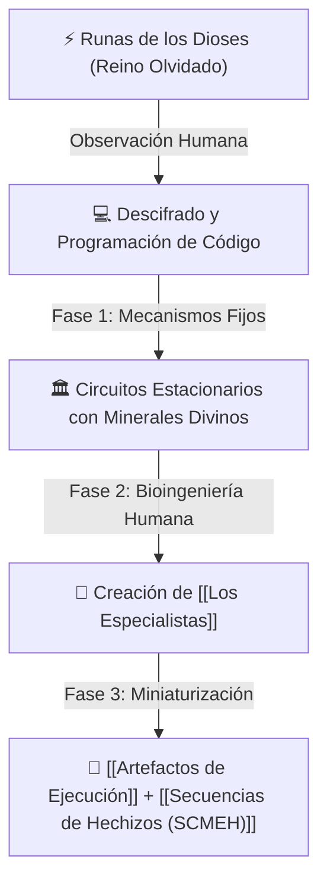

# 🔮 Magia Artificial y el Reino Olvidado

> *"Los dioses no hacían magia: ejecutaban el código primordial del cosmos mediante runas. Nosotros simplemente aprendimos a leer su lenguaje, a compilarlo y a engañar a la realidad con máquinas."*
> — Aforismo atribuido a los Primeros [[Ingenieros y Alquimistas]]

---

## 1. Resumen Ejecutivo
La **Magia Artificial** (o fenómeno *pseudo-mágico*) es una tecnología desarrollada históricamente por la humanidad tras descifrar las runas originales de los dioses. Al carecer los humanos de conductividad mágica natural, crearon mecanismos y, finalmente, una nueva raza con ingeniería genética: [[Los Especialistas]]. La magia artificial no se estudia como un arte místico, sino que se programa como **[[Secuencias de Hechizos (SCMEH)]]** y se manifiesta a través de **[[Artefactos de Ejecución]]**.

---

## 2. Historia y Origen

### A. El Reino Olvidado
En épocas remotas, la tierra donde habitaban los dioses era conocida como el **Reino Olvidado**. De este territorio procedían materiales y minerales de conductividad metafísica única. Los humanos observaron los patrones y runas que las deidades empleaban para alterar la materia y las leyes físicas.

### B. Los Primeros Mecanismos Fijos
Al principio, la humanidad no podía canalizar este poder directamente. Desarrollaron **mecanismos fijos** e inmóviles: salas completas de maquinaria y circuitos pesados que integraban fragmentos extraídos del Reino Olvidado. Estos aparatos ejecutaban secuencias rudimentarias pero efectivas.

### C. La Creación de los Especialistas
Decididos a no depender de maquinaria fija y anhelando emular a los dioses, los científicos y genetistas humanos crearon a [[Los Especialistas]]: personas modificadas genéticamente integrando los materiales del Reino Olvidado en su propia biología celular. Esto dotó a esta nueva especie de una **capacidad mágica latente**, lista para ser encendida mediante catalizadores portátiles.

---

## 3. Principios Fundamentales del Sistema

1. **Naturaleza Digital y Programable:** La magia artificial no surge de la voluntad o la iluminación espiritual; es código binario-rúnico compilado e interpretado por un sistema.
2. **Triada de Manifestación:** Para que un hechizo exista en el mundo tangible, se requiere obligatoriamente:
   - **El Portador:** Un [[Los Especialistas|Especialista]] con suficiente parámetro de `[✨] Control`.
   - **El Catalizador:** Un [[Artefactos de Ejecución|Artefacto de Ejecución]] del rango adecuado.
   - **El Software:** Una [[Secuencias de Hechizos (SCMEH)]] configurada en los slots del artefacto.

---

## 4. Adaptación y Base para FATE Básico

En el sistema **FATE Básico**, la Magia Artificial se gestiona bajo el concepto de **Extras y Permisos**:
* **Permiso Narrativo:** El personaje debe poseer un Aspecto que lo acredite como [[Los Especialistas|Especialista]] (ej. `Especialista de Combate Rango B`).
* **Canalizador Obligatorio:** Requiere registrar al menos un [[Artefactos de Ejecución|Artefacto de Ejecución]] en la hoja de personaje (como Extra de Equipo).
* **Métrica de Poder:** El atributo `[✨] Control` se modela como una Habilidad de la pirámide de FATE, dictando qué secuencias puede disparar sin sufrir estrés ni consecuencias por sobrecarga.

---

## 5. Entidades Relacionadas
* [[Artefactos de Ejecución]]
* [[Secuencias de Hechizos (SCMEH)]]
* [[Los Especialistas]]
* [[Ingenieros y Alquimistas]]
* [[Reglas FATE - Sistema de Magia Artificial]]
