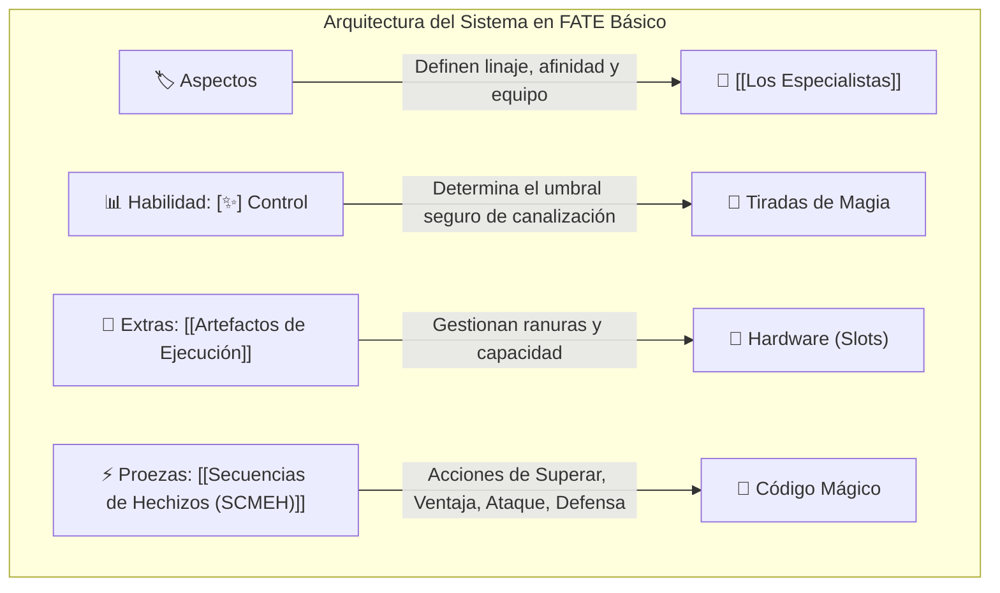
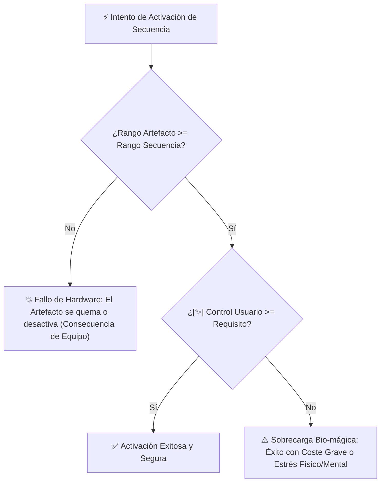

# 🎲 Reglas de FATE Básico: Sistema de Magia Artificial

> Este documento adapta la tecnología de [[Artefactos de Ejecución]] y [[Secuencias de Hechizos (SCMEH)]] al motor de juego de rol **FATE Básico** (Fate Core / Fate Condensado), permitiendo modelar a [[Los Especialistas]], la gestión de slots y las consecuencias por sobrecarga de forma equilibrada.

---

## 1. Pilares Mecánicos en FATE Básico

El sistema de Magia Artificial se apoya en los cuatro pilares fundamentales de FATE:



---

## 2. Los Aspectos del Especialista

Para poder interactuar con el sistema de magia artificial, el personaje debe incorporar aspectos narrativos clave:

1. **Aspecto de Condición o Concepto Alto:**
   * Debe expresar su condición de Especialista y su especialización de combate o rango militar.
   * *Ejemplos:* `Especialista Kinético de Asalto`, `Cadete Especialista en Formación`, `Veterano de la Guerra Rango A`.
2. **Aspecto de Afinidad Elemental:**
   * Establece su elemento biológico primario heredado de los materiales del [[Magia Artificial y Reino Olvidado|Reino Olvidado]].
   * *Ejemplos:* `Afinidad Elemental: Vientos Huracanados`, `Sangre Ígnea Inestable`, `Afinidad: Corrientes de Agua y Escarcha`.
   * **Beneficio Mecánico:** Invocar este aspecto otorga **+2 a la tirada** o repetir dados al utilizar una secuencia afín.

---

## 3. La Habilidad: `[✨] Control`

Se incorpora la habilidad **`[✨] Control`** a la pirámide de habilidades del juego:

### ¿Para qué se utiliza?
* **Umbral Pasivo de Seguridad:** Dicta qué secuencias puede activar el personaje sin sufrir fatiga ni riesgo de retroceso mágico.
* **Tiradas Activas:**
  * **Superar Obstáculos:** Manipulación física mediante secuencias (e.g. mover rocas, desviar corrientes, levitar).
  * **Crear una Ventaja:** Establecer aspectos mágicos en el campo de batalla.
  * **Ataque / Defensa:** Cuando la secuencia instalada sustituye a habilidades convencionales como *Disparar*, *Pelear* o *Atletismo*.
  * **Resistir Sobrecargas:** Protegerse del estrés físico/mental si se fuerza una secuencia sin cumplir los requisitos ideales.

### Tabla de Equivalencia de Rangos y Control

| Nivel de la Habilidad FATE | Valor Numérico | Rangos Seguros de Secuencia | Calificativo Operativo |
| :--- | :---: | :--- | :--- |
| **Mediocre (+1)** | `[✨] Control (1)` | **Rango C** | Principiante / Civil |
| **Aceptable (+2)** | `[✨] Control (2)` | **Rango B** | Soldado / Operador Regular |
| **Bueno (+3)** | `[✨] Control (3)` | **Rango A** | Élite / Operador Táctico |
| **Grande (+4)** | `[✨] Control (4)` | **Rango S** | Maestro / Grado Estratégico |
| **Excelente (+5+)** | `[✨] Control (5+)`| **Rango SSS** | Singularidad / Nivel Calamidad |

---

## 4. Los Artefactos de Ejecución como "Extras"

Un **[[Artefactos de Ejecución|Artefacto de Ejecución]]** se gestiona en FATE como una pieza de equipo especial (**Extra**):

* **Rango del Artefacto:** Determina el techo máximo de las secuencias que puede alojar de manera estable (Rango C, B, A, S, SSS).
* **Slots (Ranuras de Memoria):** Cada slot alberga exactamente una secuencia de hechizo.
* **Aspecto de Equipo:** Todo artefacto tiene un aspecto propio que describe su fabricación o desgaste (ej. *Catalizador Estándar de la Milicia*, *Brazalete con Blindaje de Cobre*).
* **Retrocompatibilidad:** Puede cargar secuencias de su rango y de cualquier rango inferior (e.g. un catalizador Rango A puede cargar secuencias de rangos A, B y C).

---

## 5. Las Secuencias de Hechizos como "Proezas" (Stunts)

Las secuencias configuradas en los slots del artefacto operan como **Proezas activas**:
* No consumen puntos FATE para ser activadas en su forma básica siempre que se cumpla el requisito de `[✨] Control`.
* Otorgan capacidades de acción específicas:
  * **[[Secuencia - Levitar]]:** Permite usar `[✨] Control` para Superar obstáculos cinéticos o Crear la Ventaja `[Suspendido en el Aire]` en objetos de hasta 250 kg.
* **Chips de Memoria (Consumibles de Un Solo Uso):**
  * Un chip de memoria permite ejecutar una secuencia **una sola vez**. Tras resolver la tirada, el chip queda destruido y se elimina de la hoja de personaje.

---

## 6. Reglas de Riesgo: Fallo de Rango y Sobrecarga

Cuando un personaje decide ignorar las advertencias de los [[Ingenieros y Alquimistas]], se aplican las siguientes reglas de peligro:



### A. Secuencia Superior al Rango del Artefacto
Si un Especialista fuerza una secuencia cuyo rango excede al del artefacto (ej. correr una secuencia Rango B en un [[Artefacto - Little Fox|Little Fox]] de Rango C):
* El artefacto no tolera la carga: debe hacerse una tirada inmediata de `[✨] Control` contra dificultad fija alta (+4 o más).
* Independientemente del resultado, el artefacto sufre una **Consecuencia de Equipo** inmediata (ej. `[Placa Base Fundida]` o `[Catalizador Bloqueado por Emergencia]`) y queda inoperativo hasta ser reparado por un [[Ingenieros y Alquimistas|Ingeniero]].

### B. Secuencia con [✨] Control Insuficiente
Si el Especialista no posee el nivel de Control exigido por la secuencia:
* Puede forzar la activación, pero se considera automáticamente un intento con **Éxito con Coste Grave**.
* El exceso de energía mágica se descarga en el cuerpo del usuario y en el entorno:
  * El usuario recibe **daño de Estrés Físico o Mental** igual a la diferencia entre su Control y el requisito.
  * Si sufre una consecuencia, adquiere estados como `[Quemaduras Bioeléctricas]`, `[Migraña por Resonancia]` o `[Onda Expansiva Incontrolada]`.

---

## 7. Ejemplo de Ficha Rápida en FATE Básico

```text
================================================================
HOJA DE PERSONAJE (FATE BÁSICO)
================================================================
NOMBRE: Kaelen Vane
CONCEPTO ALTO: Especialista Novato de la Guardia Urbana
AFINIDAD ELEMENTAL: Afinidad: Ráfagas de Viento y Presión de Aire
PROBLEMA: Deuda pendiente con un Alquimista clandestino

HABILIDADES:
+3 (Bueno):       [✨] Control
+2 (Aceptable):   Atletismo, Disparar
+1 (Mediocre):    Pelear, Alerta, Investigar

EXTRA: ARTEFACTO DE EJECUCIÓN - LITTLE FOX [RANGO C]
- Aspecto: Fiel catalizador de antebrazo con triple ranura
- Slot #1: S.C.M.E.H. Levitar (Rango C)
- Slot #2: S.C.M.E.H. Ráfaga Cortante (Rango C)
- Slot #3: [Ranura Vacía]

INVENTARIO CONSUMIBLE:
- 1x Chip de Memoria de Un Solo Uso: S.C.M.E.H. Muralla de Humo (Rango C)
================================================================
```

---

## 8. Entidades Relacionadas
* [[Artefactos de Ejecución]]
* [[Secuencias de Hechizos (SCMEH)]]
* [[Los Especialistas]]
* [[Ingenieros y Alquimistas]]
* [[Artefacto - Little Fox]]
* [[Secuencia - Levitar]]
