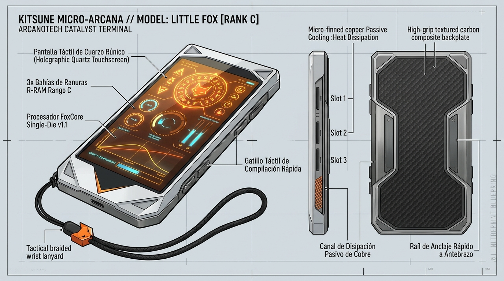

# 🦊 Little Fox (Rango C)

> *"Compacto, ligero y casi indestructible si no cometes la estupidez de meterle código militar. El **Little Fox** ha sido el primer catalizador de tres generaciones de Especialistas."*

---



---

> [!NOTE] Producto Comercial de Venta Libre (Información Pública Civil y Militar)
> El **Little Fox** es un dispositivo de consumo masivo comercializado abiertamente por [[Corporaciones y Fabricantes de Neoterra|Kitsune Micro-Arcana]]. No constituye equipo clasificado ni exige credenciales de la Federación: cualquier ciudadano con magia latente, estudiante de preparatoria, técnico civil o cadete militar puede adquirirlo legalmente en tiendas de electrónica arcana y armerías comerciales.

## 1. Descripción y Especificaciones Técnicas
El **Little Fox** es el catalizador de Rango C más vendido de Neoterra. Su popularidad radica en su versatilidad civil: funciona tanto como terminal de mano autónomo (similar a un smartphone blindado) como montado en un raíl magnético sobre el antebrazo.

A diferencia del tosco [[Kit Reglamentario de Recluta de la Federacion|Aegis Sentinel-C]] de dotación militar básica —que es pesado, tiene botones mecánicos duros y solo 2 ranuras—, el Little Fox ofrece **3 ranuras de memoria**, pantalla táctil de cuarzo rúnico de alta sensibilidad y un chasis ultraligero de aleación de titanio y magnesio, convirtiéndolo en la elección por excelencia de cadetes virtuosos (como Luna Evergarden), duelistas callejeros y técnicos civiles.

* **Fabricante:** [[Corporaciones y Fabricantes de Neoterra|Kitsune Micro-Arcana]].
* **Rango Operativo:** **Rango C** (Iniciación / Civil).
* **Factor de Forma (Chasis):** Terminal táctil de mano (perfil smartphone de 6.5 pulgadas) acoplable a raíl de antebrazo, con pantalla de cuarzo rúnico y chasis de titanio-magnesio Kitsune.
* **Método de Activación Primario:** Periférico dual: **Percutor táctil de botón** en la muñeca y **sensor giroscópico básico** (giro brusco de puño).
* **Capacidad de Almacenamiento:** 3 slots exclusivamente para secuencias de Rango C.

### Arquitectura de Hardware Interno

| Componente                      | Especificación Técnica                | Rendimiento Operativo                                                                                                         |
| :------------------------------ | :------------------------------------ | :---------------------------------------------------------------------------------------------------------------------------- |
| **RPU (CPU Rúnica)**            | *FoxCore Single-Die v1.1*             | Limitado a algoritmos $\mathcal{O}(1)$ (cálculos de un solo paso o blanco puntual). Latencia estándar ($\sim 250\text{ ms}$). |
| **R-RAM (Búfer Sináptico)**     | *256 KR-Buffer (Single-Thread)*       | **1 Hilo Activo**. Solo puede sostener un efecto mágico continuo a la vez. Activar un segundo efecto colapsa el primero.      |
| **V-RAM (Proyección Espacial)** | *512 MB-Arcanos Vectoriales*          | **Escala Puntual**. Radio máximo de manifestación física de 0 a 5 metros (mismo objetivo o zona de contacto).                 |
| **Bus & Disipación Térmica**    | *Aletas pasivas de aleación de cobre* | Caudal máximo sostenible de **$15\text{ kR/s}$**. Carece de ventilación activa.                                               |

---

## 2. Configuración de Ranuras (Slots)

El Little Fox se estructura bajo la siguiente plantilla de bahías:

```text
┌───────────────────────────────────────────────┐
│              LITTLE FOX (RANGO C)             │
├───────────────────────────────────────────────┤
│ — Slot #1: [[Secuencia - Levitar]] (Rango C)  │
│ — Slot #2: [Ranura Disponible - Rango C]      │
│ — Slot #3: [Ranura Disponible - Rango C]      │
└───────────────────────────────────────────────┘
```

> [!NOTE] Compatibilidad de Ranuras
> Al ser un dispositivo de **Rango C**, el Little Fox solo puede ejecutar secuencias de **Rango C**. Intentar compilar una secuencia de Rango B o superior activará los seguros de bloqueo o provocará la fundición inmediata de los buses de datos.

---

## 3. Ficha Técnica en FATE Básico (Extra de Equipo)

En una partida de **FATE Básico**, el Little Fox se incorpora en la hoja de personaje como un **Extra**:

* **Nombre del Extra:** *Artefacto de Ejecución: Little Fox [Rango C]*
* **Coste de Recuperación:** 0 (incluido en la creación de personaje básico de Especialista) o 1 Punto de Recuperación si incluye proezas avanzadas preinstaladas.
* **Aspecto de Equipo:** `El fiel catalizador del principiante`.
* **Capacidad:** 3 Proezas mágicas (Secuencias de Rango C).
* **Perfil Mecánico de Hardware:**
  * **RPU:** Solo secuencias $\mathcal{O}(1)$ (blanco único, acción normal).
  * **R-RAM:** Máximo 1 efecto o ventaja sostenida a la vez.
  * **V-RAM:** Efectos limitados a la **misma zona** del portador o contacto táctil.
  * **Disipación / Estrés de Equipo:** Dispone de **1 casilla de Estrés de Hardware `[1]`** para absorber sobrecargas leves o intentos de *Overclocking*.
* **Ranuras Configuradas (Ejemplo):**
  1. **Slot #1:** [[Secuencia - Levitar]] (Acción de Superar/Crear Ventaja kinética).
  2. **Slot #2:** *Proyectil de Fricción* (Ataque a distancia Rango C).
  3. **Slot #3:** *Campo de Rechazo Breve* (Defensa física Rango C).
* **Mecánica de Fallo Crítico:** Si el portador intenta forzar una secuencia de rango mayor sin absorberla con la casilla de hardware o falla estrepitosamente una tirada de `[✨] Control`, el artefacto recibe la consecuencia de equipo: `[Circuitos Quemados del Little Fox]` o `[Batería Rúnica Derretida]`, quedando inutilizado hasta que un [[Ingenieros y Alquimistas|Ingeniero]] lo repare.

---

## 4. Entidades Relacionadas
* [[Artefactos de Ejecución]]
* [[Secuencias de Hechizos (SCMEH)]]
* [[Secuencia - Levitar]]
* [[Los Especialistas]]
* [[Reglas FATE - Sistema de Magia Artificial]]
