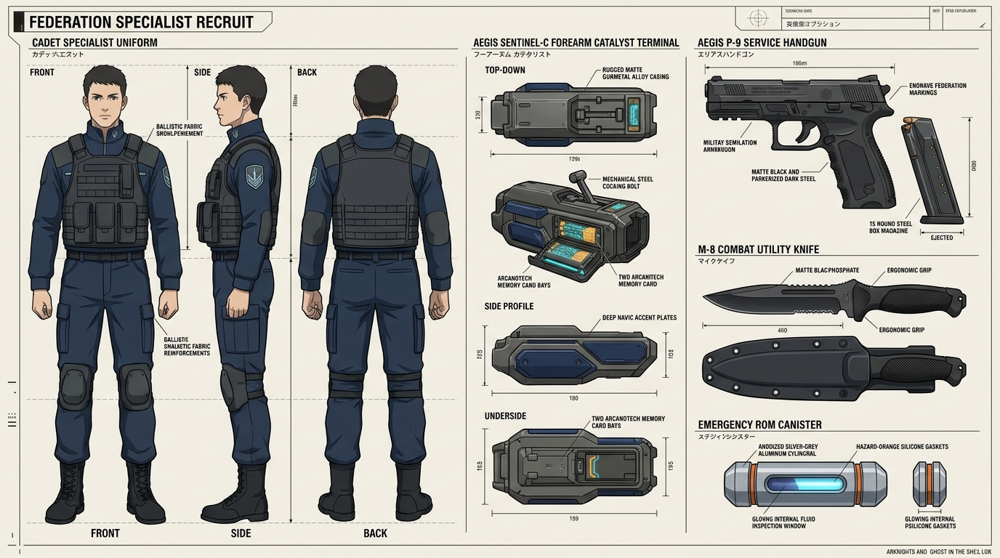
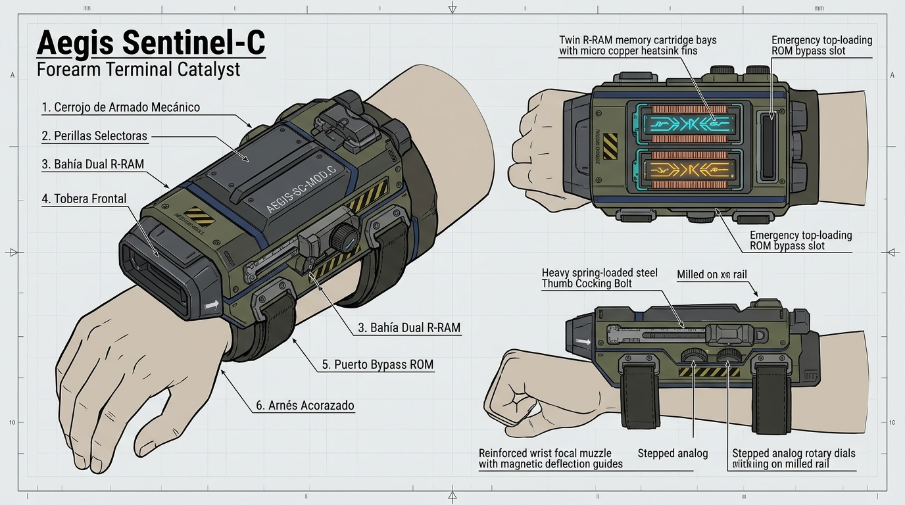

# 🪖 Dotación Estándar: Kit Reglamentario de Recluta de la Federación

> *"La Federación no te entrega un arma para que te sientas un héroe; te entrega dos kilos de acero prensado, botones duros que no se atascan en el fango y código probado durante cuarenta años para que no te vueles los dedos en tu primera guardia. Si quieres fantasías cromadas, gasta tu paga en las tiendas de Kitsune; si quieres volver vivo de la zanja, confía en el cerrojo de Aegis."*
> — Suboficial Mayor Orlov, Centro de Adiestramiento de Reclutas de Bronislav

---



> [!NOTE] Conocimiento de Doctrina de la Academia Militar (Información Pública para Jugadores)
> Este documento representa la materia teórica impartida a todos los cadetes durante su primera semana de instrucción en las Academias de la Federación. Cualquier personaje con trasfondo militar, entrenamiento como Especialista o pasado en la guardia conoce de memoria estas especificaciones, la tabla de piezas del *Aegis Sentinel-C* y la estandarización del uniforme azul marino profundo frente al verde oliva de la infantería común.

---

## 🧭 1. Visión General de la Dotación Militar

Todo ciudadano que ingresa en los acantonamientos de la Federación como **cadete o recluta Especialista** recibe una dotación física y arcana estandarizada. Este equipamiento está producido bajo licencias de adquisición estatal por **Aegis Dynamics** y la intendencia militar central, priorizando tres principios de ingeniería bélica:
1. **Fiabilidad Mecánica:** Tolerancia extrema a caídas, polvo mineral, lluvia ácida y salmuera del Reino Olvidado.
2. **Seguridad de Firmware:** Bloqueo DRM de fábrica para impedir algoritmos inestables de Rango B o sobrecargas ilegales que mutilen al cadete.
3. **Costo de Producción Contenido:** Chasis de fundición masiva de aleación de acero rúnico y baquelita, sin componentes suntuarios como pantallas de cristal pulido o dorados.

```text
┌────────────────────────────────────────────────────────────────────────┐
│             RESUMEN DEL KIT REGLAMENTARIO DE INFANTERÍA (RANGO C)       │
├────────────────────────────────────────────────────────────────────────┤
│ • Catalizador Oficial:     Aegis Sentinel-C (2 ranuras, R-RAM 128 kR)  │
│ • Secuencia Base Slot 1:   [[Secuencia - Pantalla Deflectora de Punto]]│
│ • Secuencia Base Slot 2:   [[Secuencia - Pulso Neumatico de Rechazo]]  │
│ • Consumible Médico:       1x Chip ROM [[Secuencia - Parche de Coagulacion]]│
│ • Arma Convencional:       Pistola Semiautomática Aegis P-9 (9 mm PB)  │
│ • Cuchillo Táctico:        Bayoneta/Cuchillo de Acero Pavonado M-8     │
│ • Protección Personal:     Uniforme Especialista (Azul Marino) + Kevlar │
│ • Accesorios de Campaña:   Cantimplora, Ración de Combate, Kit Limpieza│
└────────────────────────────────────────────────────────────────────────┘
```

---

## 📱 2. Catalizador Oficial de Dotación: *Aegis Sentinel-C*

El **Aegis Sentinel-C** es el artefacto reglamentario estándar distribuido a miles de conscriptos y reclutas en los cuarteles de Neoterra.



```text
================================================================
MODELO: Aegis Sentinel-C (Terminal Rúnico de Instrucción)
FABRICANTE: Aegis Dynamics (División de Contratos Estatales)
RANGO DE HARDWARE: C (Iniciación Militar)
================================================================
Formato:        Terminal de antebrazo con carcasa verde oliva mate
Activación:     Cerrojo manual de muelle y pulsadores de baquelita
Arquitectura:   RPU Bastion-Lite v1.0 (O(1)) | R-RAM 128 kR | Bus: 15 kR/s
Ranuras:        2 Ranuras de Memoria Rango C
Resistencia:    1 Casilla de Estrés de Hardware [ 1 ] (Inmune a atascos)
================================================================
```

### Características Técnicas del Sentinel-C:
* **Activación por Cerrojo Mecánico:** Para abrir el canal de ignición rúnica, el recluta debe amartillar un cerrojo lateral de resorte con el pulgar. Esto evita disparos accidentales provocados por sobresaltos o nerviosismo de novatos.
* **Selectores Analógicos de Baquelita:** En lugar de pantalla táctil, los parámetros elementales se eligen mediante dos perillas giratorias numeradas (potencia de 1 a 3) y tres interruptores de palanca blindados.
* **La Crítica de los Especialistas Jóvenes:** Aunque es indestructible y resiste ser pisado por un camión militar, los cadetes con aspiraciones de duelo o alta destreza (como Luna Evergarden) lo consideran una "herramienta tosca y pesada", cuya latencia de perilla impide concatenar efectos estéticos o geometrías complejas.

---

## 📜 3. Dotación Rúnica Reglamentaria (Secuencias Pregrabadas)

La ordenanza militar prohíbe que los reclutas programen código propio durante sus primeros seis meses de servicio. En su lugar, el *Aegis Sentinel-C* viene sellado con dos secuencias de doctrina táctica defensiva:

### Ranura #1: [[Secuencia - Pantalla Deflectora de Punto]] (Neutro)
* **Función:** El salvavidas de infantería. Despliega un disco rígido hexagonal de 60 cm angulado a 30° frente al brazo del cadete, otorgando **+2 a la Defensa** contra disparos de fusilería enemiga o esquirlas directas.

### Ranura #2: [[Secuencia - Pulso Neumatico de Rechazo]] (Aire)
* **Función:** Control de distancias y dispersión. Ante hostigadores cuerpo a cuerpo, mutantes o asaltantes en trincheras, libera una onda expansiva de 150 N a 1.5 metros para derribar al agresor y ganar tiempo para desenfundar el arma de fuego.

---

## 💊 4. Consumibles Médicos de Ordenanza: Chip ROM Sellado

Cada recluta lleva sujeto al correaje del pecho un contenedor cilíndrico estanco de aluminio anodizado que alberga:
* **1x Chip ROM Desechable de [[Secuencia - Parche de Coagulacion Hidrostatica]]:**  
  Un cartucho de silicio de un solo uso. Si el soldado o un compañero sufre una herida sangrante perforante en combate, el chip se desliza por una ranura de bypass en la parte superior del artefacto; el código se compila al instante, genera una película viscoelástica hemostática estéril sobre la carne y el chip se calcina de forma irreversible.
  * *Normativa de Intendencia:* Romper el sello de este cartucho fuera de combate real conlleva sanción disciplinaria por malversación de pertrechos de la Federación.

---

## 🔫 5. Armamento Físico y Protección Balística

1. **Pistola de Servicio Aegis P-9 (9 mm Parabellum):**  
   Pistola semiautomática de acción simple con corredera de acero al carbono y armazón de polímero negro. Cargador de 15 cartuchos estándar con núcleo encamisado de cobre. Confiable, barata y fácil de desmontar a oscuras.
2. **Cuchillo Utilitario M-8:**  
   Hoja de espiga completa de 18 cm de acero al carbono con recubrimiento fosfatado anti-reflejos y sierra en el lomo para corte de alambre o ramas.
3. **Uniforme Táctico de Especialista (Azul Marino Profundo):**  
   A diferencia de las tropas de infantería convencional y conscriptos comunes de la Federación —que visten uniforme reglamentario en verde oliva militar—, **los Especialistas visten un distintivo uniforme en tono azul marino profundo (Navy táctico)** confeccionado en tejido *ripstop* ignífugo con cuello alto rígido, hombreras reforzadas y ribetes gris antracita.
   * *Función Doctrinal:* Este tono sobrio y no chillón permite la identificación visual inmediata en el frente de combate: la infantería aliada reconoce al instante a los operativos con catalizadores de combate, mientras que los mandos pueden coordinar el despliegue bio-mágico sin comprometer el camuflaje nocturno.
4. **Chaleco Balístico de Kevlar Ligero:**  
   Protección pectoral y dorsal contra metralla y munición de pistola (otorga protección contra estrés balístico menor sin penalizar la agilidad del Especialista).

---

## ⚖️ 6. Mercado Privado vs. Ordenanza: La Opción "Little Fox"

Aunque el reglamento estipula que todo recluta debe portar el *Aegis Sentinel-C*, la Federación tolera una cláusula de excepción: **los cadetes autorizados pueden costearse de su propio bolsillo un catalizador civil o táctico alternativo**, siempre que cumpla con los estándares de Rango C y pase la inspección técnica del armero de la base.

Es aquí donde entra la elección de cadetes como **Luna Evergarden**:
* Prefieren pagar sus propios ahorros para adquirir terminales como el **[[Artefacto - Little Fox]]** de Kitsune Micro-Arcana.
* **El Motivo:** El *Little Fox* sustituye las toscas perillas de baquelita de Aegis por una pantalla táctil de cristal de cuarzo y ofrece **3 ranuras de memoria** en lugar de 2, permitiendo a los virtuosos del plasma parametrizar geometrías visuales, temperaturas extremas y desenfundes mucho más rápidos, aun a costa de perder la resistencia blindada al lodo que ofrecía el chasis militar de dotación.

---

## 🔗 Entidades Relacionadas
* [[Compendio de Artefactos de Neoterra]]
* [[Artefacto - Little Fox]]
* [[Compendio de Secuencias SCMEH - Rango C]]
* [[Corporaciones y Fabricantes de Neoterra]]
* [[Luna Evergarden Ficha Fate|Luna Evergarden]]
* [[Reglas FATE - Sistema de Magia Artificial]]
