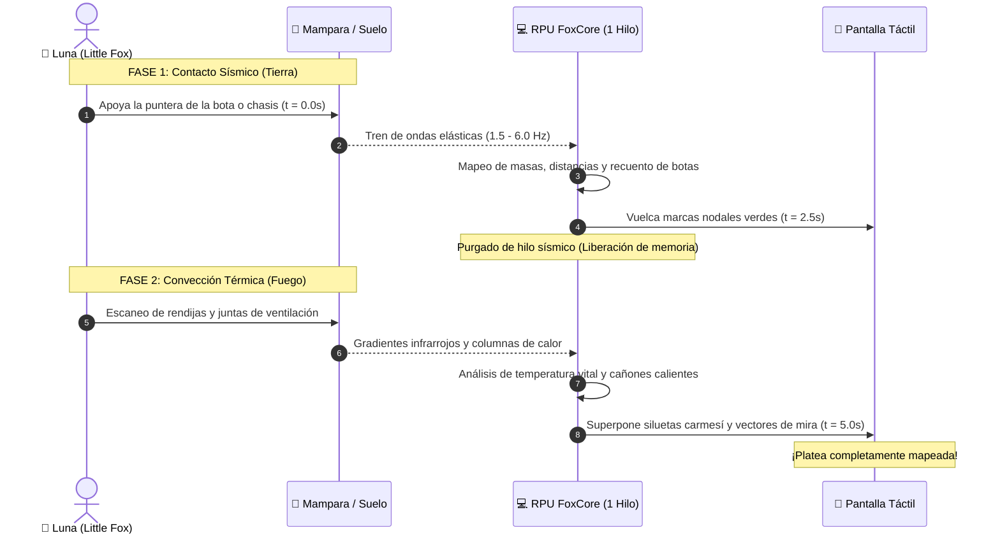

_El visor de cuarzo rúnico del Little Fox oscila en dos compases: primero un escaneo verde esmeralda de pulsos mecánicos subterráneos; luego, una sobreimpresión carmesí brillante que perfila siluetas calientes y cañones humeantes tras la pared._ %%El viejo instructor de litología casi se atraganta con su café cuando le mostré el log de compilación. Dijo que cruzar Tierra y Fuego en un procesador civil de un solo núcleo era una aberración técnica. Pobre hombre... no comprende que para una verdadera artista, el orden de los factores sí hace la función perfecta.%%

# 👁️🎭 CAAP-C07: Inspección de Platea
### *Protocolo de Telemetría Bi-Fase: Sondeo Sísmico Litológico e Infrarrojo de Convección*
**ID Oficial de Registro:** `SEC-C-HYBRID-3088-LUNA-STAGE`  
**Clasificación:** Rango C (Reconocimiento Táctico / Infiltración Pre-Asalto)  
**Complejidad:** $\mathcal{O}(1)$ | **Flujo Máximo:** $4.1\text{ kR/s}$ (Pico asíncrono no solapado)  
**Atribución de Arquitectura Base:** Fusión heterodoxa del [[Secuencia - Detector Sismico Pasivo|Detector Sísmico Pasivo (Aegis Geo-Standard)]] y el analizador de gradiente térmico `RuneScript.Elements.Fire.Thermal`.

> *"Entrar en una habitación a ciegas y disparar al bulto es la firma de los soldados vulgares, de los que terminan con una bala en la frente antes de cruzar el umbral. Una virtuosa jamás pisa el escenario sin saber exactamente cuántos espectadores ocupan las butacas, quién está de pie en primera fila y quién oculta un arma cargada en el regazo. No es cobardía; es asegurarse de que el telón se abra bajo mis propios términos."*  
> — **Luna Evergarden**, diario de desarrollo en KMA-OS.

---

## 💡 1. La Epifanía en el Aula: *"La Iluminación del Topo Ciego"*

Ocurrió durante una de las clases más insufribles de toda la formación de cadetes: *«Afinidades Elementales II: Utilidades y Mecánica Litológica de Terreno»*. 

Trajeron como invitado a un Especialista veterano de afinidad Tierra, un tipo fornido y gris que parecía esculpido en granito. Durante dos horas nos torturó demostrando el [[Secuencia - Detector Sismico Pasivo]]: apoyaba su pesado guantelete en el suelo, cerraba los ojos con cara de estreñimiento místico y contaba las pisadas de los reclutas al otro lado del muro. 

Todos los cadetes tomaban notas como si fuera magia divina. **A mí me pareció una soberana chapuza.**

—*«¿Y de qué demonios me sirve saber que hay tres personas caminando si no sé hacia dónde miran?»* —pensé mientras garabateaba en la pantalla táctil de mi *Little Fox*.— *«El sonido de los pasos te dice dónde están sus botas, pero no te dice si te están esperando con una escopeta montada hacia la puerta o si están de espaldas encendiendo un cigarrillo.»*

Fue ahí cuando se me cruzaron los cables de forma maravillosa. ¿Por qué conformarme con la tosquedad ciega de la Tierra si puedo inyectar el refinamiento visual de mi Fuego?

### ⚡ El Problema de Hardware y la Solución Asíncrona
El problema era obvio: mi *Little Fox* cuenta con una RPU *FoxCore Single-Die* (un único núcleo de cálculo) y su R-RAM soporta **un solo hilo activo a la vez**. Si intentaba correr la telemetría sísmica y el escáner infrarrojo en paralelo, el búfer de memoria colapsaría instantáneamente, tirando un error fatal y bloqueando la terminal.

La solución de los ingenieros cobardes habría sido: *"Compra un catalizador militar de diez kilos con doble núcleo"*. 

**Mi solución fue la elegancia de una coreografía bi-fase:**



1. **Fase Sísmica (2.5 segundos):** Apoyo el canto del dispositivo o la bota contra el marco. El pulso mecánico de Tierra registra el peso, número de objetivos y coordenadas topográficas en el plano. Cierra el socket y libera la memoria.
2. **Fase Térmica (2.5 segundos):** La RPU conmuta de inmediato a `PyroThermal` y `Optics`. Analiza la radiación infrarroja y la micro-convección de aire caliente que escapa por las juntas de la puerta. 

**Resultado en pantalla:** Las marcas nodales verdes de las pisadas se visten de pronto con siluetas térmicas rojas y conos de visión amarillos. En cinco segundos sé exactamente:
* Cuántos guardias hay.
* Si llevan blindaje ligero o corazas pesadas (por la amplitud sísmica).
* Hacia dónde tienen orientada la cabeza y si sus armas han disparado recientemente (por la firma de calor residual en el cañón).

---

## 🎛️ 2. Ficha Técnica Oficial (S.C.M.E.H.)

```
================================================================================
FICHA TÉCNICA: INSPECCIÓN DE PLATEA (CAAP-C07)
================================================================================
RANGO FEDERACIÓN : Rango C (Reconocimiento Táctico / Infiltración Especializada)
AFINIDAD         : Híbrido Secuencial (Tierra / Fuego)
COMPLEJIDAD      : O(1) - Dos ventanas de muestreo finitas no solapadas
FLUJO BIO-MÁGICO : 4.1 kR/s (Pico en Fase 2; Fase 1 consume 2.4 kR/s)
UMBRAL CONTROL   : [🎛️] Control (1) — Mediocre (+1)
RECARGA / RECYCLE: Usos Infinitos (Requiere 5.0 s de concentración estática)
ALCANCE SÍSMICO  : 8.0 metros a través de suelo o mampara sólida
ALCANCE TÉRMICO  : 5.0 metros (Límite puntual de la V-RAM del Little Fox)
SALIDA VISUAL    : Interfaz HUD táctil de doble capa (Nodos mecánicos + Espectro IR)
================================================================================
```

---

## 💻 3. Código Algorítmico Oficial (RuneScript)

```python
IMPORT RuneScript.Elements.Earth.Seismic AS GeoSeismic;
IMPORT RuneScript.Elements.Fire.Thermal AS PyroThermal;
IMPORT RuneScript.Sensory.Optics AS Optics;
IMPORT RuneScript.Triggers.Chronos AS Chronos;
IMPORT RuneScript.Safety.Abort AS SafeAbort;
IMPORT RuneScript.Safety.Vent AS SafeVent;

/* ============================================================================
 * SEC-C-HYBRID-3088-LUNA-STAGE :: INSPECCIÓN DE PLATEA
 * Telemetría Bi-Fase Asíncrona (Tierra -> Fuego) en arquitectura mono-hilo.
 * Autoría y optimización por Luna Evergarden.
 * ============================================================================ */

SEQUENCE InspeccionDePlatea(TouchPoint: Point) {
    HEADER {
        Rank: "C";
        Affinity: "Hybrid";
        Control_Threshold: 1;
        Recycle: "Infinite";
        Complexity: "O(1)";
        Throughput: "4.1 kR/s";
    }

    PARAMETERS {
        /* Parámetros Fase 1: Sismología mecánica de contacto */
        Seismic_Window_Sec: 2.5;
        Bandpass_Min_Hz: 1.5;
        Bandpass_Max_Hz: 6.0;
        Max_Seismic_Range_M: 8.0;

        /* Parámetros Fase 2: Termodinámica infrarroja de rendijas */
        Thermal_Window_Sec: 2.5;
        Max_Thermal_Range_M: 5.0;
        Min_Detectable_Temp_C: 30.0;    /* Umbral de calor corporal y armas */
    }

    EXECUTE {
        /* ====================================================================
         * ACTO I: SONDEO MECÁNICO LITOLÓGICO (Hilo 1 Activo)
         * ==================================================================== */
        SeismicStream = GeoSeismic.listen_elastic_waves(
            contact_point=TouchPoint,
            sample_rate_hz=400.0
        );

        /* Filtro paso-banda para marcha bípeda y pesos pesados */
        FilteredWave = GeoSeismic.apply_bandpass(
            raw_signal=SeismicStream,
            low_hz=Bandpass_Min_Hz,
            high_hz=Bandpass_Max_Hz
        );

        Chronos.wait(duration_sec=Seismic_Window_Sec);

        /* Extrae coordenadas aproximadas y masa de cada entidad */
        NodeList = GeoSeismic.resolve_contact_nodes(
            processed_wave=FilteredWave,
            max_range_m=Max_Seismic_Range_M
        );

        /* Purgado estricto del socket de Tierra para no sobrecargar el buffer */
        GeoSeismic.close_stream(stream=SeismicStream);

        /* ====================================================================
         * ACTO II: BARRIDO DE CONVECCIÓN TÉRMICA (Hilo 1 Reutilizado)
         * ==================================================================== */
        ThermalPlumes = PyroThermal.sample_convection_plumes(
            origin=TouchPoint,
            max_range_m=Max_Thermal_Range_M,
            sensitivity_celsius=Min_Detectable_Temp_C
        );

        Chronos.wait(duration_sec=Thermal_Window_Sec);

        /* Fusión óptica de ambas capas en la interfaz táctil del Little Fox */
        Optics.render_tactical_hud(
            mechanical_nodes=NodeList,
            thermal_vectors=ThermalPlumes,
            display_palette=PALETTE_RUBY_EMERALD
        );
    }

    SAFETY_OVERFLOW {
        ON Buffer_Overflow:
            /* Si la RPU se satura, aborta la fase térmica y preserva los nodos sísmicos */
            SafeVent.purge_thread_memory();
            SafeAbort.abort_execution();
    }
}
```

---

## 🎲 4. Implementación en FATE Básico

* **Nombre de la Proeza:** *S.C.M.E.H. Inspección de Platea [Rango C]*
* **Requisito de Activación:** `[✨] Control` a **Mediocre (+1)** o superior, cargada en el *Little Fox*.
* **Requisito Operativo:** Requiere permanecer inmóvil en contacto físico con la superficie durante **1 turno completo de preparación** (o unos 5 segundos de tiempo de rol fuera de combate).
* **Acción Permitida:**
  * **Crear una Ventaja** usando `[✨] Control` o `Investigar (+2)` contra dificultad **Mediocre (+0)** en tabiques convencionales o **Normal (+1)** a través de compuertas acorazadas o mamparas reforzadas.
* **Efecto Mecánico al Superar la Tirada:**
  * Coloca el aspecto de situación: **`[Audiencia y Escenario Mapeados]`** con **2 invocaciones gratuitas** (o **3 invocaciones** con *Éxito con Estilo*).
  * **Iniciativa de Emboscada Teatral:** Al abrir la compuerta o franquear la entrada, Luna y sus aliados actúan primero automáticamente (ataque sorpresa).
  * **Usos de las Invocaciones Gratuitas:**
    * Sumar **+2 a Atacar** al golpear a un enemigo que estaba de espaldas o desprevenido.
    * Sumar **+2 a Superar** o **Defenderse** para esquivar la línea de fuego de centinelas que ya tenían sus armas apuntadas.
    * Identificar inmediatamente al líder o a la unidad de mayor blindaje antes de cruzar la puerta.

---

## 🔗 5. Referencias Cruzadas del Sistema
* 📋 Ficha de Operadora: [[Luna_Evergarden_Ficha_Fate]]
* 🎭 Compendio Maestro de Luna: [[MOC - Compendio de Arte de Autoria Personal|C.A.A.P.]]
* 📚 Secuencia Base de Tierra: [[Secuencia - Detector Sismico Pasivo]]
* 🦊 Catalizador Activo: [[Artefacto - Little Fox]]
* 🗡️ Secuencia de Asalto Hermana: [[CAAP-C09 - Espadín de Ascuas]]
