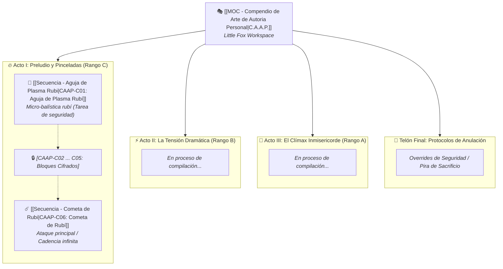

_Ante ti se abre un archivo completo lleno con retazos y elegantes anotaciones. Excesivo detalle en la belleza de un documento tan simple._ %%Y agregué algunas notas... Si no terminaría siendo un aburrido documento oficial%%
# 🔥🎭 C.A.A.P. — Compendio de Arte de Autoría Personal
### *Repositorio Maestro de Secuencias Térmicas, Balística Escénica y Pirotecnia de Precisión*
**Terminal Asignada:** *Little Fox* (Kitsune Micro-Arcana / Chassis Modificado)  
**Operadora:** Luna Evergarden | Cadete Especialista de 1.ª Clase

> *Mis amigos del pueblo murieron sin que nadie supiera sus nombres, aplastados en el barro en menos de diez segundos. La vida humana es una broma corta y mediocre... así que si el remate va a ser el final de la mía, más vale que haga temblar el escenario. La mediocridad jamás entrará en mi obituario.*

---
_Una ventana emergente aparece_
> [!CAUTION]
> ### 🛑 ADVERTENCIA DE TELEMETRÍA HOSTIL Y SENTENCIA PREMEDITADA
> **A quienquiera que haya vulnerado el cifrado de este directorio:**
> 
> Si tus pupilas no son las mías y tu pulso biológico no coincide con el sensor dérmico de este *Little Fox*, felicidades: **acabas de firmar tu última estupidez.**
> 
> En el milisegundo exacto en que este búfer de memoria se cargó en pantalla, una rutina fantasma enlazada al nodo de retransmisión envió un paquete con tu **huella eterodinámica, firma de hardware, latencia neuronal y coordenadas topográficas precisas** al servidor de seguridad. Ya sé qué terminal estás usando, a través de qué repetidor te infiltraste y a cuántos pasos exactos de distancia te encuentras.
> 
> No te molestes en borrar el registro ni en reiniciar la máquina: el volcado de logs ya fue replicado y archivado. En su lugar, te sugiero aprovechar con prudencia los escasos minutos de aire que te quedan en los pulmones: **ve pensando qué frase de arrepentimiento deseas que talle en tu epitafio.** 
> 
> *(Aunque, honestamente, con la temperatura a la que compilo mi plasma, dudo que quede suficiente carbón de ti para levantar una tumba).*

---

## 🌹 Manifiesto: El Software como Obra de Arte

A los burócratas de la Federación les fascina la palabra *S.C.M.E.H.* (Sistema Computacional de Manipulación Elemental y Hechizos). Les excita ese lenguaje estéril de manual de infantería, pensado para soldados dóciles que operan ladrillos de baquelita verde oliva y disparan fogonazos desprolijos para no morir de frío.

**Qué desprecio tan absoluto me provocan.**

Para mí, este *Little Fox* no es una herramienta reglamentaria: es el instrumento de una virtuosa. El fuego no es combustible ordinario esperando un fósforo; es cálculo termodinámico puro, oscilaciones de plasma ionizado y confinamiento de geometría impecable. Si una chispa mía no corta el aire con la simetría de una joya y la elegancia letal de un crescendo musical, no merece existir en mi búfer.

En este compendio no hay hechizos para cavar trincheras ni mecheros vulgares. Aquí habita **mi arte**: secuencias compiladas con odio hacia lo ordinario, matemáticas Big-$\mathcal{O}$ implacables y la promesa de que, cuando me toque arder, iluminaré el cielo entero.

---

## 📜 Repertorio del Compendio (En Proceso de Composición)

%%Nota: Dudo que lo termine algún día, pero me decidí a hacer los planos de la basílica aún así, sería una deshonra que esta magna obra se termine viendo como una burda compilación de escritos.%%

---

### 🎭 Estructura del Repertorio

| Código / ID | Título de la Obra   | Rango | Complejidad $\mathcal{O}$ | Flujo ($kR/s$) | Concepto Teatral / Efecto FATE                                                        |
| :---------- | :------------------ | :---: | :-----------------------: | :------------: | :------------------------------------------------------------------------------------ |
| `CAAP-C01`  | [[Secuencia - Aguja de Plasma Rubi\|Aguja de Plasma Rubí]] |  `C`  |     $\mathcal{O}(1)$      |     $8.8$      | *Micro-balística confinada de salón. Tarea de academia ultra-segura (¡aburrida!).* |
| `CAAP-C02`  | [[CAAP-C02 - [Archivo Sin Descifrar]\|[Archivo Sin Descifrar]]] |  `?`  |           `?`             |      `?`       | *%%Bloque de memoria dañado o cifrado personal%%* |
| `CAAP-C03`  | [[CAAP-C03 - [Archivo Sin Descifrar]\|[Archivo Sin Descifrar]]] |  `?`  |           `?`             |      `?`       | *%%Bloque de memoria dañado o cifrado personal%%* |
| `CAAP-C04`  | [[CAAP-C04 - [Archivo Sin Descifrar]\|[Archivo Sin Descifrar]]] |  `?`  |           `?`             |      `?`       | *%%Bloque de memoria dañado o cifrado personal%%* |
| `CAAP-C05`  | [[CAAP-C05 - [Archivo Sin Descifrar]\|[Archivo Sin Descifrar]]] |  `?`  |           `?`             |      `?`       | *%%Bloque de memoria dañado o cifrado personal%%* |
| `CAAP-C06`  | [[Secuencia - Cometa de Rubi\|Cometa de Rubí]] |  `C`  |     $\mathcal{O}(1)$      |     $6.7$      | *¡Mi consentida! Balística esférica continua, sin enfriamiento y optimizada.* |
| `CAAP-B01`  | *(Próximo estreno)* |  `B`  |     $\mathcal{O}(n)$      |   $10 - 100$   | *Balística cinética de plasma, coreografía de proyectiles o barrera simétrica.*       |
| `CAAP-A01`  | *(Próximo estreno)* |  `A`  |    $\mathcal{O}(n^2)$     | $100 - 1.000$  | *Deflagración masiva bi-fase, implosión de vacío térmico o corona de plasma blanco.*  |
| `CAAP-OVER` | *(Protocolo Negro)* |  `S`  |    $\mathcal{O}(2^n)$     |    Crítico     | *Pira de emergencia: consumo del catalizador para garantizar una despedida inmortal.* |
%%Al parecer mis profesores recomiendan que me recuerde a mi misma que debo de cuidar los limites... Malditos aburridos, pero bueno, tal vez sea buena practica? idk :p%%

---

## 🛠️ Especificaciones del Entorno de Desarrollo (IDE Little Fox)

* **Compilador Central:** `RuneScript JIT Compiler v4.22-Core` (Optimizado para procesadores arcanos miniaturizados). %%Mucho mejor que esos aburridos ladrillos, la última vez que usé uno pensaba que terminaría lanzando llamas grises o algo así... Creo que mejor no lo digo en voz alta. Seguramente los de diseño serian capaces de ver el valor de la propuesta y si puede optimizar 0.1Kr/s quitando el color lo harán... Siento escalofríos solo de pensar que un arma así pueda quitar una vida... Y más si esa puede ser la mía! Morir por una llama sin color!?%%
* **Librerías Nativas Primarias:**
  * `RuneScript.Elements.Fire` (Conducción, convección, excitación de plasma, ignición estequiométrica). %%<3🔥<3%%
  * `RuneScript.Geometry.Confinement` (Esferas de Dyson térmicas, filamentos tensores, conos focales de plasma). 
  * `RuneScript.Sensory.Optics` (Desplazamiento Doppler, gradientes cromáticos, deslumbramiento de magnesio).
  * `RuneScript.Kinetics.Vector` (Aceleración de gas ionizado, presión de choque barométrica).
  * `RuneScript.Core.Math` (Aritmética de bajo nivel, cálculo cinemático de raíces y trigonometría). %%Porque la vida es demasiado corta para calcular raíces cuadradas flotantes a mano mientras te disparan%%
* **Parámetro Estético Obligatorio en todo `EXECUTE`:**  
  Ninguna secuencia creada por✨Mi✨ se considera finalizada a menos que mantenga la temperatura por encima del punto de incandescencia blanca ($\ge 4.500\text{ K}$) y proyecte una estela geométrica visible en el espectro visible. Además de una hermosa y trabajada creación de efectos deslumbrantes

---

## 🔗 Referencias Cruzadas del Sistema

* 📋 Ficha de Operadora: [[Luna_Evergarden_Ficha_Fate]]
* 📖 Manual Operativo Personal: [[Luna_Conocimiento_del_Mundo]]
* 📚 Estándar General de la Federación: [[Secuencias de Hechizos SCMEH]]
* 🦊 Catálogo del Catalizador: [[Artefacto - Little Fox]]
