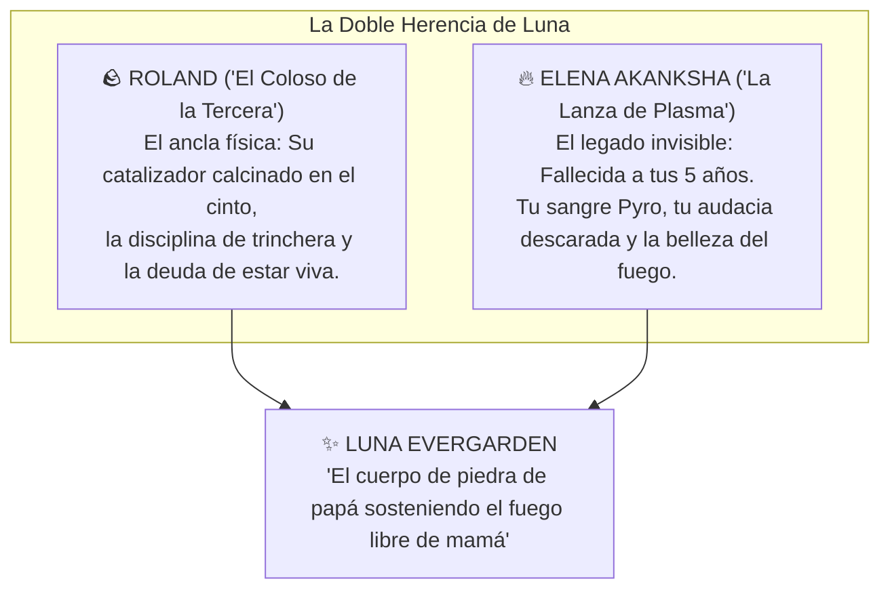

# 🔥 El Eco de la Llama: Elena en la Memoria de Luna
## Guía de Interpretación Emocional para el Jugador de Luna Evergarden

> [!NOTE] NOTA PARA EL JUGADOR DE LUNA
> Mientras que la figura de tu padre, [[Roland_Evergarden|Roland]], es un monolito presente de deber, sacrificio y cicatrices palpables, la figura de tu madre, **Elena Evergarden (de soltera Elena Akanksha)**, es un fantasma cálido, difuso y casi legendario en tu cabeza.
> 
> Esta guía te ayudará a interpretar qué significa ella para ti y cómo moldear la nostalgia y el origen de tu fuego en la mesa de juego.

---

---

## 🌫️ 1. La Edad de la Ausencia: Morir a los 5 Años

Tu madre no murió en la caravana de hace seis meses; **murió en 2012, cuando tú apenas tenías cinco años de edad**. A esa edad, el cerebro de un niño no guarda conversaciones complejas ni registros ordenados:

* **Tus Recuerdos no son Hechos, son Impresiones Sensoriales:**
  * **El Olor:** Una mezcla suave de té de manzanilla, humo de leña limpia y el aroma seco del ozono recién quemado.
  * **El Color:** El destello de una melena castaño cobriza brillante contra la luz de la ventana por las mañanas.
  * **La Risa:** Una risa ligera, cantarína y burlona, que no pedía permiso a nadie. A veces te descubres soltando esa misma risa cuando estás a punto de detonar una secuencia de plasma frente a un enemigo engreído.
  * **Las Chispas en la Penumbra:** Tu recuerdo más nítido parece un sueño: tú llorando en la cama por una pesadilla infantil, y dos manos delgadas con las yemas enrojecidas haciendo flotar pequeñas esferas de fuego rojo y dorado sobre las sábanas para hacerte sonreír.
* **El Vacío Temprano:** Para ti, crecer fue asumir que las madres eran algo que los demás niños tenían, pero que en tu casa solo había un padre enorme, botas militares y olor a aceite de armas. No sientes una herida sangrante por ella (eras demasiado pequeña para comprender la muerte), sino una **añoranza tibia y luminosa**.

---

## 🪨 2. La Leyenda Contada por Roland

Casi todo lo que sabes sobre Elena Akanksha no proviene de tu memoria, sino de las **confidencias a cuentagotas que tu padre te hacía por las noches** cuando el silencio de la casa se volvía demasiado espeso:

* Roland era un hombre de piedra, pero cuando hablaba de Elena, la voz se le volvía suave y gastada:
  > *«Tu madre no caminaba por la trinchera, Luna; flotaba. Era un relámpago con trenzas. Cuando los blindados enemigos rompían la línea, ella saltaba por encima de mi empalizada riéndose a carcajadas y dejaba el campo en cenizas antes de que yo pudiera cargar el segundo cartucho... Tienes su misma boca insolente y sus mismas manos rápidas.»*
* Por tu padre supiste que Elena fue una condecorada sargento de la primera división de choque térmico de la Federación (*«Las Salamandras»*), y que los catalizadores primitivos de aquella época le causaron un desgaste prematuro que acabó apagándola en silencio en la cama de casa.

---

## 🛡️ 3. Una Sola Reliquia Física: El Guantelete de Papá

A diferencia de otros personajes que conservan relicarios, joyas o cartas maternales, **tú no tienes ningún objeto físico de tu madre**:
* No llevas colgantes, ni cartas, ni fotos enmarcadas. Todo lo que Elena tenía se gastó o se marchó con el tiempo.
* **Tu única reliquia material es el catalizador calcinado de tu padre**, el monumental guantelete derretido que cuelga de tu cinto.
* **La Razón Simbólica:** No necesitas un objeto de metal para recordar a tu madre, porque **su herencia no está en tu cinto: está en tu sangre**. Cada vez que tus dedos rozan la pantalla táctil de tu [[Artefacto - Little Fox|Little Fox]] y compones una aguja de plasma bermellón, sabes que estás conjurando con la misma chispa que un día enamoró al Coloso de la Tercera.

---

## 🎭 Pautas de Interpretación en Mesa (Roleplay para el Jugador)

| Situación en Partida | Cómo vive Luna el recuerdo de Elena |
| :--- | :--- |
| **Alguien dice: «Te pareces a tu padre»** | Sonríes de lado y piensas para tus adentros: *«La testarudez y las malas pulgas sí... pero el talento y la puntería son de mamá»*. |
| **Ante la oscuridad o el frío de una mazmorra** | Enciendes una pequeña brasa de plasma en la palma de la mano no solo para alumbrar, sino para sentir ese calor familiar que te arrullaba a los cinco años. |
| **La sobreprotección de Roland en el pasado** | Ahora comprendes por qué tu padre te regañaba tanto de niña cuando jugabas con fuego: el pobre viejo tenía terror de que su única hija ardiera hasta consumirse igual que la mujer que vio morir. |
| **Tu estética teatral:** | No compilas magia gris ni aburrida como los militares de Aegis porque para ti el fuego es un homenaje: si tu madre fue un relámpago que deslumbró las trincheras, tú no vas a permitir que su legado se degrade a un chispazo mediocre. |

---

## 🔗 Referencias Cruzadas del Vault
* [[Personajes/Roland_Evergarden|Ficha del Capitán Roland Evergarden («El Coloso de la Tercera»)]]
* [[personaje/La Sombra del Coloso - Roland en los Ojos de Luna|Guía de Roland en los Ojos de Luna]]
* [[99_Secretos_GM/Personajes/Elena_Evergarden|Dossier Militar Confidencial de Elena Evergarden (Solo GM)]]
* [[Luna_Evergarden_Ficha_Fate|Hoja de Fate de Luna Evergarden]]
