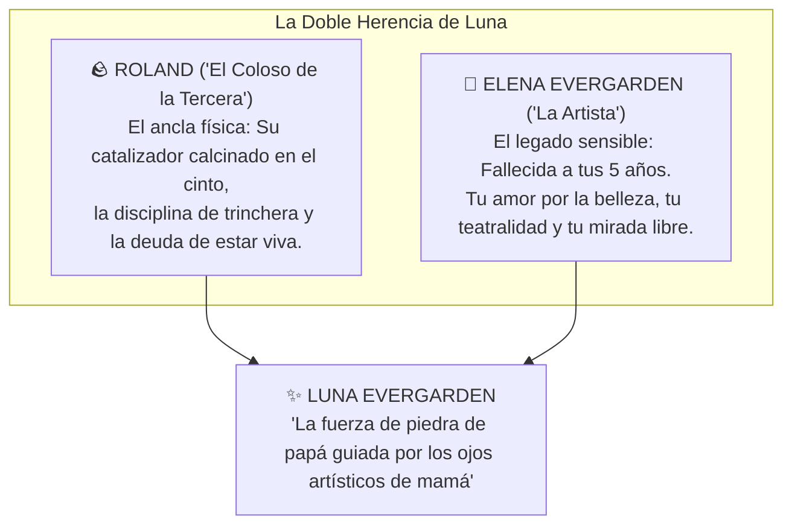

# 🎨 El Recuerdo de Elena: La Madre de Luna
## Guía de Interpretación Emocional para el Jugador de Luna Evergarden

> [!NOTE] NOTA PARA EL JUGADOR DE LUNA
> Mientras que la figura de tu padre, [[Roland_Evergarden|Roland]], es un monolito visible de disciplina militar, cicatrices y deber, la figura de tu madre, **Elena Evergarden**, es un recuerdo difuso, cálido y casi onírico.
> 
> Esta guía te servirá para entender lo que tu personaje sabe, recuerda y siente sobre ella en la mesa de juego.

---

---

## 🌫️ 1. La Edad de la Ausencia: Morir a los 5 Años

Elena falleció por una salud delicada cuando tú apenas tenías **cinco años de edad**. A esa edad, el cerebro de un niño no retiene conversaciones elaboradas ni datos biográficos formales; solo conservas **impresiones puramente sensoriales**:

* **El Olor y el Ambiente:** Un aroma suave a pigmentos vegetales, té de manzanilla, madera limpia y papel de bocetos.
* **El Color:** El brillo de una melena castaño cobriza recortada contra la luz de la ventana por las mañanas mientras dibujaba en la mesa.
* **La Risa:** Una risa ligera, alegre y descarada que llenaba los pasillos de casa. A veces te descubres sonriendo con ese mismo gesto burlón y ladeado cuando estás a punto de ejecutar una maniobra audaz.
* **El Tacto:** La sensación de unos brazos delgados arropándote cuando tenías fiebre en la cama y una voz suave que te cantaba para ahuyentar las sombras.

Para ti, crecer fue asumir con naturalidad que las madres eran algo que los demás niños tenían, pero que en tu casa solo había un padre gigante de pocas palabras, botas llenas de barro y herramientas de trinchera. No sientes un trauma desgarrador por ella, sino una **nostalgia tibia y hermosa**.

---

## 🖼️ 2. Lo que Roland te Contó: «La Artista de la Casa»

Casi todo lo que sabes sobre Elena proviene de las pocas veces en que tu padre se sentaba por las noches a contemplar el fuego y, con una voz mucho más suave de lo habitual, te hablaba de ella:

* **Cómo se Conocieron:** Roland te contó que la conoció durante un permiso civil lejos del frente de combate. Para un soldado que solo conocía trincheras de cemento y órdenes de mando, Elena fue un vendaval de aire fresco: una artista civil, sensible y libre, que se ganaba la vida dibujando, pintando y buscando belleza en los rincones más grises de la provincia.
* **Lo que Roland te Decía de Ella:**
  > *«Tu madre era una artista, Luna. Tenía las manos más rápidas y la mirada más libre que he visto en este mundo. Podías dejarla en medio de un páramo de fango y era capaz de encontrar un trazo de color para hacerlo parecer un cuadro... Tienes sus mismos ojos despiertos y su misma terquedad para no aceptar la mediocridad.»*
* **Su Partida Silenciosa:** Roland te explicó que su salud era frágil y que una neumonía complicada la apagó tranquilamente mientras dormía cuando eras pequeña.

---

## 🛡️ 3. Una Sola Reliquia Física: El Tambor Selector de Papá

En tu inventario **no conservas ningún objeto físico de tu madre**:
* No tienes relicarios, joyas ni cartas guardadas. Todo lo que Elena poseía se fue desvaneciendo o quedó en los viejos muebles de la casa familiar.
* **Tu única reliquia material es el núcleo calcinado del catalizador de tu padre**: el pesado **tambor selector rotatorio de 5 recámaras** del *Aegis Dreadnought-MK1*, asegurado a tu cadera con una correa de cuero militar. Transportar el guantelete completo (una manga de asedio de 45 kg) hubiera sido físicamente imposible para ti en combate; desmontar y conservar únicamente el tambor selector derretido fue tu manera de llevar su corazón blindado a tu lado.

![[aegis_revolver_core_relic.jpg]]
* **La Razón de Luna:** No necesitas una medalla para recordar a tu madre. Consideras que su herencia no es un pedazo de metal, sino **tu propia mirada hacia el mundo**:
  * Si tu padre te dio la resistencia para no dar un paso atrás, **tu madre te dio el alma de artista**.
  * Tu negativa a conformarte con una magia gris, utilitaria y aburrida como la que exige la Federación nace de ella: *«Papá me enseñó a aguantar los golpes, pero mamá me enseñó que la vida tiene que ser despampanante para que valga la pena vivirla»*.

---

## 🎭 Pautas de Interpretación en Mesa (Roleplay para el Jugador)

| Situación en Partida | Cómo vive Luna el recuerdo de Elena |
| :--- | :--- |
| **Alguien le dice: «Te pareces a tu padre»** | Sonríes de lado y piensas para tus adentros: *«La disciplina y la mala leche sí... pero el buen gusto es de mamá»*. |
| **Ante la burocracia militar gris y opresiva** | Sientes un rechazo instintivo: recuerdas que tu madre era un espíritu libre que odiaba los cuarteles y las corbatas rígidas. |
| **Tu obsesión con el arte del plasma:** | Cuando calibras las curvas de confinamiento y los gradientes cromáticos en tu *Little Fox*, no estás disparando una simple bala mágica; estás componiendo un lienzo en el aire. Es tu manera secreta de honrar a la artista de la casa. |

---

## 🔗 Referencias Cruzadas del Vault
* [[Personajes/Roland_Evergarden|Ficha del Capitán Roland Evergarden («El Coloso de la Tercera»)]]
* [[personaje/La Sombra del Coloso - Roland en los Ojos de Luna|Guía de Roland en los Ojos de Luna]]
* [[Luna_Conocimiento_del_Mundo|Guía de Conocimiento del Mundo para el Jugador]]
* [[Luna_Evergarden_Ficha_Fate|Hoja de Fate de Luna Evergarden]]
