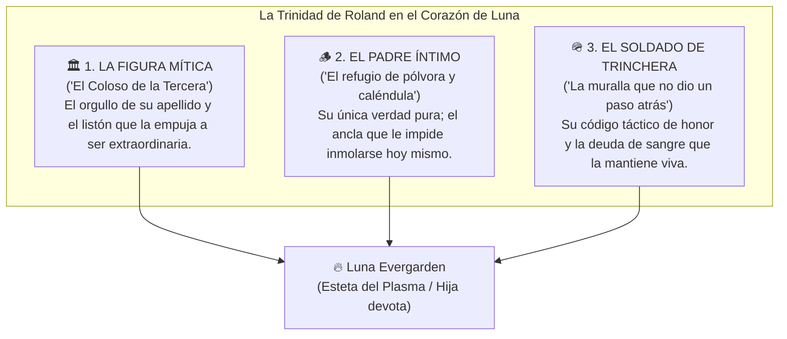

# 🛡️ La Sombra del Coloso: Roland en los Ojos de Luna
## Guía de Interpretación Emocional y Brújula de Personaje para el Jugador

> [!NOTE] GUÍA PARA EL JUGADOR DE LUNA
> Este documento está escrito para ayudarte a interpretar el corazón emocional de [[Luna_Evergarden_Ficha_Fate|Luna Evergarden]]. Frente a los demás cadetes, Luna viste una máscara de cinismo teatral, extravagancia estética y sarcasmo punzante; pero bajo ese fuego de plasma, **toda su arquitectura psicológica está construida sobre los cimientos de su padre, el Capitán [[Roland_Evergarden|Roland Evergarden]]**.
> 
> Para Luna, Roland no es solo un pariente en una cama de hospital: es simultáneamente **un Mito inalcanzable, el Padre que le dio refugio y el Soldado que compró su vida**.

---

---

## 🏛️ 1. La Figura Mítica: *«El Coloso de la Tercera»*

Para la infantería de la Federación, para los veteranos mutilados y para los manuales de la academia, Roland Evergarden es una leyenda viviente: el hombre que aguantó 25 años en la primera línea de la 3.ª Compañía («Los Rompemuros»), el que levantaba empalizadas de basalto a puño limpio con su monumental [[Artefacto - Little Fox#Arquitectura de Hardware Interno|Aegis Dreadnought-MK1]] y el que jamás dejó a un recluta atrás.

### Cómo lo vive Luna:
* **Orgullo Feroz:** Cuando un sargento veterano o un soldado raso reconoce su apellido y cuadra los hombros con respeto, Luna siente un fogonazo de orgullo visceral. Para ella, los generales de despacho y los burócratas de levita limpia como el [[Teniente Vance]] no le llegan a la suela de las botas embarradas a su padre.
* **La Sombra y la Rebeldía Estética:** Ser la hija de un monolito de piedra indestructible es una carga colosal. Luna supo desde niña que jamás sería una guerrera pesada de trinchera que aguanta golpes en silencio. Por eso **eligió el camino diametralmente opuesto: el fuego, el plasma y la teatralidad**. Su magia no es roca bruta; es arte geométrico deslumbrante. En su mente, sublimar el combate en un espectáculo visual despampanante es su forma de decir: *«Soy la hija dEl Coloso de la Tercera, pero mi fuego va a iluminar el cielo entero para que nadie se atreva a compadecerme»*.

---

## 🪵 2. El Padre Íntimo: *«El Refugio de Pólvora y Caléndula»*

Lejos del uniforme y de las miradas del ejército, Roland era un hombre rudo, de pocas palabras, pero de una devoción silenciosa e incondicional hacia su hija. Tras la muerte de su madre cuando Luna era apenas una niña, Roland se convirtió en su mundo entero.

### Las memorias que el zumbido de la Antimagia no pudo borrar:
* **La Ternura Tosca:** Las manos gigantescas de Roland, cubiertas de callos y cicatrices de metralla, curando con torpeza infinita las quemaduras accidentales de Luna con ungüento casero de caléndula.
* **La Sonrisa Clandestina:** Las broncas fingidas que le echaba cuando Luna aprendía una pirueta rúnica prohibida con chispas de fuego en el patio de casa... y la mirada de fascinación y orgullo que Roland no lograba disimular mientras fingía leer el periódico de la guarnición.
* **El Quiebre de la Máscara:** Cuando Luna cruza la puerta del Pabellón 4B del hospital militar, **toda la coraza cínica se derrumba**. Frente a esa cama no hay chistes mordaces ni poses teatrales; solo una muchacha de diecinueve años apretando una mano áspera que se enfría por minutos, dispuesta a cometer alta traición, quemar la base o asaltar los laboratorios de Aegis para escuchar su voz una vez más.

> *"Todo el mundo cree que soy una engreída que se ríe del peligro porque la vida no le importa. Qué idiotas son... Me río de ellos porque el único hombre cuya opinión me importaba está dormido detrás de un cristal respirando niebla."*  
> — Luna en el pasillo del Pabellón 4B.

---

## 🪖 3. El Soldado de Trinchera: *«El Código que Compró su Vida»*

Roland le enseñó a Luna que un Especialista no es un hechicero de salón que hace trucos de magia para impresionar a la corte: es un combatiente responsable de la vida de quienes están a su espalda.

### El ADN Táctico de Roland en el Juego:
1. **La Ética del Frente:** Desprecio visceral por la cobardía, por el abandono de los heridos y por la obediencia ciega a órdenes suicidas dadas desde oficinas con aire acondicionado.
2. **Combate Sucio y Rudo:** Roland le enseñó que si la magia falla o el artefacto se recalienta, los puños, las patadas al barro y la culata de la pistola siguen funcionando. Luna no vacila en pelear cuerpo a cuerpo porque tiene en sus músculos la memoria muscular de su padre.
3. **La Deuda de Sangre de la Ruta Sur 14-B:**  
   Luna sabe que está viva por una sola razón: **Roland Evergarden decidió morir para que ella corriera**.  
   Cuando la frecuencia del Heraldo Aguja-03 amenazaba con aplastar la caravana, Roland se interpuso entre la criatura y el camión de Luna. Sus últimas palabras (*«¡No mires atrás, Luna! ¡Sube a ese camión y aprieta el acelerador! ¡La pared va a aguantar mientras me quede sangre en las venas... corre y haz que valga la pena!»*) no son un recuerdo; son un mandato sagrado. Luna considera que **su propia vida ya no le pertenece del todo: es un préstamo que su padre pagó con sus pulmones**.

---

## 🎭 Pautas de Roleplay para la Mesa (Cómo Usar Esto en la Partida)

| Situación en Mesa | Cómo reacciona Luna a través de Roland |
| :--- | :--- |
| **Un veterano o recluta elogia a Roland** | Sonrisa sincera pero esquiva; baja la guardia por un instante y muestra un respeto solemne poco común en ella. |
| **Un oficial (como Vance) insulta o minimiza a su padre** | Se le enciende la mirada con un odio gélido y peligroso; la ironía se vuelve afilada como un bisturí y busca cualquier forma reglamentaria de humillarlo. |
| **Sufre estática o visiones del Heraldo (su Complicación)** | Lleva instintivamente la mano derecha al **catalizador calcinado** que lleva en el cinto. Aferrarse a ese metal derretido es su ancla física para recordar quién es y no disolverse en la colmena. |
| **Frente al peligro inminente o la tentación de huir** | Recuerda la espalda de su padre frente a la pared de roca: Luna no da un paso atrás cuando hay inocentes en juego, aunque disfrace su heroísmo de vanidad dramática (*«No me voy a ir sin darles el clímax que se merecen»*). |

---

## 🔗 Notas Relacionadas
* [[Personajes/Roland_Evergarden|Ficha Completa del Capitán Roland Evergarden]]
* [[Luna_Evergarden_Ficha_Fate|Hoja de Personaje de Luna Evergarden]]
* [[Luna_Conocimiento_del_Mundo|Guía de Conocimiento del Mundo]]
* [[Guia_Narrativa_y_Mecanicas|Guía Narrativa y Mecánicas FATE]]
