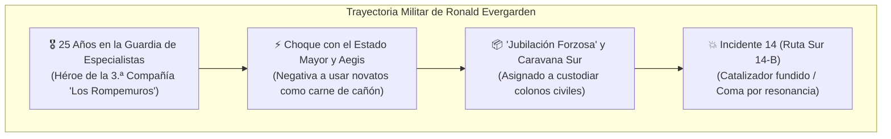

# 🛡️ Capitán Ronald Evergarden: *«El Bastión de Hierro»*
## Leyenda de la Guardia Militar de Especialistas & Padre de Luna

> *"Un verdadero Especialista no se mide por cuántos kilovatios de fuego puede escupir al aire, sino por cuántos de sus hombres siguen respirando cuando el polvo se asienta en la trinchera. El hierro no presume; el hierro resiste."*
> — Capitán Ronald Evergarden a los cadetes de la 3.ª Compañía (2021).

---

## 1. Perfil e Identidad Histórica

* **Nombre Completo:** Ronald "Ron" Evergarden
* **Rango Militar:** Capitán de Primera Línea / Sargento Mayor de Ordenanza (Retirado con Honores).
* **Fuerza Militar:** **Guardia Militar de Especialistas de la Federación**.
* **Especialización Rúnica:** Manipulación tectónica molecular, cinemática de contención y estabilización litológica de choque (`RuneScript.Elements.Earth`).
* **Estado Actual:** Internado en coma inducido con fallo respiratorio severo en el **Pabellón 4B del Hospital Militar de la Federación**. Dependiente de soporte bio-resonante para sostener sus funciones vitales.

---

## 2. Relevancia Dentro de la Guardia de Especialistas

Ronald Evergarden no fue un simple recluta de trinchera; durante más de dos décadas fue una de las **figuras morales y tácticas más influyentes de la infantería pesada de la Federación**:

### A. La Filosofía del "Hierro y Sangre"
Mientras los oficiales de Estado Mayor y las corporaciones como [[Corporaciones y Fabricantes de Neoterra|Aegis Foundry]] veían a los Especialistas como unidades prescindibles para calibrar armamento experimental, Ronald impuso una doctrina de supervivencia colectiva:
* **El Protector de Cadetes:** Se ganó el apodo de *«El Bastión de Hierro»* por interponerse físicamente con sus murallas de roca entre emboscadas del éter y los pelotones de reclutas aterrorizados.
* **El Enemigo de los Burócratas:** Acumuló docenas de menciones al valor, pero también un grueso expediente de sanciones disciplinarias por desobedecer órdenes directas que implicaban abandonar destacamentos heridos para cumplir cuotas de tiempo.

### B. El Catalizador Legendario: *«Aegis Dreadnought-MK1»*
Ronald rehusaba utilizar los terminales ligeros o visores tácticos modernos. Su firma en el campo de batalla era un monumental **guantelete de trinchera forjado en acero templado, baquelita y placas de amortiguación magnética** que cubría todo su antebrazo izquierdo:
* Con este guantelete no disparaba ráfagas a distancia: clavaba el puño en la tierra para levantar empalizadas de basalto instantáneas o comprimir el suelo bajo los blindados enemigos.
* **La Reliquia Calcinada:** Ese mismo guantelete es el objeto mudo y derretido que hoy cuelga del cinto de [[Luna_Evergarden_Ficha_Fate|Luna Evergarden]]; sus núcleos están calcinados desde que intentó bloquear de frente la frecuencia sónica de la anomalía que arrasó la caravana.

---

## 3. El Retiro Forzoso y la Tragedia del Sector Sur

A finales de 2025, la tensión entre Ronald y la cúpula militar llegó a un punto insostenible:
1. **La Salida Elegante:** Incapaces de someterlo a un consejo de guerra por su estatus de héroe condecorado entre las tropas de tropa, el Alto Mando le ofreció un retiro honorable con pensión completa y la jefatura de escolta de la **Caravana Civil de Reasentamiento hacia el Sector Sur 14-B**.
2. **El Ataque (Incidente 14 — 12 de Mayo de 2026):**  
   Seis meses atrás, la caravana fue interceptada por una entidad anómala desconocida (que los comunicados oficiales encubrieron como una explosión de combustible clandestino). Ronald combatió hasta el colapso: cuando los amortiguadores de su guantelete estallaron por la saturación armónica, Ronald descargó toda su bio-energía en bruto para sellar una brecha de evacuación donde resguardó a Luna y a un puñado de supervivientes.
3. **El Coste:** El contragolpe bio-mágico destruyó sus vías respiratorias y cristalizó sus terminales nerviosos. Su catalizador quedó fundido y su mente atrapada en el umbral entre la vida y el coma silente.

---

## 4. La Relación con Luna: El Choque de Dos Generaciones

La dinámica entre Ronald y su hija Luna es el corazón emocional que explica la psicología del personaje:

| Aspecto | 🪨 Ronald Evergarden | 🔥 Luna Evergarden |
| :--- | :--- | :--- |
| **Estética Mágica** | Tosca, pesada, utilitaria, sin adornos. El poder de la piedra cruda. | Despampanante, geométrica, simétrica, plasma blanco y rojo rubí. |
| **Hardware** | Guantelete de ordenanza de hierro macizo (*Aegis Dreadnought*). | Terminal de pantalla táctil rápida (*Kitsune Little Fox*). |
| **Doctrina** | Aguantar en la línea, defender a otros, no dar un paso atrás. | Cinismo mordaz, movilidad veloz, odio visceral a la muerte anónima y vulgar. |
| **Vínculo Mutuo** | Orgullo ciego por el talento rúnico de su hija; temor a que su soberbia la queme. | Devoción absoluta; su padre es la única verdad pura en un mundo de mentiras. |

> *"Mi padre pasó veinticinco años tragando barro y órdenes idiotas para que las medallas se las colgaran otros. Lo dieron de baja como a un perro viejo y lo mandaron a una carretera secundaria a morir en silencio. No voy a permitir que su historia termine con un certificado de defunción sellado por un estúpido como Vance."*  
> — Luna Evergarden en privado.

---

## 5. Perfil Mecánico en FATE Básico (En su Época de Servicio)

* **Concepto Principal:** `Capitán Legendario de la Guardia de Especialistas, Escudo de la Infantería`
* **Problema / Complicación:** `Desprecio visceral hacia las órdenes sacrificatorias del Estado Mayor`
* **Aspectos de Combate:**
  * `[Mi guantelete de hierro no retrocede]`
  * `[La trinchera se defiende con sangre y basalto]`
  * `[Ciego ante el miedo cuando hay reclutas en peligro]`

### Pirámide de Habilidades (Veterano de Élite):
* **Excelente (+5):** `[✨] Control` *(Maestro de Geo-Ingeniería / Rango S defensivo)*
* **Grande (+4):** **Físico**, **Voluntad**
* **Bueno (+3):** **Pelear**, **Contactos Militares**, **Percepción**
* **Aceptable (+2):** **Disparar**, **Saber**, **Liderazgo (Carisma)**, **Atletismo**
* **Mediocre (+1):** **Sigilo**, **Investigar**, **Máquinas**, **Recursos**

### Proezas Notables:
1. **La Muralla Viviente:** Puede gastar 1 Punto FATE para asumir sobre sí mismo cualquier consecuencia física que fuera a sufrir un aliado en su misma zona.
2. **Impacto Sísmico de Trinchera:** Gana **+2 a Superar o Atacar** con `[✨] Control` cuando golpea el suelo para quebrar la estabilidad de formaciones enemigas.
3. **Veteranía de Ordenanza:** Gana **+2 a la Defensa con Físico** contra armas balísticas y metralla siempre que porte su catalizador pesado de Aegis.

---

## 6. Entidades Relacionadas
* [[Luna_Evergarden_Ficha_Fate]]
* [[Guia_Narrativa_y_Mecanicas]]
* [[Mision - 01 - Ecos en el Sector Suroeste]]
* [[Terminal - Manifiesto HazMat-07]]
* [[Corporaciones y Fabricantes de Neoterra]]
